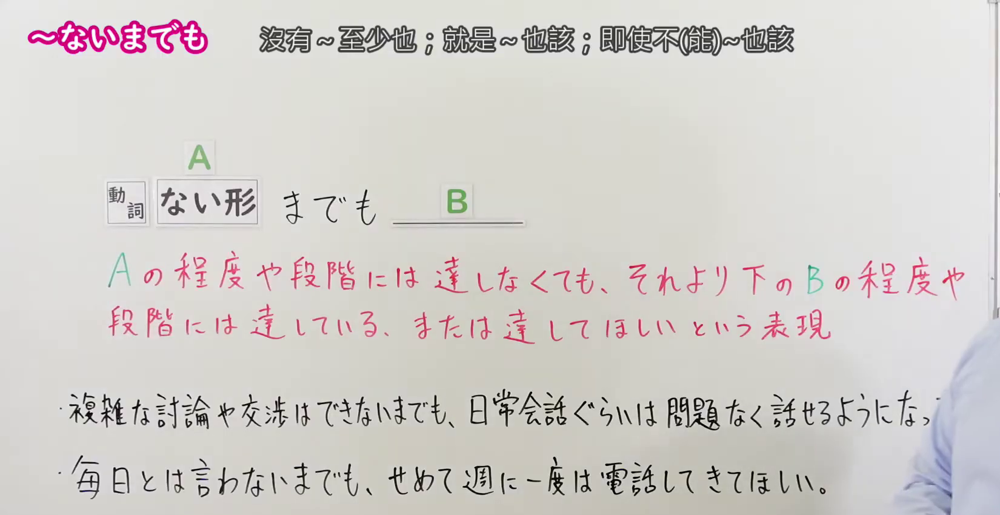

---
{
  "id": "N1-G-0052",
  "kind": "grammar",
  "level": "N1",
  "title": "～ないまでも：即使达不到，也至少……",
  "card_revision": 1,
  "schema_version": 1,
  "source": {
    "lesson": "N1 第52个语法",
    "material": "出口日語原视频板书、日语自动字幕与Hagoromo文型检索正文",
    "video": "https://www.youtube.com/watch?v=thnSrXnP2YI",
    "screenshot": "assets/grammar/n1/N1-G-0052-connection.png",
    "screenshot_seconds": 55,
    "screenshot_crop": {
      "x": 0,
      "y": 0,
      "width": 1650,
      "height": 850
    }
  },
  "tags": [
    "程度・比较",
    "N1"
  ],
  "confusions": [
    "～とまでは言わないまでも",
    "～なくても"
  ]
}
---

# ～ないまでも

# 视频学习资料整理

- [出口日語 N1 第52课原视频](https://www.youtube.com/watch?v=thnSrXnP2YI)：讲解「～ないまでも」。自动字幕有同音误写，接续和用法按原视频板书与讲解核对。
- 接续图：视频 **0:55（55 秒）**；原图 **1920 × 1080**，固定左上角裁切区域 **(x=0, y=0, 宽=1650, 高=850)**。0:01 老师遮挡了板书；改用本帧，保留接续与完整红字说明；第一条例句的末尾被老师遮挡，第二条清晰可读。

- 例句图：视频 **2:28.27（148.27 秒）**；原图 **1920 × 1080**，固定左上角裁切区域 **(x=0, y=0, 宽=1895, 高=920)**。保留四条例句及其原视频翻译。

# 核心

## 功能一：即使未达到 A 的程度或阶段，也已达到比它低的 B 的程度或阶段，或希望至少达到 B

**最上位意味カテゴリー：**

- **ないまでも：** ものごとの関係（事物之间的关系）

**中位意味カテゴリー：**

- **ないまでも：** 比較（比较）

**意味：**

- **ないまでも：** 程度（程度）

**くわしい意味記述：**

- **ないまでも：** 「Vする程度までにはならないけれど，それより下の程度にはなっている」という意味を表す。「〜とは言わないまでも」「〜とは言えないまでも」という言い方でよく使われる。（表示虽未达到做某事的程度，却已达到较低程度；常用于「～とは言わないまでも」「～とは言えないまでも」的说法。）

**派生語：** 未列出

### 例句

1. 私の留学に対して、父は反対しないまでも、心配でたまらないようだ。

   （父亲虽不反对我留学，却似乎担心得不得了。）

2. 私は携帯電話を買うのが遅かった。
   それは私が携帯電話を憎んでるとは言わないまでも、好きになれなかったからだ。

   （我很晚才买手机。虽说不上讨厌手机，却一直喜欢不起来。）

3. もっと真剣に何かがなされなければ、ＮＡＴＯは死ぬとはいわないまでも、徐々に衰退していくだろう。

   （如果不采取更认真的行动，北约即使不至于消亡，也会逐渐衰退吧。）

4. 犯罪に至らないまでも、子どもたちの心がどこか遠いところへ行ってしまったと感じている国民も多い。

   （虽还没有严重到犯罪的程度，仍有许多民众觉得孩子们的心已经飘到了远处。）

# 来源

- [出口日語原视频](https://www.youtube.com/watch?v=thnSrXnP2YI)
- [Hagoromo「ないまでも」](https://hagoromo-text.work/lookup?vid=1111)（查询日期：2026-09-24；含[用例](https://hagoromo-text.work/get_reibun?vid=1111)）
