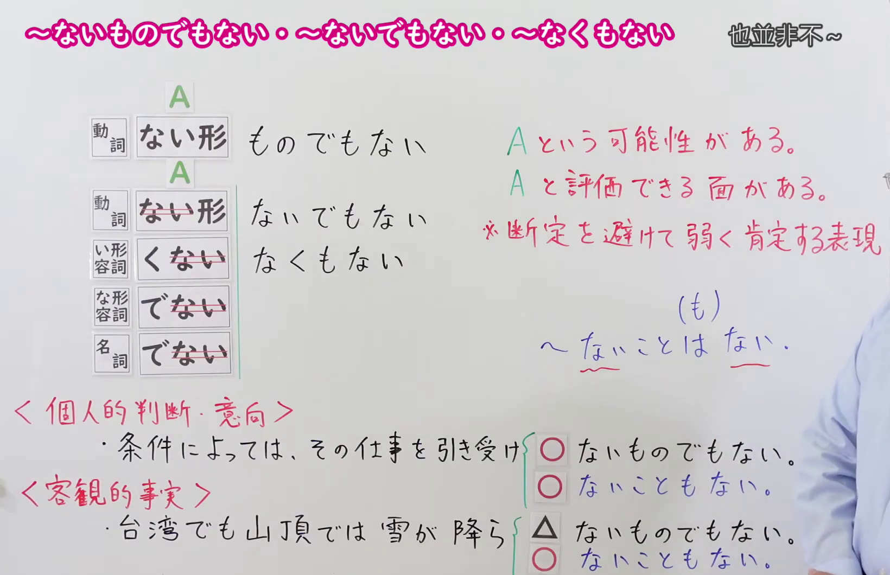
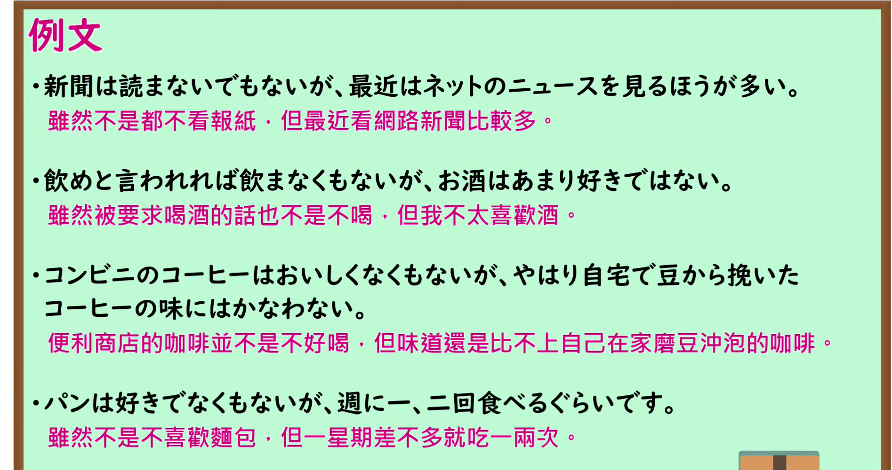

---
{
  "id": "N1-G-0053",
  "kind": "grammar",
  "level": "N1",
  "title": "～ないものでもない／～ないでもない／～なくもない：并非完全不……",
  "card_revision": 1,
  "schema_version": 1,
  "source": {
    "lesson": "N1 第53个语法",
    "material": "出口日語原视频板书、日语自动字幕、Hagoromo文型检索与日本語NET正文",
    "video": "https://www.youtube.com/watch?v=WrS31KB59J0",
    "screenshot": "assets/grammar/n1/N1-G-0053-connection.png",
    "screenshot_seconds": 307.07,
    "screenshot_crop": {
      "x": 0,
      "y": 0,
      "width": 1640,
      "height": 1060
    }
  },
  "tags": [
    "弱肯定",
    "N1"
  ],
  "confusions": [
    "～ないことはない／～ないこともない"
  ]
}
---

# ～ないものでもない／～ないでもない／～なくもない

# 视频学习资料整理

- [出口日語 N1 第53课原视频](https://www.youtube.com/watch?v=WrS31KB59J0)：课程讲解三种标题形式，并以「～ないことはない／～ないこともない」作对照。自动字幕的接续词有误写，以下以板书与讲解核对。
- 接续图：视频 **5:07.07（307.07 秒）**；原图 **1920 × 1080**，固定左上角裁切区域 **(x=0, y=0, 宽=1640, 高=1060)**。0:01 老师遮挡了右侧的红字说明；改用讲解后段画面，保留三种形式、红字说明及下方对照。

- 例句图：视频 **5:18.20（318.20 秒）**；原图 **1920 × 1080**，固定左上角裁切区域 **(x=0, y=0, 宽=1895, 高=1000)**。保留四条例句及其原视频翻译。

# 核心

## 功能一：A 有发生的可能，也有值得肯定的一面；避免断言，作弱肯定

**最上位意味カテゴリー：**

- **ないものでもない：** 考え・感情（想法与感情）
- **なくもない：** ものごとの様子（事物的状态）

**中位意味カテゴリー：**

- **ないものでもない：** 主張・断定的評価（主张与断定性评价）
- **なくもない：** 否定（否定）

**意味：**

- **ないものでもない：** わずかな可能性（微小的可能性）
- **なくもない：** 部分否定（部分否定）

**くわしい意味記述：**

- **ないものでもない（Hagoromo）：** 「〜ないものでもない」の「〜」の部分に対して，「〜をする場合もある」「まったく〜しないとはいえない」のように述べる時に使う。（用于表示对于前接内容，也存在会做某事的情况，不能说完全不会做。）
- **ないでもない（日本語NET）：** 全く〜ないわけではない / 場合によっては〜する（并非完全不……；视情况也会……。）
- **なくもない（Hagoromo）：** 否定を二回使うことによって，結果的に肯定を表す。完全に肯定するのではなく，可能性がゼロではないが，低いことを肯定的に表す。個人的な判断・推量・好き嫌いについて使われることが多い。（通过两次否定表达肯定，但并非完全肯定，而是肯定可能性虽低却并非为零；多用于个人判断、推测和好恶。）

**派生語：** Hagoromo 两个条目均未列出

### 例句

1. 条件によっては、Ａ社の提案を受け入れないものでもない。

   （视条件而定，也并非完全不能接受 A 公司的提案。）

2. 新しく発売されたスマホは少し高いが、買えないでもない。

   （新上市的手机有点贵，但也不是买不起。）

3. 日本の納豆は食べられないでもないが、あまり好きじゃない。

   （日本纳豆倒也不是不能吃，只是不太喜欢。）

4. このまま支持率が低い状態が続けば、近いうちに政権交代が起こる可能性がなくもない。

   （如果支持率继续保持低迷，近期也不是没有发生政权更替的可能。）

# 来源

- [出口日語原视频](https://www.youtube.com/watch?v=WrS31KB59J0)
- [Hagoromo「ないものでもない」](https://hagoromo-text.work/lookup?vid=1113)（查询日期：2026-09-24；含[用例](https://hagoromo-text.work/get_reibun?vid=1113)）
- [日本語NET「〜ないでもない／〜ないものでもない」](https://nihongokyoshi-net.com/2019/06/10/jlptn2-grammar-naidemonai/)（查询日期：2026-09-24；用于「ないでもない」的意义与例句）
- [Hagoromo「なくもない」](https://hagoromo-text.work/lookup?vid=2008)（查询日期：2026-09-24；含[用例](https://hagoromo-text.work/get_reibun?vid=2008)）
