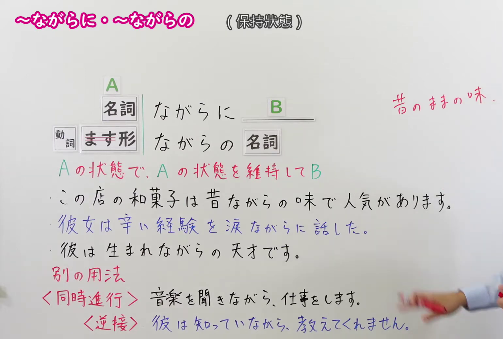
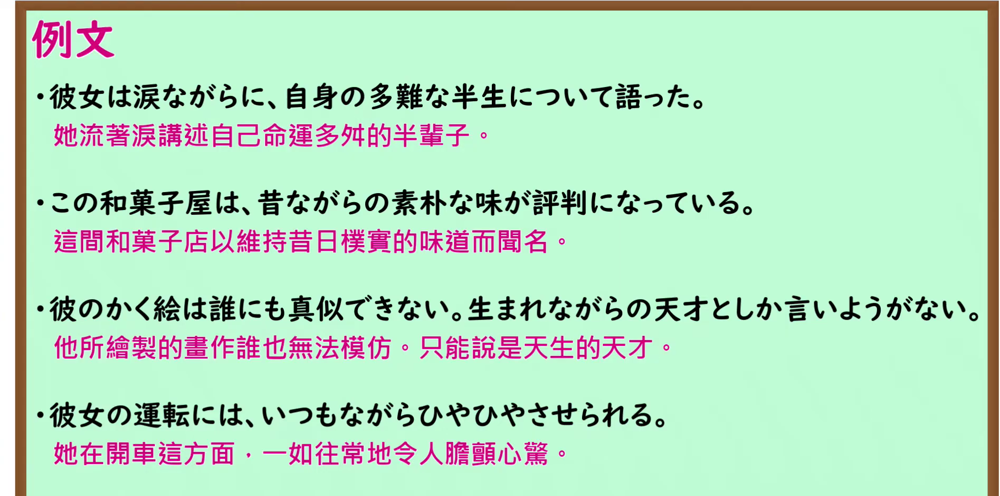

---
{
  "id": "N1-G-0054",
  "kind": "grammar",
  "level": "N1",
  "title": "～ながらに／～ながらの：保持原有状态",
  "card_revision": 1,
  "schema_version": 1,
  "source": {
    "lesson": "N1 第54个语法",
    "material": "出口日語原视频板书、日语自动字幕、Hagoromo文型检索与毎日のんびり日本語教師正文",
    "video": "https://www.youtube.com/watch?v=Ybz1Eyha1p4",
    "screenshot": "assets/grammar/n1/N1-G-0054-connection.png",
    "screenshot_seconds": 97.6,
    "screenshot_crop": {
      "x": 0,
      "y": 0,
      "width": 1540,
      "height": 1040
    }
  },
  "tags": [
    "状态保持",
    "N1"
  ],
  "confusions": [
    "～ながら（同时进行）",
    "～ながらも（逆接）"
  ]
}
---

# ～ながらに／～ながらの

# 视频学习资料整理

- [出口日語 N1 第54课原视频](https://www.youtube.com/watch?v=Ybz1Eyha1p4)：讲解保持原有状态的「～ながらに／～ながらの」。自动字幕有同音误写，以下依原视频板书与讲解核对。
- 接续图：视频 **1:37.60（97.60 秒）**；原图 **1920 × 1080**，固定左上角裁切区域 **(x=0, y=0, 宽=1540, 高=1040)**。0:01 老师遮挡必要板书；改用本帧，保留接续、红字说明、板书例句及与同时进行、逆接用法的对照。

- 例句图：视频 **4:08.53（248.53 秒）**；原图 **1920 × 1080**，固定左上角裁切区域 **(x=0, y=0, 宽=1895, 高=940)**。保留四条例句及原视频译文。

# 核心

## 功能一：在 A 的状态下保持该状态，进而出现 B

**最上位意味カテゴリー：**

- **ながら（に）：** ものごとの様子（事物的样态）

**中位意味カテゴリー：**

- **ながら（に）：** 様子・状態（样态与状态）

**意味：**

- **ながら（に）：** 様子（样态）

**くわしい意味記述：**

- **ながらに（Hagoromo「ながら（に）」）：** 「〜のままで」「その状態で」「変わらず」という意味を表す。「昔ながら」「涙ながら」「生まれながら」といった表現で使う。（表示保持原样、处于那种状态、没有改变；用于「昔ながら」「涙ながら」「生まれながら」等表达。）
- **ながらの（毎日のんびり日本語教師）：** 元々の状態から変わらないことを表します。「生まれながら（天生）」「昔ながら（一如既往）」「いつもながら（和往常一样）」「涙ながら（流着泪的状态）」など、接続できる語は限られています。（表示从原来的状态起没有改变；可前接的词有限，例如「生まれながら」「昔ながら」「いつもながら」「涙ながら」。）

**派生語：** Hagoromo 列出「ながらに」

### 例句

1. 涙ながらに訴えた。

   （含泪诉说了。）

2. 昔ながらの伝統を大切にしよう。

   （好好珍惜延续至今的传统吧。）

3. 人には必ず生まれながらの使命がある。

   （人一定有与生俱来的使命。）

4. 街から昔ながらの喫茶店が減っている。

   （城里保留旧式风貌的咖啡馆正越来越少。）

# 来源

- [出口日語原视频](https://www.youtube.com/watch?v=Ybz1Eyha1p4)
- [Hagoromo「ながら（に）」](https://hagoromo-text.work/lookup?vid=1120)（查询日期：2026-09-24；含[用例](https://hagoromo-text.work/get_reibun?vid=1120)）
- [毎日のんびり日本語教師「～ながらに／ながらの」](https://mainichi-nonbiri.com/grammar/n1-nagarani/)（查询日期：2026-09-24；用于「ながらの」的意义与例句）
