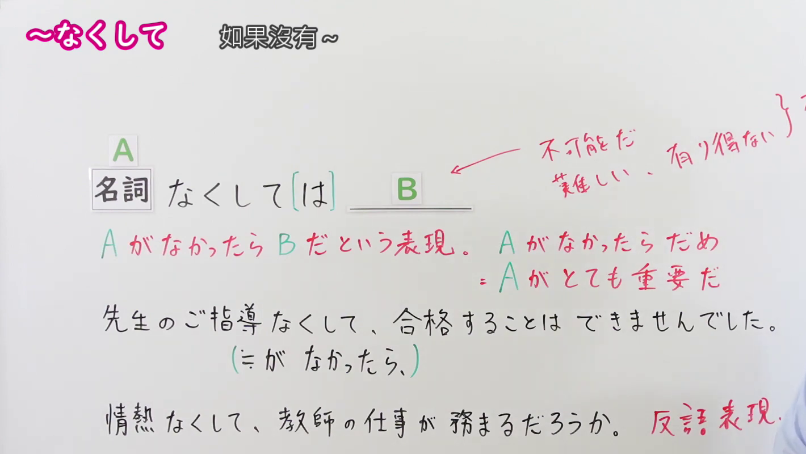
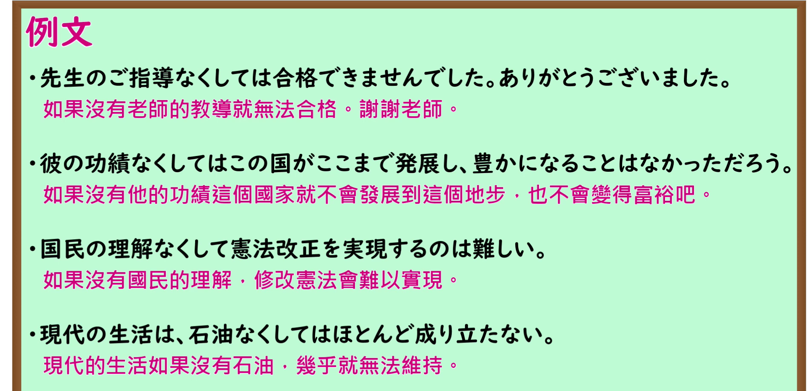

---
{
  "id": "N1-G-0055",
  "kind": "grammar",
  "level": "N1",
  "title": "～なくして（は）：没有……就无法……",
  "card_revision": 1,
  "schema_version": 1,
  "source": {
    "lesson": "N1 第55个语法",
    "material": "出口日語原视频板书、日语自动字幕、Hagoromo文型检索与毎日のんびり日本語教師正文",
    "video": "https://www.youtube.com/watch?v=1xzIzLAjdGU",
    "screenshot": "assets/grammar/n1/N1-G-0055-connection.png",
    "screenshot_seconds": 180,
    "screenshot_crop": {
      "x": 0,
      "y": 0,
      "width": 1420,
      "height": 800
    }
  },
  "tags": [
    "条件・必要性",
    "N1"
  ],
  "confusions": [
    "～なしに／～なしでは"
  ]
}
---

# ～なくして（は）

# 视频学习资料整理

- [出口日語 N1 第55课原视频](https://www.youtube.com/watch?v=1xzIzLAjdGU)：讲解「～なくして（は）」。自动字幕把「なくして」等词误写，以下以原视频板书与讲解核对。
- 接续图：视频 **3:00（180 秒）**；原图 **1920 × 1080**，固定左上角裁切区域 **(x=0, y=0, 宽=1420, 高=800)**。0:01 老师遮挡了板书例句；改用讲解后段画面，保留接续、红字说明、两条例句及反问用法标记。右上方补充板书被老师遮挡，后项限制另以实际语法条目核对。

- 例句图：视频 **3:31.63（211.63 秒）**；原图 **1920 × 1080**，固定左上角裁切区域 **(x=0, y=0, 宽=1895, 高=920)**。保留四条例句及其原视频译文。

# 核心

## 功能一：如果没有 A，就无法实现或成立 B

**最上位意味カテゴリー：**

- **なくして：** ものごとの関係（事物之间的关系）

**中位意味カテゴリー：**

- **なくして：** 条件（条件）

**意味：**

- **なくして：** 逆接（逆接）

**くわしい意味記述：**

- **なくして（Hagoromo）：** 「〜がなければ」の意味。後には否定的な内容が続き，「〜がなければ、〜はできない」という意味を表す。かたい，文語的な表現で，標語などに使われる。（表示「如果没有……」；后接否定性内容，表达「没有……就无法……」。属于较郑重的书面语，也用于标语。）
- **なくしては（毎日のんびり日本語教師）：** 仮定条件です。元々あるものが無くなったら何もかも難しくなることを表します。「は」は省略可能です。書き言葉です。口語「～がなかったら」と同義。（表示假设条件：原有的事物若不存在，各种事情就会变得困难。「は」可以省略；属于书面语，与口语「～がなかったら」意义相同。）

**派生語：** Hagoromo 未列出

### 例句

1. 伝統を尊重することなくして、新しい文化の創造はあり得ない。

   （不尊重传统，就不可能创造出新的文化。）

2. 真の勇気なくしては正しい行動をとることはできない。

   （没有真正的勇气，就无法采取正确的行动。）

3. 愛情なくして夫婦は務まらない。

   （没有爱情，就难以维系夫妻关系。）

4. 失敗なくしては成功もありません。

   （没有失败，也就不会有成功。）

# 来源

- [出口日語原视频](https://www.youtube.com/watch?v=1xzIzLAjdGU)
- [Hagoromo「なくして」](https://hagoromo-text.work/lookup?vid=1122)（查询日期：2026-09-24；含[用例](https://hagoromo-text.work/get_reibun?vid=1122)）
- [毎日のんびり日本語教師「～なくして／なくしては」](https://mainichi-nonbiri.com/grammar/n1-nakushite/)（查询日期：2026-09-24；用于「なくしては」的说明与例句）
