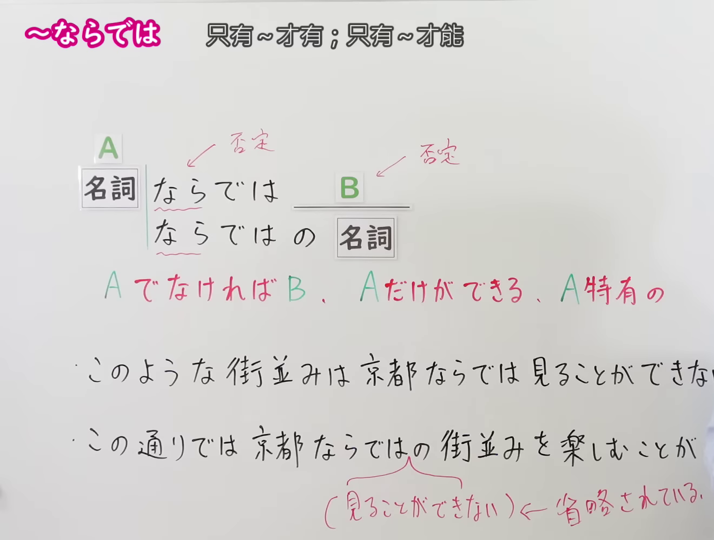
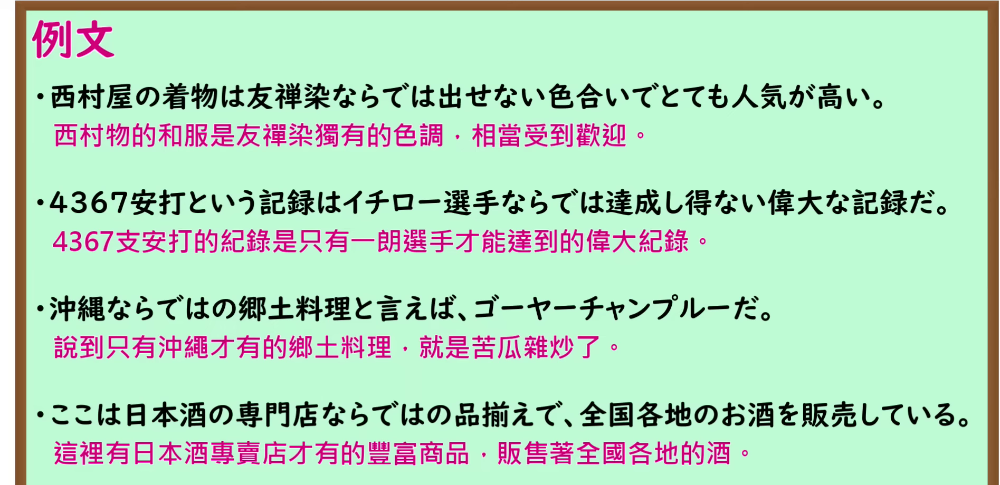

---
{
  "id": "N1-G-0056",
  "kind": "grammar",
  "level": "N1",
  "title": "～ならでは：只有……才做得到；……特有的",
  "card_revision": 1,
  "schema_version": 1,
  "source": {
    "lesson": "N1 第56个语法",
    "material": "出口日語原视频板书、日语自动字幕与Hagoromo文型检索正文",
    "video": "https://www.youtube.com/watch?v=68GlfBnUEGQ",
    "screenshot": "assets/grammar/n1/N1-G-0056-connection.png",
    "screenshot_seconds": 180,
    "screenshot_crop": {
      "x": 0,
      "y": 0,
      "width": 1320,
      "height": 1000
    }
  },
  "tags": [
    "限定・特有",
    "N1"
  ],
  "confusions": [
    "～だけに",
    "～にしかない"
  ]
}
---

# ～ならでは

# 视频学习资料整理

- [出口日語 N1 第56课原视频](https://www.youtube.com/watch?v=68GlfBnUEGQ)：讲解「～ならでは」及「～ならではの」。日语自动字幕仅作定位参考，语法形式与例句以原视频画面核对。
- 接续图：视频 **3:00（180 秒）**；原图 **1920 × 1080**，固定左上角裁切区域 **(x=0, y=0, 宽=1320, 高=1000)**。0:01 画面中老师遮挡板书，改用讲解后段，保留接续、红字意义说明及例句板书。画面右侧的例句末尾仍被老师遮挡，完整课程例句见下方独立截图。

- 例句图：视频 **3:37.03（217.03 秒）**；原图 **1920 × 1080**，固定左上角裁切区域 **(x=0, y=0, 宽=1895, 高=920)**。保留四条完整的原视频例句及其译文。

# 核心

## 功能一：如果不是 A 就无法实现 B；只有 A 才能做到，或为 A 所特有

**最上位意味カテゴリー：**

- **ならでは（1166）：** ものごとの関係（事物之间的关系）
- **ならでは／ならではの（1167）：** ものごとの関係（事物之间的关系）

**中位意味カテゴリー：**

- **ならでは（1166）：** 限定（限定）
- **ならでは／ならではの（1167）：** 限定（限定）

**意味：**

- **ならでは（1166）：** 限定（限定）
- **ならでは／ならではの（1167）：** 限定（限定）

**くわしい意味記述：**

- **ならでは（1166）：** 「〜でなければ」と同じ意味。「ならではの」と比べるとあまり用いられない。（与「若不是……」同义；与「ならではの」相比，使用得较少。）
- **ならでは／ならではの（1167）：** 「〜でなければ」と同じ意味。「ならではの」と比べるとあまり用いられない。（与「若不是……」同义；与「ならではの」相比，使用得较少。）

**派生語：** 1166 条目未列出；1167 条目列出「ならではの」。

### 例句

1. あの熟練工の彼ならでは作りえない製品だ。

   （这是只有那位熟练工人才能做出来的产品。）

2. 今後も大学ならではできない基礎研究を行っていきたい。

   （今后也想继续开展只有大学才能进行的基础研究。）

3. 金メダルは、彼女ならではの快挙だ。

   （夺得金牌，是只有她才能实现的壮举。）

4. このようにおいしいパフェを、情緒あふれる町屋カフェで食べるというのは、京都ならではの醍醐味ではないだろうか。

   （在充满情调的町屋咖啡馆享用如此美味的芭菲，难道不正是京都独有的乐趣吗？）

# 来源

- [出口日語原视频](https://www.youtube.com/watch?v=68GlfBnUEGQ)
- [Hagoromo「ならでは」条目 1166](https://hagoromo-text.work/lookup?vid=1166)（查询日期：2026-09-24；含[用例](https://hagoromo-text.work/get_reibun?vid=1166)）
- [Hagoromo「ならでは／ならではの」条目 1167](https://hagoromo-text.work/lookup?vid=1167)（查询日期：2026-09-24；含[用例](https://hagoromo-text.work/get_reibun?vid=1167)）
