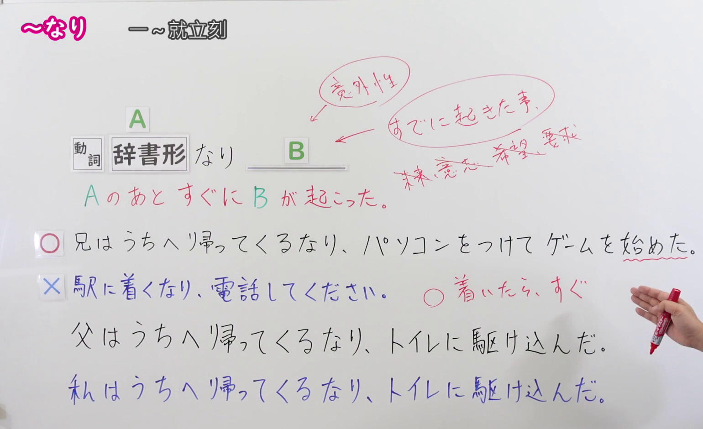
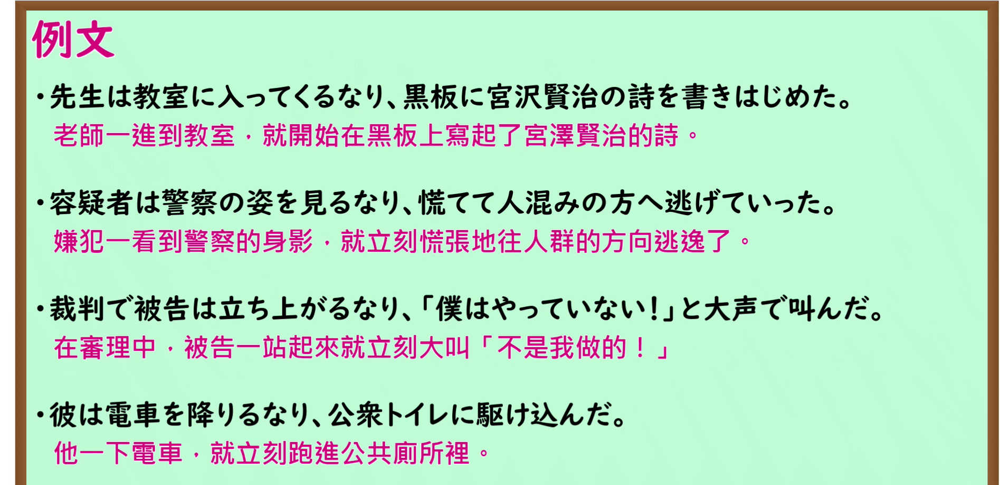

---
{
  "id": "N1-G-0057",
  "kind": "grammar",
  "level": "N1",
  "title": "～なり：一……就……",
  "card_revision": 1,
  "schema_version": 1,
  "source": {
    "lesson": "N1 第57个语法",
    "material": "出口日語原视频板书、日语自动字幕、Hagoromo文型检索与毎日のんびり日本語教師正文",
    "video": "https://www.youtube.com/watch?v=HSEp-rpKiY8",
    "screenshot": "assets/grammar/n1/N1-G-0057-connection.png",
    "screenshot_seconds": 160,
    "screenshot_crop": {
      "x": 0,
      "y": 0,
      "width": 1540,
      "height": 940
    }
  },
  "tags": [
    "时间・继起",
    "N1"
  ],
  "confusions": [
    "～やいなや",
    "～が早いか"
  ]
}
---

# ～なり

# 视频学习资料整理

- [出口日語 N1 第57课原视频](https://www.youtube.com/watch?v=HSEp-rpKiY8)：本课讲动词辞书形后接「なり」表示紧接发生的事。日语自动字幕仅作定位参考，板书内容以原视频画面核对。
- 接续图：视频 **2:40（160 秒）**；原图 **1920 × 1080**，固定左上角裁切区域 **(x=0, y=0, 宽=1540, 高=940)**。0:01 的例句被老师遮挡，改用讲解后段，保留接续、红字意义说明、正确与错误用法的对照及两组例句。

- 例句图：视频 **3:19.90（199.90 秒）**；原图 **1920 × 1080**，固定左上角裁切区域 **(x=0, y=0, 宽=1895, 高=920)**。保留四条完整的原视频例句及其译文。

# 核心

## 功能一：A 之后马上发生 B

**最上位意味カテゴリー：**

- **なり：** 場所・時間（地点与时间）

**中位意味カテゴリー：**

- **なり：** 時間的前後（时间上的先后）

**意味：**

- **なり：** 継起（後）（紧接发生后项）

**くわしい意味記述：**

- **なり（Hagoromo）：** あることをすると同時に別のことをすることを表す。（表示做某事的同时又做另一件事。）
- **なり（毎日のんびり日本語教師）：** 前件の動作後すぐに後件が発生したことを表します。原則過去のことにしか使えません。（表示前项动作发生后，后项随即发生；原则上只用于过去的事情。）

**派生語：** Hagoromo 未列出。

### 例句

1. 田中さんは私の顔を見るなり、不機嫌な顔でだまってしまった。

   （田中一看到我的脸，就板着脸沉默不语了。）

2. その男は私と目が合うなり、追いかけてきた。

   （那个男人刚和我对上视线，就追了过来。）

3. バッグに商品を入れるなり、店から立ち去って行った。

   （他刚把商品放进包里，就离开了店。）

4. 彼女はその教会に足を踏み入れるなり涙が止まらなくなったそうだ。

   （听说她刚踏进那座教堂，就泪流不止了。）

# 来源

- [出口日語原视频](https://www.youtube.com/watch?v=HSEp-rpKiY8)
- [Hagoromo「なり（継起（後））」](https://hagoromo-text.work/lookup?vid=1170)（查询日期：2026-09-24；含[用例](https://hagoromo-text.work/get_reibun?vid=1170)）
- [毎日のんびり日本語教師「～なり」](https://mainichi-nonbiri.com/grammar/n1-nari/)（查询日期：2026-09-24；用于说明及例句）
