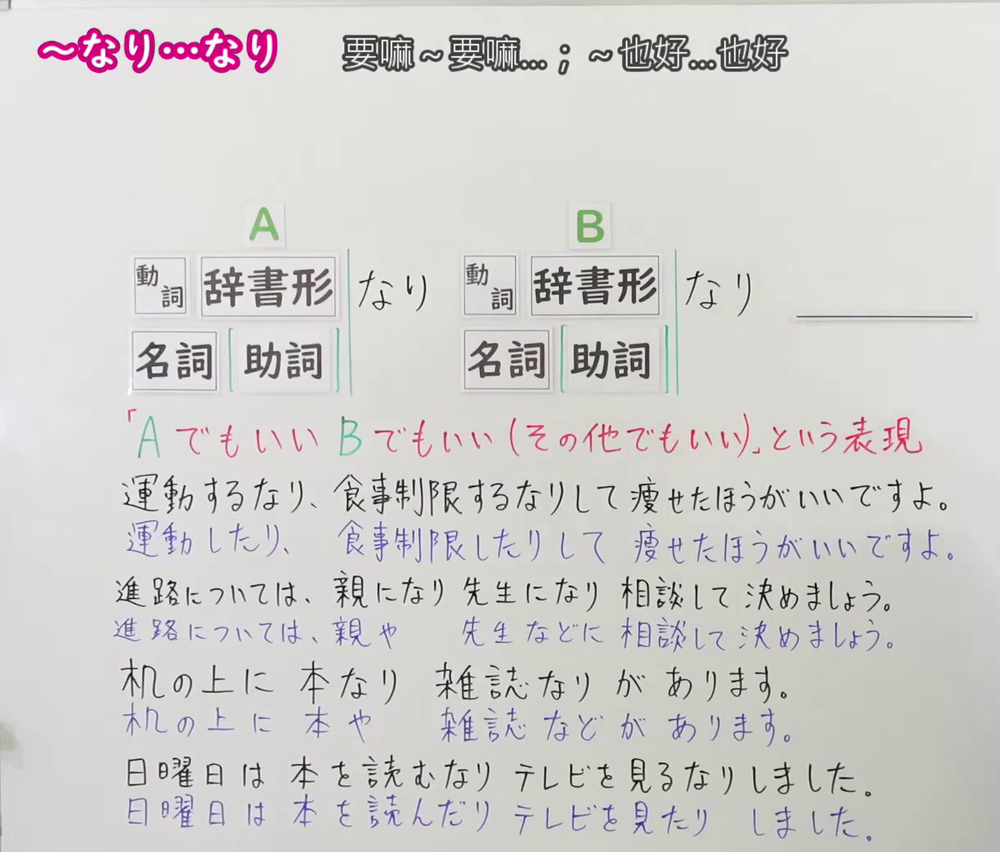
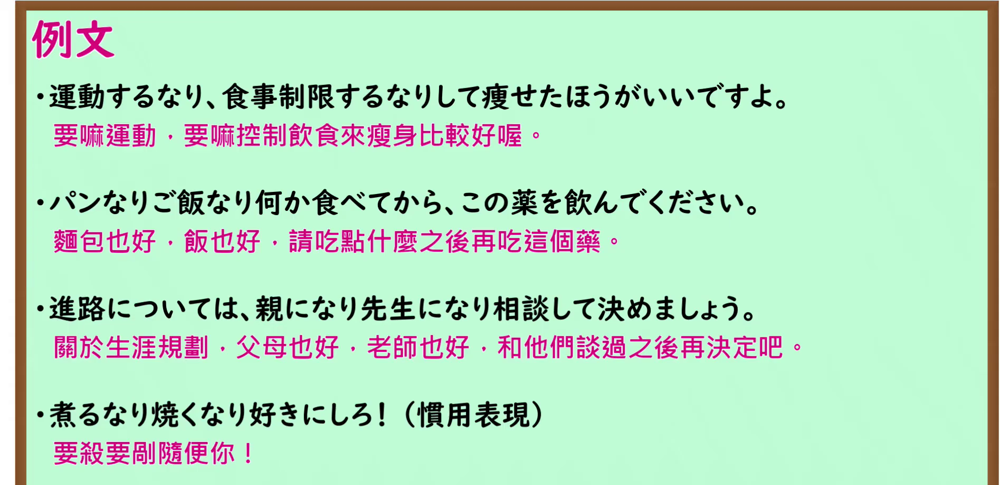

---
{
  "id": "N1-G-0058",
  "kind": "grammar",
  "level": "N1",
  "title": "～なり…なり：……也好，……也好",
  "card_revision": 1,
  "schema_version": 1,
  "source": {
    "lesson": "N1 第58个语法",
    "material": "出口日語原视频板书、日语自动字幕、Hagoromo文型检索与毎日のんびり日本語教師正文",
    "video": "https://www.youtube.com/watch?v=5Z1W0ymvzPU",
    "screenshot": "assets/grammar/n1/N1-G-0058-connection.png",
    "screenshot_seconds": 1,
    "screenshot_crop": {
      "x": 0,
      "y": 0,
      "width": 1220,
      "height": 1040
    }
  },
  "tags": [
    "例示・选择",
    "N1"
  ],
  "confusions": [
    "～なり（紧接发生）",
    "～なりとも"
  ]
}
---

# ～なり…なり

# 视频学习资料整理

- [出口日語 N1 第58课原视频](https://www.youtube.com/watch?v=5Z1W0ymvzPU)：讲解「～なり…なり」列举可选的人、物或做法。日语自动字幕仅作定位参考，语法形式与例句以原视频画面核对。
- 接续图：视频 **0:01（1 秒）**；原图 **1920 × 1080**，固定左上角裁切区域 **(x=0, y=0, 宽=1220, 高=1040)**。保留接续、红字意义说明及多组板书例句，裁去右侧人物与空白。

- 例句图：视频 **5:26.73（326.73 秒）**；原图 **1920 × 1080**，固定左上角裁切区域 **(x=0, y=0, 宽=1895, 高=920)**。保留四条原视频例句及其译文。

# 核心

## 功能一：A 也可以，B 也可以，其他选择也可以

**最上位意味カテゴリー：**

- **なり…なり：** ものごとの関係（事物之间的关系）

**中位意味カテゴリー：**

- **なり…なり：** 例示（举例）

**意味：**

- **なり…なり：** 例示（举例）

**くわしい意味記述：**

- **なり…なり（Hagoromo）：** 「〜なり…なり」の形で、「〜でも…でもいい」と，複数の候補をあげる時に使う。「何でもいい」というニュアンスがある。（采用「……なり……なり」的形式，在列举多个候选项、表示「……也可以，……也可以」时使用；带有「选什么都可以」的语感。）

**派生語：** Hagoromo 未列出。

### 例句

1. 困ったことがあったら、先生なり先輩なりに聞いたほうがいいよ。

   （遇到难题时，最好问问老师或学长。）

2. おにぎりなりパンなり、何か食べてから行きなさい。

   （吃个饭团或面包什么的再走吧。）

3. 分からないときは、私に聞くなり、辞書で調べるなりしてください。

   （不明白的时候，请问我或查字典。）

4. 疲れたら軽く運動するなり背伸びするなり自由にしてください。

   （累了就做点轻运动或伸展一下，随意活动。）

# 来源

- [出口日語原视频](https://www.youtube.com/watch?v=5Z1W0ymvzPU)
- [Hagoromo「なり〜なり（例示）」](https://hagoromo-text.work/lookup?vid=1171)（查询日期：2026-09-24；含[用例](https://hagoromo-text.work/get_reibun?vid=1171)）
- [毎日のんびり日本語教師「～なり～なり／～なりとも／～なり何なりと」](https://mainichi-nonbiri.com/grammar/n1-narinari/)（查询日期：2026-09-24；采用其中「～なり～なり」的例句）
