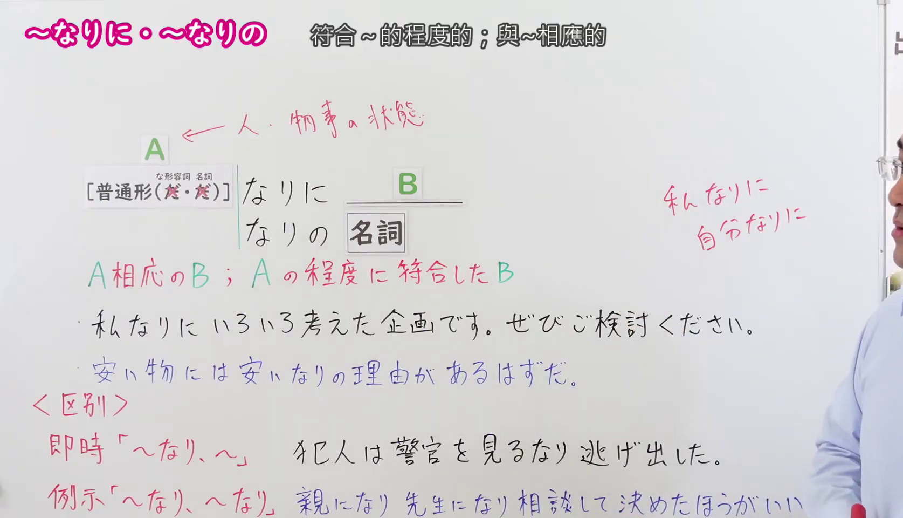
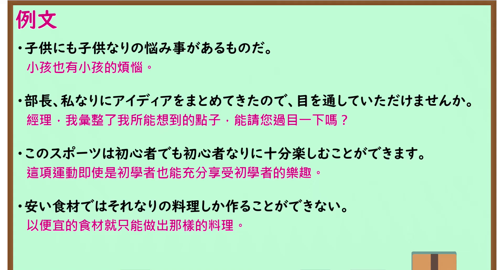

---
{
  "id": "N1-G-0059",
  "kind": "grammar",
  "level": "N1",
  "title": "～なりに／～なりの：以～相称的；以～自己的方式",
  "card_revision": 1,
  "schema_version": 1,
  "source": {
    "lesson": "N1 第59个语法",
    "material": "出口日語原视频板书、日语自动字幕与 Hagoromo 文型检索正文",
    "video": "https://www.youtube.com/watch?v=RhUTMFxv6xM",
    "screenshot": "assets/grammar/n1/N1-G-0059-connection.png",
    "screenshot_seconds": 231.0,
    "screenshot_crop": {
      "x": 0,
      "y": 0,
      "width": 1675,
      "height": 960
    }
  },
  "tags": [
    "立場",
    "N1"
  ],
  "confusions": [
    "～なり（～するなり…）（接动词辞书形，表示前项动作一发生紧接着发生后项，如「警官を見るなり逃げ出した」；而「～なりに／～なりの」表示与自身程度或立场相符）",
    "～なり～なり（表示从同类示例中列举任选其一，如「親になり先生になり相談する」；而「～なりに／～なりの」作状语或定语修饰）"
  ]
}
---

# N1 第59个语法：～なりに／～なりの

# 视频学习资料整理

- 课程：[出口日語「【Ｎ１文法】～なりに／～なりの」](https://www.youtube.com/watch?v=RhUTMFxv6xM)，时长 5 分 40 秒。
- 接续图：原视频 3:51.00（231.00 秒）；原图 1920×1080，固定左上角裁切区域 `(0, 0, 1675, 960)`。0:01 画面讲师居中遮挡了右侧板书内容；选用 231.00 秒讲师退至画面右侧边缘之外，接续框（普通形＋なりに／なりの，な形容词/名词直接接，修饰名词用なりの）、红字核心含义「A相応のB／Aの程度に符合したB」、自谦限度用法（私なりに、不可对尊长使用）、客观相符用法（安いものには安いなりの理由）、以及与「～なり」「～なり～なり」的对比辨析均 100% 完整清晰呈现。

- 例句图：原视频 4:35.00（275.00 秒）；原图 1920×1080，固定左上角裁切区域 `(0, 0, 1895, 1030)`。四条例句及原视频中文说明完整清晰，裁去底部多余边框与进度条。

# 核心

## 功能一：以与A相称的方式；按照A自身的程度或限度

**最上位意味カテゴリー：**

- **Nなり：** ものごとの関係（事物关系）

**中位意味カテゴリー：**

- **Nなり：** 判断の立場（判断的立场）

**意味：**

- **Nなり：** 立場（立场/相应状态）

**くわしい意味記述：**

- **Nなり：** 十分ではないが，それ相応の状態である，というときに使う。（表示虽然谈不上十全十美/非常充分，但处于与其相称、相应之状态时使用。）

**派生語：** Nなりに，Nなりの

### 例句

1. 私なりに考えて出した結論だ。

   （这是我尽自己所能思考后得出的结论。）

2. これが私なりの結論だ。

   （这就是以我自己的方式得出的结论。）

3. 日本では「外道」の世界は「正道」には直結はしていないものの、どこかで結びつき、しかも外道には外道なりの秩序があり、道徳があり、目的もある。

   （然而在日本，“外道”的世界虽未与“正道”直接相连，却在某处隐秘勾连，且外道自有外道相应的秩序、道德与目的。）

4. ヨーロッパは、ヨーロッパなりの偏見がある。

   （欧洲自有欧洲自身特有的成见与偏见。）

# 来源

- [出口日語原视频](https://www.youtube.com/watch?v=RhUTMFxv6xM)
- [Hagoromo 文型检索「Nなり（立場）」](https://hagoromo-text.work/)（查询日期：2026-09-24；页面内检索「なりに」）
