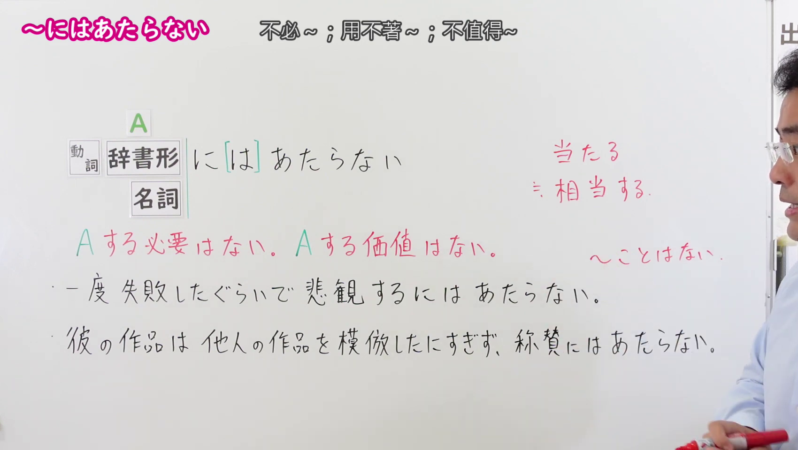
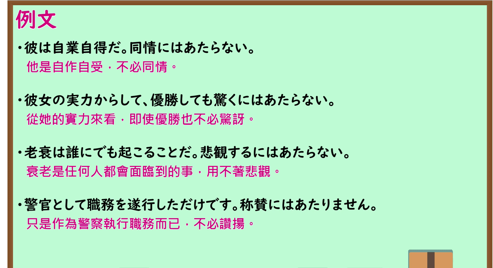

---
{
  "id": "N1-G-0060",
  "kind": "grammar",
  "level": "N1",
  "title": "～には当たらない：用不着～；不值得～；算不上……",
  "card_revision": 1,
  "schema_version": 1,
  "source": {
    "lesson": "N1 第60个语法",
    "material": "出口日語原视频板书、日语自动字幕与 Hagoromo 文型检索正文",
    "video": "https://www.youtube.com/watch?v=2WfA6PhMQw0",
    "screenshot": "assets/grammar/n1/N1-G-0060-connection.png",
    "screenshot_seconds": 120.0,
    "screenshot_crop": {
      "x": 0,
      "y": 0,
      "width": 1700,
      "height": 960
    }
  },
  "tags": [
    "主張・断定的評価",
    "N1"
  ],
  "confusions": [
    "～におよばない（～に及ばない）（两者均可表示“用不着/不必”；但「～に及ばない」重点表示事态轻微，无需大动干戈或专门采取动作，如「わざわざ行くには及ばない」；而「～には当たらない」源于动词「当たる（相称/相当于）」，重点强调“够不上、不值得、算不上值得大惊小怪或过度反应的情形”，如「驚くには当たらない」「悲観するには当たらない」）",
    "～に足りない（～に足らない）（主要表示“不足以……/不值得……”，常用于修饰名词强调某事物毫无价值，如「取るに足りない人物」；而「～には当たらない」主要作句尾谓语，多用于评价某种心理反应或情感态度过度、没必要）"
  ]
}
---

# N1 第60个语法：～には当たらない

# 视频学习资料整理

- 课程：[出口日語「【Ｎ１文法】～には当たらない」](https://www.youtube.com/watch?v=2WfA6PhMQw0)，时长 3 分 49 秒。
- 接续图：原视频 2:00.00（120.00 秒）；原图 1920×1080，固定左上角裁切区域 `(0, 0, 1700, 960)`。0:01 画面讲师居中遮挡了右侧板书内容；选用 120.00 秒讲师退至画面右侧边缘之外，接续框（动词辞书形/名词＋に（は）当たらない）、渊源「当たる（相当する）」、红字核心含义（～する必要はない/～する価値はない）、与初中级文法「～ことはない」转换对比、以及两组典型板书例句均 100% 完整清晰呈现。

- 例句图：原视频 2:44.00（164.00 秒）；原图 1920×1080，固定左上角裁切区域 `(0, 0, 1895, 1030)`。四条例句及原视频中文说明完整清晰，裁去底部多余边框与进度条。

# 核心

## 功能一：用不着某行为（没必要）；不值得/算不上某评价（够不上）

**最上位意味カテゴリー：**

- **にあたらない：** 考え・感情（思考与感情）

**中位意味カテゴリー：**

- **にあたらない：** 主張・断定的評価（主张与断定性评价）

**意味：**

- **にあたらない：** 評価（评价）

**くわしい意味記述：**

- **にあたらない：** 「ある行為をするのは適切ではない」「ある行為をするようなことではない」という意味。話し手がある行為をすることに批判的であるときに使う。「にはあたらない」の前に、理由を表す表現がくることが多い。（表示“做某行为并不恰当/合适”“并非值得去做某事的大不了之事”的意思。多在说话人对做某行为持否定或客观平息态度时使用。「にはあたらない」之前常伴随表示理由的表达。）

**派生語：** にはあたらない

### 例句

1. 彼の行動は、驚くにあたらない。

   （他的所作所为，根本用不着大惊小怪 / 不足为奇。）

2. 親が子どものために学校を選ぶのは当然のことで、問題とするにはあたらない。

   （父母为子女挑选学校是理所当然的事，根本算不上什么大问题 / 没必要拿来当作问题。）

3. 学説も多くは、それは新たな憲法の制定であって、改正にはあたらないとしていた。

   （学界大多数观点也认为，那属于新宪法的制定，根本谈不上是修宪。）

4. 日本人の宗教感覚のその部分は、日本人としてはあたりまえのことで、問題とするにはあたらない。

   （日本人宗教观的这一特质，对于日本人而言乃司空见惯之事，根本不足为奇 / 算不上问题。）

# 来源

- [出口日語原视频](https://www.youtube.com/watch?v=2WfA6PhMQw0)
- [Hagoromo 文型检索「にあたらない（評価）」](https://hagoromo-text.work/)（查询日期：2026-09-24；页面内检索「あたらない」）
