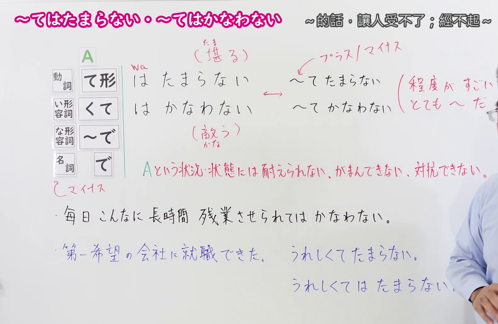
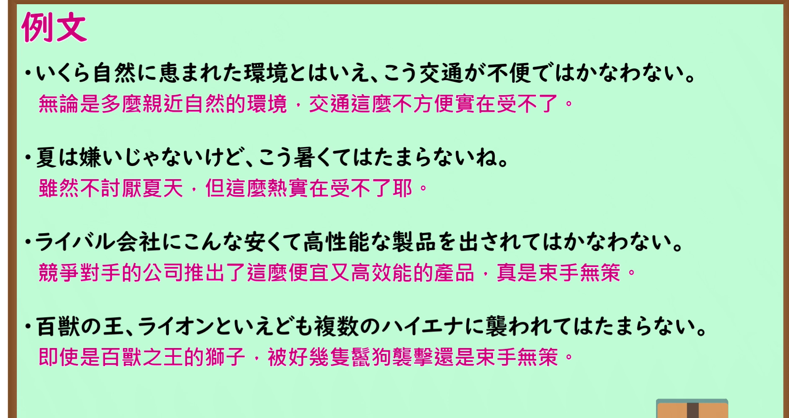

---
{
  "id": "N1-G-0061",
  "kind": "grammar",
  "level": "N1",
  "title": "てはたまらない／てはかなわない（…的话让人受不了；受不了、无法忍受）",
  "card_revision": 1,
  "schema_version": 1,
  "source": {
    "lesson": "N1 第61个语法",
    "material": "出口日語原视频板书、日语自动字幕与毎日のんびり日本語教師正文",
    "video": "https://www.youtube.com/watch?v=JFRLbtS4NPc",
    "screenshot": "assets/grammar/n1/N1-G-0061-connection.png",
    "screenshot_seconds": 200,
    "screenshot_crop": {
      "x": 0,
      "y": 0,
      "width": 1580,
      "height": 1030
    }
  },
  "tags": [
    "てはたまらない",
    "てはかなわない",
    "N1"
  ],
  "confusions": [
    "「〜てはたまらない／〜てはかなわない」带「は」，前件必须是负面状况，表示「无法忍受这种状况」；去掉「は」的「〜てたまらない／〜てかなわない」只强调程度极高（とても〜だ），正面和负面内容都可以用",
    "「〜てたまらない」前接感情或感觉词（嬉しい、暑い 等），「〜てはたまらない」的前件是状况、状态，不能是单纯的感情词，因此「嬉しくてたまらない」成立而「嬉しくてはたまらない」不成立",
    "「は」的有无会改变意思，「こんなに」等词呼应时多需要加「は」；「かなわない」的语源是「（に）敵う」，「たまらない」的语源是「貯まる」，两者都取否定形表示受不了"
  ]
}
---

# N1 第61个语法：てはたまらない／てはかなわない（…的话让人受不了；受不了、无法忍受）

## 视频学习资料整理

原视频：[出口日語 N1 第61课「～てはたまらない・～てはかなわない」](https://www.youtube.com/watch?v=JFRLbtS4NPc)（时长 6:12）

本课把「〜てはたまらない」和「〜てはかなわない」作为同一个用法讲解，并用它们与去掉「は」的「〜てたまらない／〜てかなわない」作对比。

### 接续图（真实时间 3:20.00）

- 原图尺寸：1920×1080；裁切区域：x=0, y=0, width=1580, height=1030。
- 固定左上角、收拢右下角，裁去底部空白与右侧多余画面。
- 板书内容：接续「動詞て形＋は＋たまらない」「い形容詞くて＋は＋かなわない」以及な形容詞「〜で」、名詞「で」的「は」接续；红色含义说明「Aという状況・状態には耐えられない、がまんできない、対抗できない。」；作为对比的「〜てたまらない（プラス／マイナス・程度がすごい／とても〜だ）」与「〜てかなわない」；以及两条课程例句「毎日こんなに長時間残業させられてはかなわない。」「第一希望の会社に就職できた。うれしくてたまらない。／うれしくてはたまらない。」
- 替换说明：0:01 时点含义说明只写到一半、右侧对比标注被教师遮挡，改用板书写全的 3:20.00 时点；该时点右侧仅有教师手臂的一小部分，板书文字完整可读。

### 例句图（真实时间 4:42.72）

- 原图尺寸：1920×1080；裁切区域：x=10, y=10, width=1875, height=995。
- 固定左上角、收拢右下角，裁去底部空白与边框之外的画面。
- 板书内容：课程例句页的四条例句及其中文翻译。

# 核心

## 功能一：对于A这种情况、状态，无法忍受、无法忍耐、无法对抗

**くわしい意味記述：**

- **てはかなわない（ては敵わない）／ては遣り切れない（やりきれない）：** 我慢できない、耐えられないという主観的な感情を強調します。「やりきれない」は例文（８）のように単独でも用いることができます。「こんなに」等の語が呼応すると、「～ては敵わない／ては遣り切れない」のように「は」が必要になる場合が多いです。元々は動詞「（に）適う／敵わない」です。対抗する力がある／ないといいう意味を持ちます。（强调「无法忍耐、无法忍受」这一主观情感。「やりきれない」如该页例句（８）那样也可以单独使用。当与「こんなに」等词语呼应时，多需要像「～ては敵わない／ては遣り切れない」这样加上「は」。它原本来自动词「（に）適う／敵わない」，含有「有／没有与之对抗的力量」的意思。）

### 例句

1. こんなに寒くては敵わない。

   （这么冷可真让人受不了。）

2. ダイエットしたいが、毎晩断食ではかなわない。

   （我想减肥，但每天晚上断食的话可受不了。）

3. 毎日残業続きではやりきれない。

   （每天加班可真受不了。）

4. 歯が痛くてかなわない。

   （牙疼得受不了。）

5. 近隣に住む若者がうるさくて敵わない。

   （住在附近的年轻人吵得让人受不了。）

# 来源

- [出口日語原视频](https://www.youtube.com/watch?v=JFRLbtS4NPc)
- [毎日のんびり日本語教師「【Ｎ１文法】～ては敵わない（かなわない）／ては遣り切れない（やりきれない）」](https://mainichi-nonbiri.com/grammar/n1-tehakanawanai/)（查询日期：2026-09-24）

