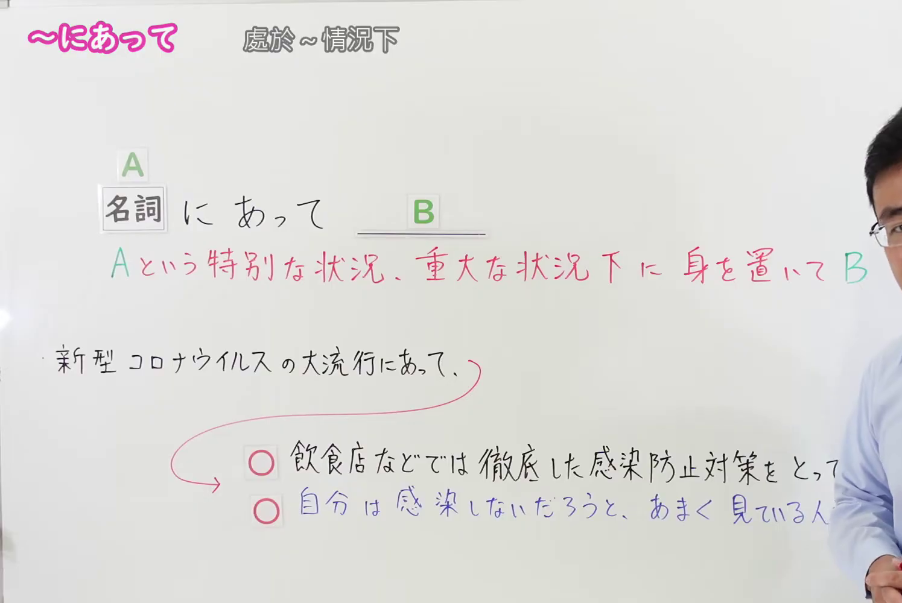

---
{
  "id": "N1-G-0062",
  "kind": "grammar",
  "level": "N1",
  "title": "にあって（处于…状况下；在…之中）",
  "card_revision": 1,
  "schema_version": 1,
  "source": {
    "lesson": "N1 第62个语法",
    "material": "出口日語原视频板书、日语自动字幕与 Hagoromo 文型検索正文",
    "video": "https://www.youtube.com/watch?v=CIFpXDqXblo",
    "screenshot": "assets/grammar/n1/N1-G-0062-connection.png",
    "screenshot_seconds": 139,
    "screenshot_crop": {
      "x": 0,
      "y": 0,
      "width": 1495,
      "height": 1000
    }
  },
  "tags": [
    "にあって",
    "N1"
  ],
  "confusions": [
    "「にあって」前接名词，表示置身于特别的、重大的状况之中；后项既可接顺接内容，也可接与预想相反的逆接内容，两种情况都成立",
    "「にあって」多用于书面语和较硬的说明、论述，口语中不常出现",
    "派生形式「にあっては」提示该特殊状况下的对照，「にあっても」带有「即使在…之中也」的逆接让步语气",
    "与表示时机的「〜にあたって」（在…之际）形近但不同，后者前接动词或名词，表示在某个时间点或场合做某事"
  ]
}
---

# N1 第62个语法：にあって（处于…状况下；在…之中）

## 视频学习资料整理

原视频：[出口日語 N1 第62课「～にあって」](https://www.youtube.com/watch?v=CIFpXDqXblo)（时长 4:08）

### 接续图（真实时间 2:19.00）

- 原图尺寸：1920×1080；裁切区域：x=0, y=0, width=1495, height=1000。
- 固定左上角、收拢右下角，裁去底部空白与右侧多余画面。
- 板书内容：接续「名詞＋にあって＋B」，红色含义说明「Aという特別な状況、重大な状況下に身を置いてB」，以及课程例句「新型コロナウイルスの大流行にあって、」和后项的两种接法「○飲食店などでは徹底した感染防止対策をとっている。」「○自分は感染しないだろう、あまく見ている人も多い」。
- 替换说明：0:01 至 1:05 各时点红色含义说明被教师遮挡或尚未写全，改用板书写全的 2:19.00 时点；该时点右侧仍有教师头部的一小部分，两条例句右端的「とっている。」「多い」被教师身体遮挡，其余板书完整可读。
- 本课要点：前件必须是名词，表示特别的、重大的状况，后项既可接顺接内容，也可接与预想相反的逆接内容。

### 例句图（真实时间 2:42.00）

- 原图尺寸：1920×1080；裁切区域：x=10, y=10, width=1875, height=1040。
- 固定左上角、收拢右下角，裁去边框之外的画面。
- 板书内容：课程例句页的四条例句及其中文翻译。

# 核心

## 功能一：将自身置于A这种特别状况、重大状况之下，然后B

**最上位意味カテゴリー：**

- **にあって：** 場所・時間（地点与时间）

**中位意味カテゴリー：**

- **にあって：** 時点・場面（时点与场面）

**意味：**

- **にあって：** 状況・場合（状况与场合）

**くわしい意味記述：**

- **にあって：** 特別な状況にあることを表す。（表示处于特别的状况之中。）

**派生語：** にあっては，にあっても

### 例句

1. 経済が困難な時にあって、有効な対策はなにか考えなければならない。

   （在经济困难的时期，必须思考什么是有效的对策。）

2. 高度成長期にあっては、長時間労働は当然であった。

   （在经济高速增长期，长时间劳动是理所当然的。）

3. 指導者は緊急事態にあっても、冷静に状況を見極めることが必要だ。

   （指导者即使在紧急事态之中，也需要冷静地看清状况。）

4. したがって、こうした強い社会学的志向のなかにあって、転職を容易にしうる条件はきわめて限られてくる。

   （因此，在如此强烈的社会学志向之中，能让转职变得容易的条件极为有限。）

5. こうした不安定局面にあって、ＮＡＴＯはロシア拡張主義の再生に対する保険とみなされる。

   （在这样不稳定的局面之中，NATO 被视为防范俄罗斯扩张主义复活的保险。）

# 来源

- [出口日語原视频](https://www.youtube.com/watch?v=CIFpXDqXblo)
- [Hagoromo 文型検索「にあって」](https://www.hagoromo-text.work/lookup?vid=1209)（查询日期：2026-09-24）

