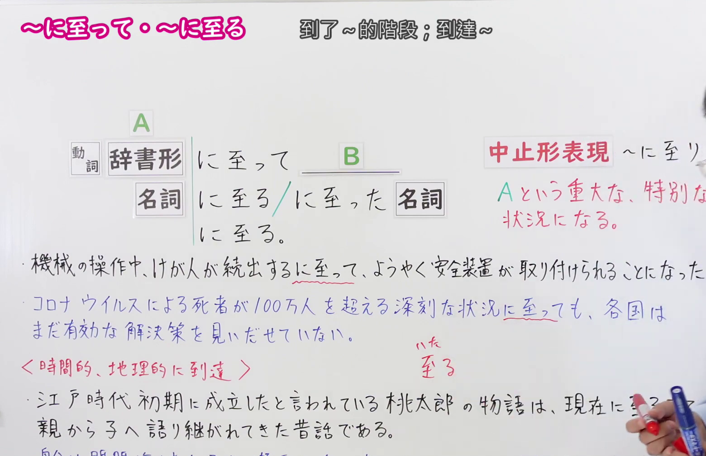
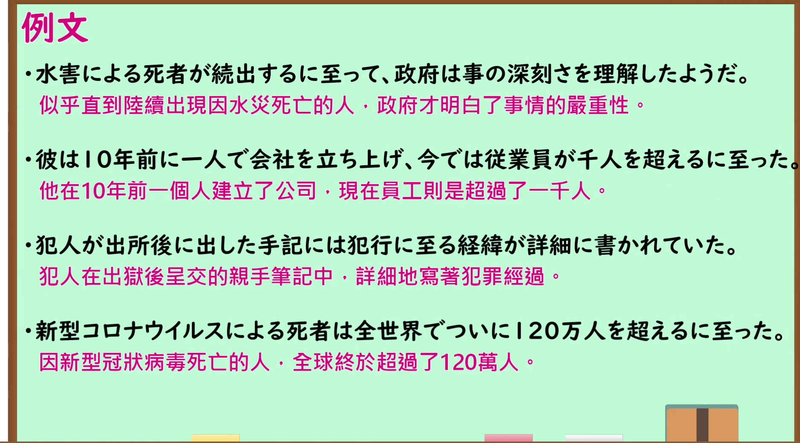

---
{
  "id": "N1-G-0063",
  "kind": "grammar",
  "level": "N1",
  "title": "に至って／に至る（到了…的阶段；到达…）",
  "card_revision": 1,
  "schema_version": 1,
  "source": {
    "lesson": "N1 第63个语法",
    "material": "出口日語原视频板书、日语自动字幕与 Hagoromo 文型検索正文",
    "video": "https://www.youtube.com/watch?v=Jmx2YdBTdAs",
    "screenshot": "assets/grammar/n1/N1-G-0063-connection.png",
    "screenshot_seconds": 150,
    "screenshot_crop": {
      "x": 0,
      "y": 0,
      "width": 1560,
      "height": 1010
    }
  },
  "tags": [
    "に至って",
    "に至る",
    "N1"
  ],
  "confusions": [
    "「に至って」前接动词辞书形或名词，表示事态终于发展到某种重大的、特别的状况；后项多为到了该状况才出现的应对，常带「ようやく／ついに」的语气",
    "前件多接重大的、特别的、深刻的等负面内容，不用于轻微的或正面的事态",
    "名词后接续时用「に至る＋名词」或「に至った＋名词」，句末用「に至る。」；中止形是「に至り」，比「に至って」更生硬",
    "「至る」本义是「到达」，也可表示时间上的到达（現在に至るまで）和地理上的到达（神戸港に至った），与文法用法不同",
    "派生形式「に至っても」「に至っては」由 Hagoromo 条目列出；「に至っては」本课未展开讲解"
  ]
}
---

# N1 第63个语法：に至って／に至る（到了…的阶段；到达…）

## 视频学习资料整理

原视频：[出口日語 N1 第63课「～に至って・～に至る」](https://www.youtube.com/watch?v=Jmx2YdBTdAs)（时长 6:10）

### 接续图（真实时间 2:30.00）

- 原图尺寸：1920×1080；裁切区域：x=0, y=0, width=1560, height=1010。
- 固定左上角、收拢右下角，裁去底部空白与右侧多余画面。
- 板书内容：接续「動詞辞書形＋に至って＋B」「名詞＋に至る／に至った＋名詞」「〜に至る。」，红色含义说明「Aという重大な、特別な状況になる。」，红色标注「中止形表現 〜に至り」，以及课程例句「機械の操作中、けが人が続出するに至って、ようやく安全装置が取り付けられることになった。」「コロナウイルスによる死者が100万人を超える深刻な状況に至っても、各国はまだ有効な解決策を見いだせていない。」，还有「＜時間的、地理的に到達＞」下的「江戸時代初期に成立したと言われている桃太郎の物語は、現在に至るまで親から子へ語り継がれてきた昔話である。」「船は関門海峡を通り、瀬戸内海を東に進んで、ついに神戸港に至った。」。
- 替换说明：0:01 与 0:29.67 时点的红色含义说明和中止形标注被教师头部遮挡，改用板书完整、教师让开的 2:30.00 时点；该时点仅最后一条例句右端的「至った。」被教师手中的笔遮挡，其余板书完整可读。

### 例句图（真实时间 4:30.28）

- 原图尺寸：1920×1080；裁切区域：x=10, y=10, width=1875, height=1040。
- 固定左上角、收拢右下角，裁去边框之外的画面。
- 板书内容：课程例句页的四条例句及其中文翻译。

# 核心

## 功能一：变成A这种重大的、特别的状况

**最上位意味カテゴリー：**

- **にいたって：** 場所・時間（地点与时间）

**中位意味カテゴリー：**

- **にいたって：** 起点・終点（起点与终点）

**意味：**

- **にいたって：** 終点（终点）

**くわしい意味記述：**

- **にいたって：** 「ある行為や出来事がついに〜になった」ことを表す。（表示「某个行为或事件终于变成了〜」。）

**派生語：** にいたっても，にいたっては

### 例句

1. 深夜に至って、会議の出席者にも疲れが見えてきた。

   （到了深夜，会议出席者也显出了疲态。）

2. 裁判が始まる段階に至っても、彼はまだ罪をみとめないつもりだろうか。

   （即使到了审判开始的阶段，他难道还打算不认罪吗？）

3. 事実、わが国の老年人口（六十五歳以上の人口）は戦後に至って急激に増加している。

   （事实上，我国的老年人口（六十五岁以上人口）到了战后急剧增加。）

4. ８９年後半に至っても、転換社債やワラント債の発行額、株式投信の設定額が高水準だったことをみても、依然として強い株価上昇期待が残っていたと考えられる。

   （即使到了89年下半年，从可转换公司债、认股权证债的发行额以及股票投资信托的设定额仍处于高水平来看，可以认为依然残留着强烈的股价上涨预期。）

5. ところで、最近に至って、米国のパソコンや情報関連製品が、そのソフト力と独創性を生かして日本市場で急速に競争力を発揮し始めた。

   （顺便一提，到了最近，美国的电脑及信息相关产品发挥其软件实力与独创性，开始在日本市场迅速展现出竞争力。）

# 来源

- [出口日語原视频](https://www.youtube.com/watch?v=Jmx2YdBTdAs)
- [Hagoromo 文型検索「にいたって」](https://www.hagoromo-text.work/lookup?vid=1213)（查询日期：2026-09-24）

