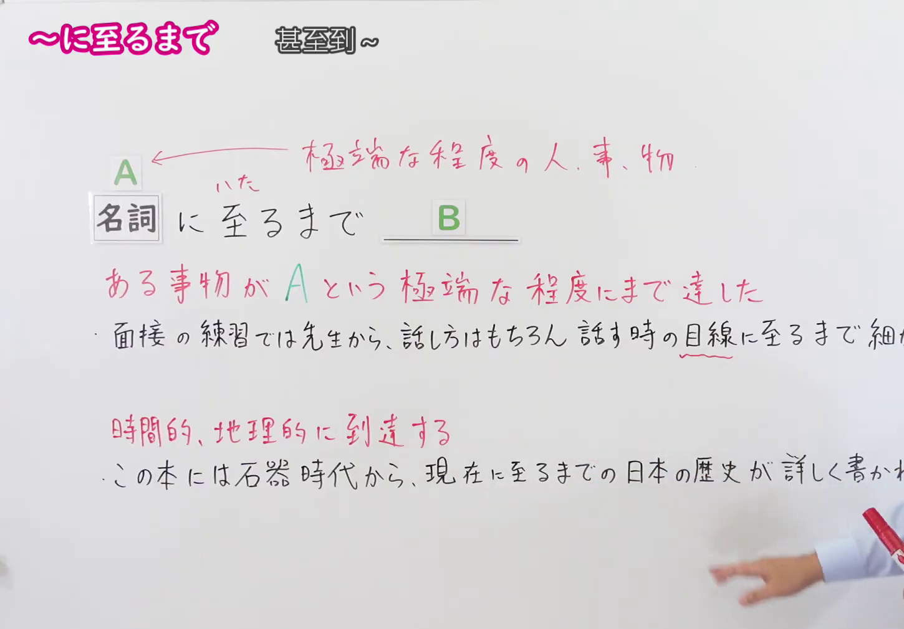
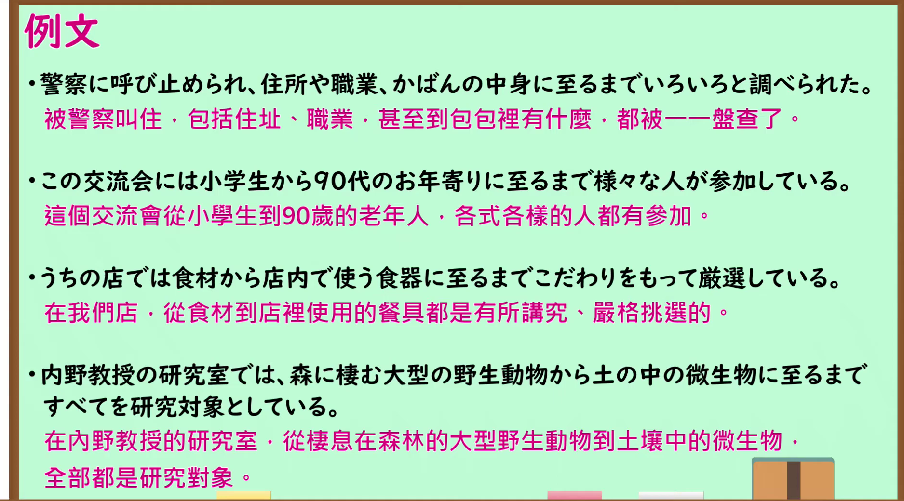

---
{
  "id": "N1-G-0064",
  "kind": "grammar",
  "level": "N1",
  "title": "に至るまで（甚至到…；达到…的程度）",
  "card_revision": 1,
  "schema_version": 1,
  "source": {
    "lesson": "N1 第64个语法",
    "material": "出口日語原视频板书、日语自动字幕与 Hagoromo 文型検索正文",
    "video": "https://www.youtube.com/watch?v=Dw3Wt7bs0BE",
    "screenshot": "assets/grammar/n1/N1-G-0064-connection.png",
    "screenshot_seconds": 120,
    "screenshot_crop": {
      "x": 0,
      "y": 0,
      "width": 1450,
      "height": 1010
    }
  },
  "tags": [
    "に至るまで",
    "N1"
  ],
  "confusions": [
    "「に至るまで」前接名词，表示事物的范围一直达到某个极端的程度，前件多为极端的人、事、物",
    "常与「〜から」呼应构成「〜から〜に至るまで」，表示从起点到极端的终点这整个范围；只保留「〜に至るまで」时句子也成立",
    "「至る」本义是「到达」，也可以表示时间上的到达（現在に至るまで）和地理上的到达（神戸港に至った），与文法用法不同",
    "与上一课的「〜に至って」用法不同：「に至って」表示事态终于发展到某种状况、后项多为应对措施；「に至るまで」表示范围达到极端程度"
  ]
}
---

# N1 第64个语法：に至るまで（甚至到…；达到…的程度）

## 视频学习资料整理

原视频：[出口日語 N1 第64课「～に至るまで」](https://www.youtube.com/watch?v=Dw3Wt7bs0BE)（时长 4:41）

### 接续图（真实时间 2:00.00）

- 原图尺寸：1920×1080；裁切区域：x=0, y=0, width=1450, height=1010。
- 固定左上角、收拢右下角，裁去底部空白与右侧多余画面。
- 板书内容：接续「名詞＋に至るまで＋B」（「至る」上方标有振假名「いた」），指向 A 的红色标注「極端な程度の人、事、物」，红色含义说明「ある事物が A という極端な程度にまで達した」，红色标注「時間的、地理的に到達する」，以及两条课程例句「面接の練習では先生から、話し方はもちろん、話すときの目線に至るまで細かく指導された。」「この本には石器時代から、現在に至るまでの日本の歴史が詳しく書かれている。」。
- 替换说明：0:01 与 0:49.96 时点两条例句与红色含义说明被教师头部遮挡，改用教师最靠右的 2:00.00 时点；该时点两条例句右端的「細かく指導された。」「詳しく書かれている。」被教师身体遮挡并落在裁切之外，右下角有教师手部的少许画面，其余板书完整可读。

### 例句图（真实时间 3:30.25）

- 原图尺寸：1920×1080；裁切区域：x=10, y=10, width=1875, height=1040。
- 固定左上角、收拢右下角，裁去边框之外的画面。
- 板书内容：课程例句页的四条例句及其中文翻译。

# 核心

## 功能一：某事物达到了A这种极端的程度

**最上位意味カテゴリー：**

- **（から）〜にいたるまで：** 場所・時間（地点与时间）

**中位意味カテゴリー：**

- **（から）〜にいたるまで：** 起点・終点（起点与终点）

**意味：**

- **（から）〜にいたるまで：** 範囲（范围）

**くわしい意味記述：**

- **（から）〜にいたるまで：** 物事の範囲があるところまで達したことを表す。極端なことを表す名詞とともに使う。（表示事物的范围一直达到了某个地步。与表示极端事物的名词一起使用。）

**派生語：** 未列出

### 例句

1. 国会議員は、財産から借金に至るまで明らかにしなければならない。

   （国会议员必须公开从财产到负债的一切。）

2. 人類がはじめて地球上に現われてから、現在に至るまで、性に関する基本的なことはほとんど変っていない。

   （人类自首次出现在地球上以来直到现在，与性相关的基本事项几乎没有改变。）

3. 戦後はおろか今日に至るまで、日本の国民大衆の貯蓄性向はきわめて高い。

   （岂止是战后，直到今天，日本国民大众的储蓄倾向都极高。）

4. 監獄では、人の生活はごくつまらない細部に至るまでびっしり予定に組み込まれており、いかなる種類の選択の余地もない。

   （在监狱里，人的生活连极琐碎的细节都被密密麻麻地编入预定日程，没有任何选择的余地。）

5. たとえばＦＩＳはいくつかのグループから成っているが、これらグループは献身の儀式の適切な作法から政府の適切な形式に至るまで、あらゆる問題について対立している。

   （例如FIS由若干个团体组成，这些团体在从献身仪式的恰当做法到政府的恰当形式等一切问题上都互相对立。）

# 来源

- [出口日語原视频](https://www.youtube.com/watch?v=Dw3Wt7bs0BE)
- [Hagoromo 文型検索「（から）〜にいたるまで」](https://www.hagoromo-text.work/lookup?vid=1218)（查询日期：2026-09-24）

