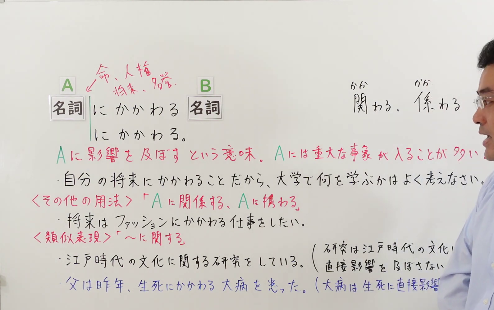
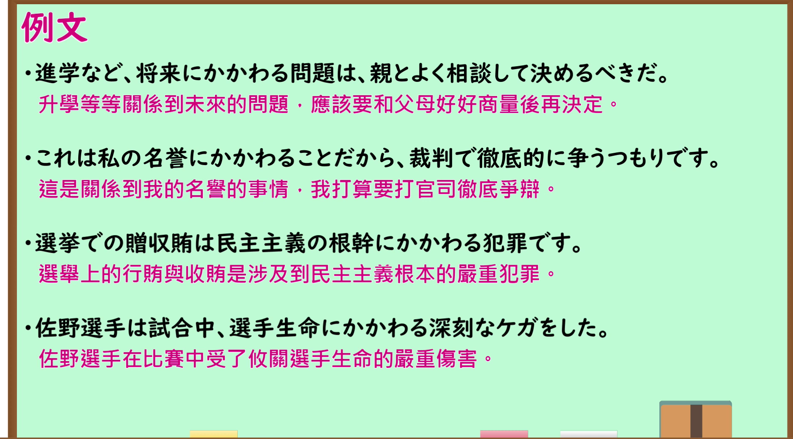

---
{
  "id": "N1-G-0065",
  "kind": "grammar",
  "level": "N1",
  "title": "にかかわる（关系到…；影响到…）",
  "card_revision": 1,
  "schema_version": 1,
  "source": {
    "lesson": "N1 第65个语法",
    "material": "出口日語原视频板书、日语自动字幕与 Hagoromo 文型検索正文",
    "video": "https://www.youtube.com/watch?v=wODZUb1UTDQ",
    "screenshot": "assets/grammar/n1/N1-G-0065-connection.png",
    "screenshot_seconds": 84,
    "screenshot_crop": {
      "x": 0,
      "y": 0,
      "width": 1590,
      "height": 1000
    }
  },
  "tags": [
    "にかかわる",
    "N1"
  ],
  "confusions": [
    "「にかかわる」前接名词，表示与该名词所代表的事物有重大关系、或会给它带来影响；A 多为生命、名誉、将来、机密这类重大的事或人",
    "与类似表达「〜に関する」不同：「〜に関する」只表示「与…有关」，不含直接影响重大事物的语感；板书对比「江戸時代の文化に関する研究をしている」不能用「関わる」",
    "「にかかわる」还有「Aに関係する、Aに接する」的用法，如「将来はファッションにかかわる仕事がしたい」；汉字可写作「関わる」「係わる」",
    "派生形式「にかかわらず」「にかかわりなく」表示「不论…」，与本课「にかかわる」的意义不同"
  ]
}
---

# N1 第65个语法：にかかわる（关系到…；影响到…）

## 视频学习资料整理

原视频：[出口日語 N1 第65课「～にかかわる」](https://www.youtube.com/watch?v=wODZUb1UTDQ)（时长 6:29）

### 接续图（真实时间 1:24.16）

- 原图尺寸：1920×1080；裁切区域：x=0, y=0, width=1590, height=1000。
- 固定左上角、收拢右下角，裁去底部空白与右侧多余画面。
- 板书内容：接续「名詞＋にかかわる＋名詞」「〜にかかわる。」，指向 A 的红色标注「命、人権／将来、勝負」，红色含义说明「Aに影響を及ぼすという意味。Aには重大な事や人であることが多い。」，红色标注「＜その他の用法＞「Aに関係する、Aに接する」」「＜類似表現＞「〜に関する」」及振假名标注「関わる、係わる」，还有课程例句「自分の将来にかかわることだから、大学で何を学ぶかはよく考えなさい。」「将来は ファッションにかかわる仕事がしたい。」「江戸時代の文化に関する研究をしている。（研究は江戸時代の文化に直接影響を及ぼさない）」「父は昨年、生死にかかわる 大病を患った。（大病は生死に直接影響を及ぼす）」。
- 替换说明：0:01 时点虽有粉红色标题「〜にかかわる」，但右侧含义说明与例句被教师身体遮挡；此后相机推近、标题移出画面。改用板书文字最完整、教师位于画面最右的 1:24.16 时点，该时点右侧边缘仍有教师面部的一小部分，右下角有教师肩部画面；两条例句的括号内说明被教师肩部遮挡。

### 例句图（真实时间 4:51.20）

- 原图尺寸：1920×1080；裁切区域：x=10, y=10, width=1875, height=1040。
- 固定左上角、收拢右下角，裁去边框之外的画面。
- 板书内容：课程例句页的四条例句及其中文翻译。

# 核心

## 功能一：表示给A带来影响，A多为重大的事情或人

**最上位意味カテゴリー：**

- **にかかわる：** ものごとの関係（事物之间的关系）

**中位意味カテゴリー：**

- **にかかわる：** 関連・対応（关联与对应）

**意味：**

- **にかかわる：** 関連（关联）

**くわしい意味記述：**

- **にかかわる：** 「前の名詞に関係・影響する」という意味。（表示「与前面的名词有关系、给其带来影响」。）

**派生語：** にかかわらず，にかかわりなく

### 例句

1. 人の名誉にかかわるようなことを軽々しく言うものではない。

   （不该轻率地说出有损他人名誉的话。）

2. こうして、あるニュースを読めば、それに関わるニュース、記事、図などのリンクもすぐ手に入れるようになった。

   （这样一来，读到某条新闻时，也能马上获得与之相关的新闻、报道、图表等链接。）

3. 今われわれは情報化時代にいる。何もかもがインターネットにかかわっている。

   （现在我们身处信息化时代。一切都与互联网相关。）

4. それから、この点も「聴解」にかかわる。

   （而且，这一点也与「听力」相关。）

# 来源

- [出口日語原视频](https://www.youtube.com/watch?v=wODZUb1UTDQ)
- [Hagoromo 文型検索「にかかわる」](https://www.hagoromo-text.work/lookup?vid=1231)（查询日期：2026-09-24）

