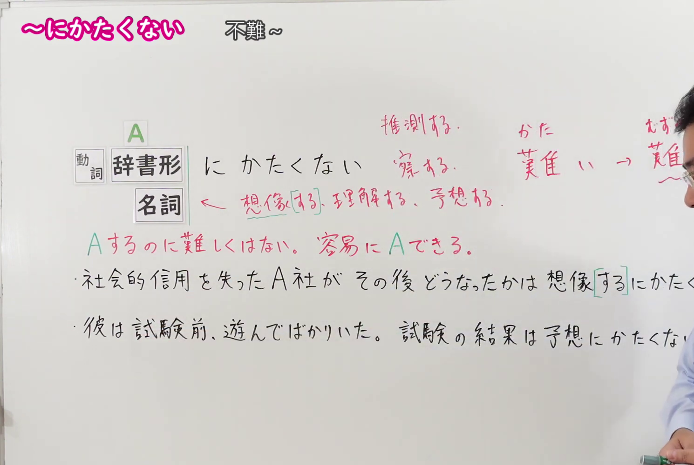
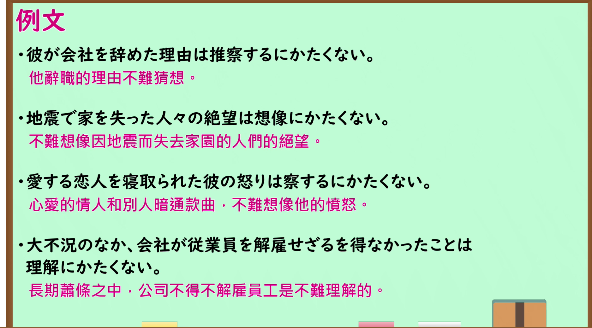

---
{
  "id": "N1-G-0066",
  "kind": "grammar",
  "level": "N1",
  "title": "にかたくない（不难…；可以轻易地…）",
  "card_revision": 1,
  "schema_version": 1,
  "source": {
    "lesson": "N1 第66个语法",
    "material": "出口日語原视频板书、日语自动字幕与 Hagoromo 文型検索正文",
    "video": "https://www.youtube.com/watch?v=s8QdXDh4MNM",
    "screenshot": "assets/grammar/n1/N1-G-0066-connection.png",
    "screenshot_seconds": 200,
    "screenshot_crop": {
      "x": 0,
      "y": 0,
      "width": 1490,
      "height": 1000
    }
  },
  "tags": [
    "にかたくない",
    "N1"
  ],
  "confusions": [
    "「にかたくない」前接名词或动词辞书形＋に，能进入这个位置的词很有限，主要是「想像・理解・推測・察する・予想」等，其中「想像」占一半以上",
    "「かたくない」的「かた」是「難い」而不是「硬い」，「にかたくない」＝「するのに難しくはない」；现代日语多说「難しい」，这是生硬的书面表达",
    "「想像するにかたくない」中的「する」可以省略，说成「想像にかたくない」",
    "该形式表示从某种状况出发自然能推断出的结果，本课与 Hagoromo 的例句多为绝望、愤怒、心劳、苦劳等令人同情的事态"
  ]
}
---

# N1 第66个语法：にかたくない（不难…；可以轻易地…）

## 视频学习资料整理

原视频：[出口日語 N1 第66课「～にかたくない」](https://www.youtube.com/watch?v=s8QdXDh4MNM)（时长 5:31）

### 接续图（真实时间 3:20.00）

- 原图尺寸：1920×1080；裁切区域：x=0, y=0, width=1490, height=1000。
- 固定左上角、收拢右下角，裁去底部空白与右侧多余画面。
- 板书内容：接续「動詞辞書形＋にかたくない」「名詞＋にかたくない」（「にかたくない」上方标有振假名），红色含义说明「Aするのに難しくはない。容易に Aできる。」，指向接续位的红色熟语标注「推測する、察する」「想像する、理解する、予想する」，以及词源标注「かつ／難い → むずかしい」和两条课程例句「社会的信用を失ったA社がその後どうなったかは想像するにかたくない。」「彼は試験前、遊んでばかりいた。試験の結果は予想にかたくない。」。
- 替换说明：0:01、1:25.82、2:50.00 各时点板书尚未写全或被教师手臂遮挡，改用板书写全、教师让开的 3:20.00 时点；该时点两条例句右端被教师身体遮挡并落在裁切之外，词源标注末尾的「むずかしい」被教师头部遮挡（无法通过裁切恢复），其余板书完整可读。

### 例句图（真实时间 4:07.62）

- 原图尺寸：1920×1080；裁切区域：x=10, y=10, width=1875, height=1040。
- 固定左上角、收拢右下角，裁去边框之外的画面。
- 板书内容：课程例句页的四条例句及其中文翻译。

# 核心

## 功能一：做A并不难，能够轻易地做到A

**最上位意味カテゴリー：**

- **にかたくない：** ものごとの様子（事物的样子）

**中位意味カテゴリー：**

- **にかたくない：** 可能・難易（可能与难易）

**意味：**

- **にかたくない：** 可能：容易（可能：容易）

**くわしい意味記述：**

- **にかたくない：** 「ある状況から判断して，簡単に〜できる」という意味を表す。「想像にかたくない」「理解にかたくない」という形でよく使われる。（表示「根据某种状况来判断，可以轻易地做到〜」。常用「想像にかたくない」「理解にかたくない」的形式。）

**派生語：** 未列出

### 例句

1. 父の死後、母がどんなに苦労したか想像にかたくない。

   （父亲去世后，母亲吃了多少苦，不难想象。）

2. こうしたことをされた外国人の迷惑は想像にかたくない。

   （被这样对待的外国人的困扰，不难想象。）

3. 睡魔とたたかうことが、禅僧のたいせつなつとめであることは、理解にかたくない。

   （与睡魔斗争是禅僧重要的职责，这一点不难理解。）

4. 「医療の専門知識を持つ医師らに、真実を隠された遺族の心労が大きいことは推測に難くない」と病院トップによる医療ミス隠しを厳しく非難した。

   （“被拥有医疗专业知识的医生们隐瞒了真相的遗属，其心力交瘁之大不难推测”——（报道）如此严厉谴责医院高层隐瞒医疗事故的行为。）

# 来源

- [出口日語原视频](https://www.youtube.com/watch?v=s8QdXDh4MNM)
- [Hagoromo 文型検索「にかたくない」](https://www.hagoromo-text.work/lookup?vid=1240)（查询日期：2026-09-24）

