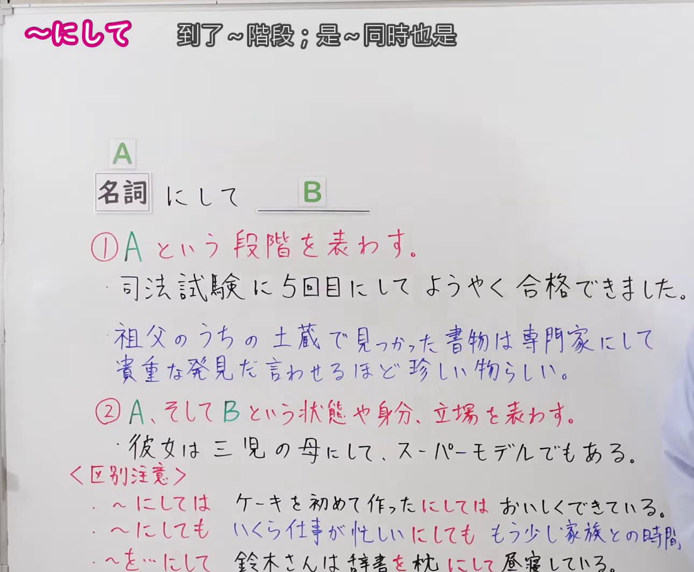
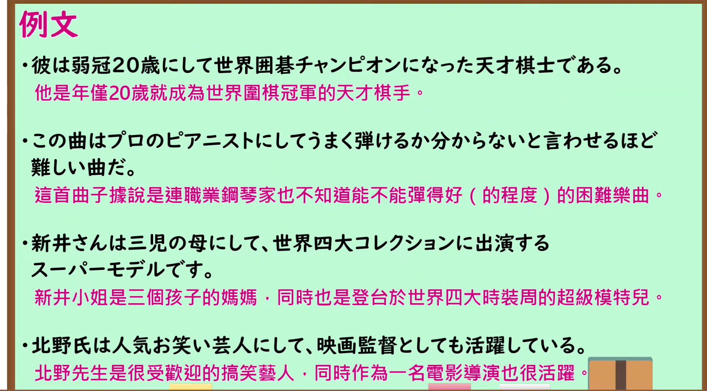

---
{
  "id": "N1-G-0067",
  "kind": "grammar",
  "level": "N1",
  "title": "にして（到了…阶段；既是…同时也是…）",
  "card_revision": 1,
  "schema_version": 1,
  "source": {
    "lesson": "N1 第67个语法",
    "material": "出口日語原视频板书、日语自动字幕与 Hagoromo 文型検索正文",
    "video": "https://www.youtube.com/watch?v=FlPrxmLRwYw",
    "screenshot": "assets/grammar/n1/N1-G-0067-connection.png",
    "screenshot_seconds": 1,
    "screenshot_crop": {
      "x": 0,
      "y": 0,
      "width": 1290,
      "height": 1065
    }
  },
  "tags": [
    "にして",
    "N1"
  ],
  "confusions": [
    "「にして」前接名词，本课有两个用法：①表示到达某个阶段（Aという段階）；②表示两个状态、身份、立场并存（AにしてB＝既是A也是B）",
    "用法①常与「ようやく」「初めて」呼应，表示经过很长时间或多次之后才实现；Hagoromo 的 #116 与 #1269 表达同一功能（到达某阶段后才有某事发生／才能做到），本条合并为一个功能",
    "与「〜にしては」（从…来看与预想不同）、「〜にしても」（即使…也／不论…都）、「〜を〜にして」（把…当作…）是不同用法，视频板书专设〈区別注意〉提示",
    "用法②把两个要素作为一个整体来把握，多用于介绍兼具两种身份的人物；也可接形容动词词干，如「荘重にして冗長」"
  ]
}
---

# N1 第67个语法：にして（到了…阶段；既是…同时也是…）

## 视频学习资料整理

原视频：[出口日語 N1 第67课「～にして」](https://www.youtube.com/watch?v=FlPrxmLRwYw)（时长 5:12）

本课把「〜にして」分为两个用法讲解：①表示到达某个阶段（Aという段階）；②表示两个状态、身份、立场并存（A、そしてBという状態や身分、立場）。

### 接续图（真实时间 0:01.00）

- 原图尺寸：1920×1080；裁切区域：x=0, y=0, width=1290, height=1065。
- 固定左上角、收拢右下角，裁去右侧多余画面。
- 板书内容：接续「名詞＋にして＋B」，红色含义说明①「Aという段階を表わす。」与②「A、そしてBという状態や身分、立場を表わす。」，四条课程例句「司法試験に5回目にしてようやく合格できました。」「祖父のうちの土蔵で見つかった書物は専門家にして貴重な発見だ言わせるほど珍しい物らしい。」「彼女は三児の母にして、スーパーモデルでもある。」，以及〈区別注意〉的「〜にしては」「〜にしても」「〜を〜にして」三组对比句。
- 替换说明：采用板书写全之初的 0:01.00 时点；该时点右侧除教师身体遮挡处的〈区別注意〉「〜にしても」句尾与「〜を〜にして」句尾外，板书完整可读。

### 例句图（真实时间 3:38.36）

- 原图尺寸：1920×1080；裁切区域：x=10, y=10, width=1875, height=1040。
- 固定左上角、收拢右下角，裁去边框之外的画面。
- 板书内容：课程例句页的四条例句及其中文翻译。

# 核心

## 功能一：表示到达某个阶段

**最上位意味カテゴリー：**

- **N＋にして（Hagoromo #116）：** ものごとの関係（事物之间的关系）
- **にして（Hagoromo #1269）：** 考え・感情（思考与感情）

**中位意味カテゴリー：**

- **N＋にして（Hagoromo #116）：** 基準（基准）
- **にして（Hagoromo #1269）：** 主張・断定的評価（主张・断定性评价）

**意味：**

- **N＋にして（Hagoromo #116）：** 評価（评价）
- **にして（Hagoromo #1269）：** 評価（评价）

**くわしい意味記述：**

- **N＋にして（Hagoromo #116）：** ある段階に到達して初めて何かが起こったことを表す。（表示到达某个阶段之后，某事才第一次发生。）
- **にして（Hagoromo #1269）：** ある段階に至ってはじめて何かができるようになったことを表す。「Nにしてようやく」「Nにして初めて」のように用いられることが多い。（表示到达某个阶段之后，才终于能够做到某事。多用于「Nにしてようやく」「Nにして初めて」这样的形式。）

**派生語：** 未列出

### 例句

1. これはあの人にして初めてできることだ。

   （这是只有他才能做到的事。）

2. 五十歳にして初めて登山靴をはいた。

   （到了五十岁才第一次穿上登山鞋。）

3. ４０歳にしてようやく人の気持ちがわかるようになった。

   （到了四十岁才终于懂得别人的心情。）

## 功能二：表示两个状态、身份、立场

**最上位意味カテゴリー：**

- **にして（Hagoromo #1270）：** ものごとの関係（事物之间的关系）

**中位意味カテゴリー：**

- **にして（Hagoromo #1270）：** 並列・反復（并列・反复）

**意味：**

- **にして（Hagoromo #1270）：** 並立・列挙（并立・列举）

**くわしい意味記述：**

- **にして（Hagoromo #1270）：** 「〜でもあり，〜でもある」という意味。２つの要素をより一体的に捉える表現。（意为「既是〜也是〜」。是把两个要素作为一个整体来把握的表达。）

**派生語：** 未列出

### 例句

1. 田中氏は教師にして作家である。

   （田中先生既是教师，也是作家。）

2. これが最初にして最大の難関。

   （这是最初也是最大的难关。）

3. かつての軍隊では、部隊の配置が変わったような場合、新しい長官の前にいってやる申告というものをやったが、荘重にして冗長なものだった。

   （过去的军队在部队编制变动等情况下，要到新长官面前做一种申报，那种申报既庄重又冗长。）

# 来源

- [出口日語原视频](https://www.youtube.com/watch?v=FlPrxmLRwYw)
- [Hagoromo 文型検索「N＋にして」](https://www.hagoromo-text.work/lookup?vid=116)（查询日期：2026-09-24）
- [Hagoromo 文型検索「にして」（評価）](https://www.hagoromo-text.work/lookup?vid=1269)（查询日期：2026-09-24）
- [Hagoromo 文型検索「にして」（並立・列挙）](https://www.hagoromo-text.work/lookup?vid=1270)（查询日期：2026-09-24）

