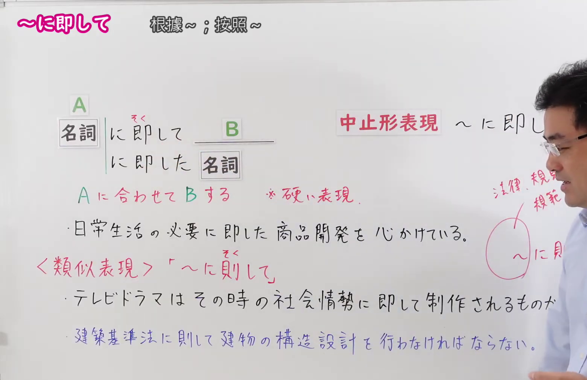
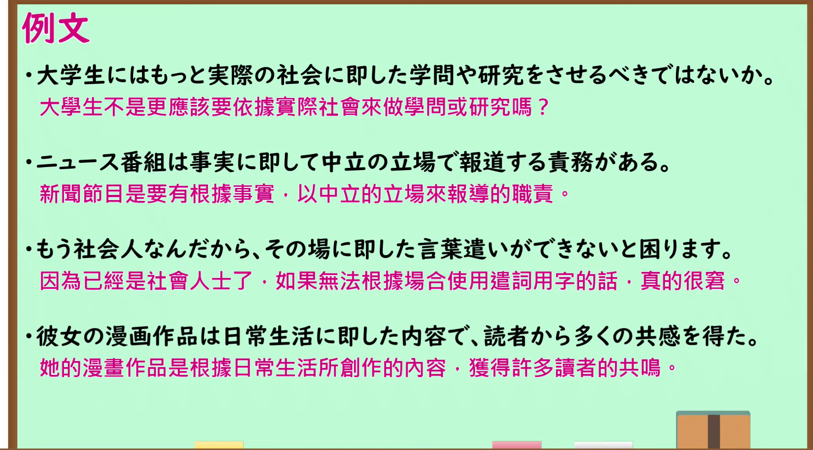

---
{
  "id": "N1-G-0068",
  "kind": "grammar",
  "level": "N1",
  "title": "に即して（根据…；按照…）",
  "card_revision": 1,
  "schema_version": 1,
  "source": {
    "lesson": "N1 第68个语法",
    "material": "出口日語原视频板书、日语自动字幕与 Hagoromo 文型検索正文",
    "video": "https://www.youtube.com/watch?v=OW7LwiETSJg",
    "screenshot": "assets/grammar/n1/N1-G-0068-connection.png",
    "screenshot_seconds": 167,
    "screenshot_crop": {
      "x": 0,
      "y": 0,
      "width": 1560,
      "height": 1010
    }
  },
  "tags": [
    "に即して",
    "N1"
  ],
  "confusions": [
    "「に即して」前接名词，表示以某种状况或事物为依据、与之相配合地做某事；常与「実態・実情・現実・事実・事例」「計画・指針・方針」等词搭配",
    "后接名词时用「に即した＋名词」，中止形是「に即し」，比「に即して」更生硬",
    "「即」读作「そく」，在书写上以写成汉字为好",
    "与同音的相似表达「〜に則して」的区别：接「社会情勢」等状况时用「即」（テレビドラマはその時の社会情勢に即して制作される），接「法律・規則・規範・方針」等规则、规范时多用「則」（建築基準法に則して建物の構造設計を行う），板书把「法律、規範」与「〜に則」圈在一起提示这一点"
  ]
}
---

# N1 第68个语法：に即して（根据…；按照…）

## 视频学习资料整理

原视频：[出口日語 N1 第68课「～に即して」](https://www.youtube.com/watch?v=OW7LwiETSJg)（时长 5:08）

### 接续图（真实时间 2:47.54）

- 原图尺寸：1920×1080；裁切区域：x=0, y=0, width=1560, height=1010。
- 固定左上角、收拢右下角，裁去底部空白与右侧多余画面。
- 板书内容：接续「名詞＋に即して＋B」「に即した＋名詞」（「即」上方标有振假名「そく」），红色说明「中止形表現 〜に即し」与「Aに合わせてBする ※硬い表現」，以及课程例句「日常生活の必要に即した商品開発を心がけている。」和〈類似表現〉下的「テレビドラマはその時の社会情勢に即して制作されるものが多い。」「建築基準法に則して建物の構造設計を行わなければならない。」，右侧还有把「法律、規範」与「〜に則」圈在一起的红色标注。
- 替换说明：0:01 时点板书尚未写全、教师位于画面中部，改用板书写全的 2:47.54 时点；该时点右侧边缘仍有教师面部的一小部分与右下角肩部画面。

### 例句图（真实时间 3:30.49）

- 原图尺寸：1920×1080；裁切区域：x=10, y=10, width=1875, height=1040。
- 固定左上角、收拢右下角，裁去边框之外的画面。
- 板书内容：课程例句页的四条例句及其中文翻译。

# 核心

## 功能一：按照A来做B（生硬的表达）

**最上位意味カテゴリー：**

- **にそくして：** ものごとの関係（事物之间的关系）

**中位意味カテゴリー：**

- **にそくして：** 基準（基准）

**意味：**

- **にそくして：** 判断基準（判断基准）

**くわしい意味記述：**

- **にそくして：** 「〜に合わせて」「〜に従って」という意味を表す。判断や行動をするときの拠り所を示す。「実態，実情，現実，事実，事例」「計画，指針，方針」といった言葉とともによく使われる。（表示「配合〜」「按照〜」。指出做判断或采取行动时的依据。常与「実態，実情，現実，事実，事例」「計画，指針，方針」等词一起使用。）

**派生語：** にそくし，にそくした，にそくしては，にそくしても，

### 例句

1. 何事も、規定に即して処理する。

   （任何事情都按照规定来处理。）

2. アナウンサーは、場面に即した応答が求められる。

   （播音员需要做出与场面相应的应答。）

3. ふたたび私的な体験に即して、この当時をふりかえってみたい。

   （我想再次结合自身的私人体验，来回顾这个时期。）

4. しかし、こういう時にこそ、社会の底流に流れる人々の文化志向と企業の存在との関係を時代の変化に即して考えてみる必要があろう。

   （然而正是在这种时候，才有必要结合时代的变化，来思考社会底层流动的人们的文化取向与企业存在之间的关系。）

5. 例えば、女性による地域活動、再開発による新しいまちづくり等をテーマにしながら、それぞれのテーマに即して防災を考えていこうという試みを行っている。

   （例如，以女性参与的地区活动、通过再开发建设新街区等为主题，正在开展结合各自主题来思考防灾的尝试。）

# 来源

- [出口日語原视频](https://www.youtube.com/watch?v=OW7LwiETSJg)
- [Hagoromo 文型検索「にそくして」](https://www.hagoromo-text.work/lookup?vid=1371)（查询日期：2026-09-24）

