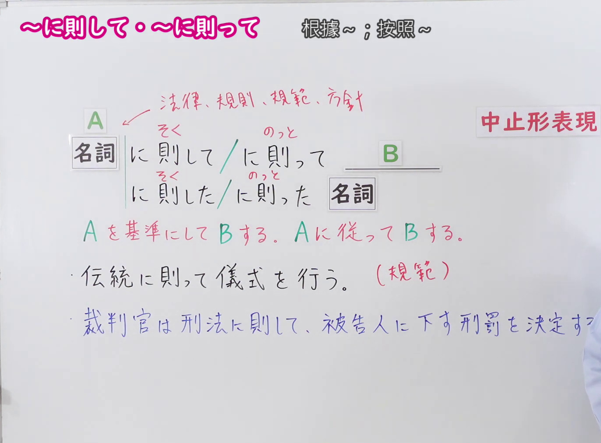

---
{
  "id": "N1-G-0069",
  "kind": "grammar",
  "level": "N1",
  "title": "に則って（根据…；依照…）",
  "card_revision": 1,
  "schema_version": 1,
  "source": {
    "lesson": "N1 第69个语法",
    "material": "出口日語原视频板书、日语自动字幕与 Hagoromo 文型検索正文",
    "video": "https://www.youtube.com/watch?v=5HXMqwTE6S4",
    "screenshot": "assets/grammar/n1/N1-G-0069-connection.png",
    "screenshot_seconds": 190,
    "screenshot_crop": {
      "x": 0,
      "y": 0,
      "width": 1372,
      "height": 1010
    }
  },
  "tags": [
    "に則って",
    "にのっとって",
    "N1"
  ],
  "confusions": [
    "「に則って」前接名词，表示以法律、规则、规范、方针等为依据来做某事；板书把〈法律、規則、規範、方針〉圈注在 A 的位置",
    "「則」读作「のっと」（训读），与上一课「に即して」的「即＝そく」（音读）读音不同，两者意思几乎相同，本课板书把「に則して」和「に則って」并列在一起",
    "后接名词时用「に則った＋名词」，也写作「に則した」；中止形是「に則り」，也写作「に則し」，比「に則って」更生硬",
    "「に則って」是生硬的书面表达，多用于法律条文、白书、新闻等正式文体"
  ]
}
---

# N1 第69个语法：に則って（根据…；依照…）

## 视频学习资料整理

原视频：[出口日語 N1 第69课「～に則って」](https://www.youtube.com/watch?v=5HXMqwTE6S4)（时长 4:58）

### 接续图（真实时间 3:10.00）

- 原图尺寸：1920×1080；裁切区域：x=0, y=0, width=1372, height=1010。
- 固定左上角、收拢右下角，裁去底部空白与右侧多余画面。
- 板书内容：接续「名詞＋に則して（そく）／に則って（のっと）＋B」「に則した（そく）／に則った（のっと）＋名詞」（两种读法上方都标有振假名），指向 A 的红色标注「法律、規則、規範、方針」，红色说明「中止形表現」与「Aを基準にしてBする。Aに従ってBする。」，以及两条课程例句「伝統に則って儀式を行う。（規範）」「裁判官は刑法に則して、被告人に下す刑罰を決定する。」。
- 替换说明：0:01、1:51.31 时点红色标注或例句被教师遮挡，改用板书写全的 3:10.00 时点；该时点右下角有教师肩部的少量画面，第二条例句句尾的「する。」被教师身体遮挡。

### 例句图（真实时间 3:20.23）

- 原图尺寸：1920×1080；裁切区域：x=10, y=10, width=1875, height=1040。
- 固定左上角、收拢右下角，裁去边框之外的画面。
- 板书内容：课程例句页的四条例句及其中文翻译。

# 核心

## 功能一：以A为基准做B。按照A做B

**最上位意味カテゴリー：**

- **Nにのっとって：** ものごとの関係（事物之间的关系）

**中位意味カテゴリー：**

- **Nにのっとって：** 基準（基准）

**意味：**

- **Nにのっとって：** 根拠（根据、依据）

**くわしい意味記述：**

- **Nにのっとって：** Nにしたがってという意味を表す。（表示「按照N、依照N」的意思。）

**派生語：** にのっとり，にのっとった

### 例句

1. 選手たちはルールにのっとって正々堂々と戦った。

   （选手们按照规则堂堂正正地比赛。）

2. 集団生活が基本の学校生活を、校則にのっとって生活するのはもちろんだ。

   （以集体生活为基本的学校生活，按校规生活自不必说。）

3. 「大学を卒業したらすぐに就職するべきだ」なんて、法でもルールでもないのに、私たちは知らず知らずにそれにのっとって生きていると思う。

   （“大学一毕业就该马上就业”这种话，既不是法律也不是规则，但我们却在不知不觉中依照它生活着。）

4. 国及び地方公共団体は、それぞれ基本理念にのっとって高齢社会対策を策定し、実施する責務があるとするとともに、国民の努力についても規定している。

   （国家和地方公共团体有责任分别依照基本理念制定并实施高龄社会对策，同时也对国民应做的努力作出了规定。）

# 来源

- [出口日語原视频](https://www.youtube.com/watch?v=5HXMqwTE6S4)
- [Hagoromo 文型検索「Nにのっとって」](https://www.hagoromo-text.work/lookup?vid=2034)（查询日期：2026-09-24）

