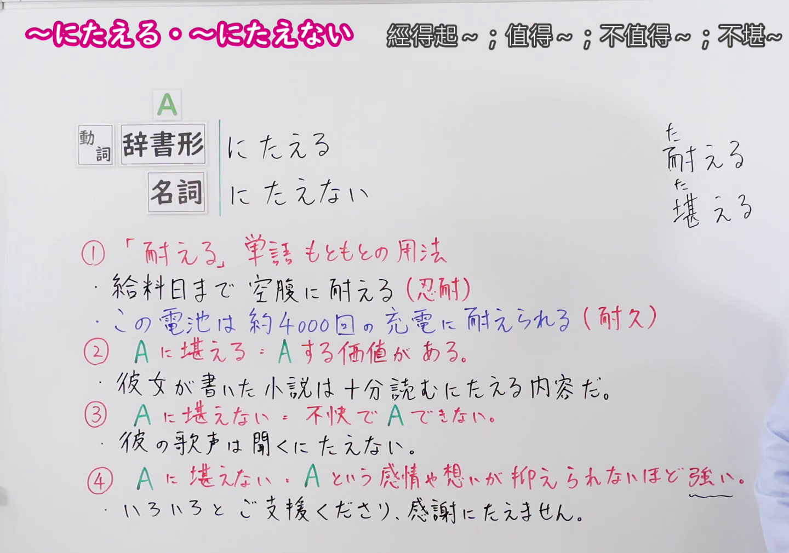
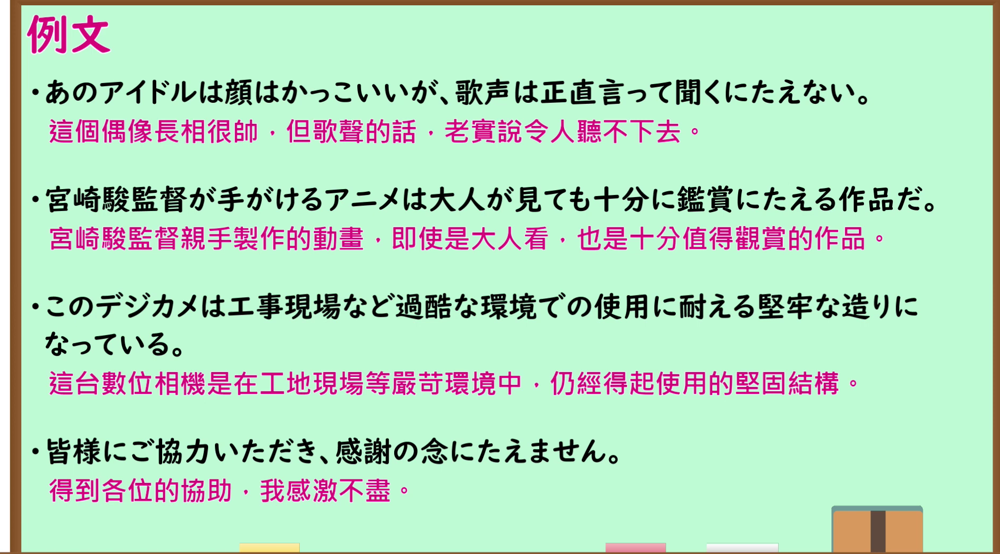

---
{
  "id": "N1-G-0070",
  "kind": "grammar",
  "level": "N1",
  "title": "にたえる／にたえない（经得起…；值得…；不堪…；不胜…）",
  "card_revision": 1,
  "schema_version": 1,
  "source": {
    "lesson": "N1 第70个语法",
    "material": "出口日語原视频板书、日语自动字幕与 Hagoromo 文型検索正文、毎日のんびり日本語教師正文",
    "video": "https://www.youtube.com/watch?v=uzlbp-VVi4w",
    "screenshot": "assets/grammar/n1/N1-G-0070-connection.png",
    "screenshot_seconds": 235,
    "screenshot_crop": {
      "x": 0,
      "y": 0,
      "width": 1440,
      "height": 1010
    }
  },
  "tags": [
    "にたえる",
    "にたえない",
    "N1"
  ],
  "confusions": [
    "板书①「給料日まで空腹に耐える（忍耐）」「約4000回の充電に耐えられる（耐久）」是动词「耐える」本身的用法，老师说明它不属于本课语法；本课语法是板书②③④",
    "②「Aにたえる」＝Aする価値がある（值得…）；③「Aにたえない」＝不快でAできない（不堪…）；④「Aにたえない」＝Aという感情が抑えられない（不胜…）。三者意思不同，要按前件和肯否判断",
    "③多接「見る・聞く・読む・正視する」等动词，④只接「感謝・感激・遺憾・反省・同情」等感情名词，属惯用表达",
    "表示忍耐、耐久时常用汉字「耐える」；③④这两种文法用法实际上多以平假名写「たえる／たえない」，也可写作「堪える／堪えない」"
  ]
}
---

# N1 第70个语法：にたえる／にたえない（经得起…；值得…；不堪…；不胜…）

## 视频学习资料整理

原视频：[出口日語 N1 第70课「～にたえる・～にたえない」](https://www.youtube.com/watch?v=uzlbp-VVi4w)（时长 5:42）

板书按①〜④列出四种用法。其中①是动词「耐える」本身的用法（忍耐・耐久），老师说明它不算本课语法，因此不进入「核心」；本课语法是②③④，对应下面三个功能。

### 接续图（真实时间 3:55.00）

- 原图尺寸：1920×1080；裁切区域：x=0, y=0, width=1440, height=1010。
- 固定左上角、收拢右下角，裁去底部空白与右侧多余画面。
- 板书内容：接续「動詞辞書形＋にたえる」「名詞＋にたえない」，右上角振假名标注「た／耐える」「た／堪える」，红色四条说明①「「耐える。」単語もともとの用法」（例句「給料日まで空腹に耐える（忍耐）」「この電池は約4000回の充電に耐えられる（耐久）」）、②「Aに堪える。Aする価値がある。」（例句「彼女が書いた小説は十分読むにたえる内容だ。」）、③「Aに堪えない。不快でAできない。」（例句「彼の歌声は聞くにたえない。」）、④「Aに堪えない。Aという感情や想いが抑えられないほど強い。」（例句「いろいろとご支援くださり、感謝にたえません。」）。
- 替换说明：0:01、1:55.50 时点教师站在板书中部，②③④各行右端被遮挡，改用教师站到最右、板书全部可见的 3:55.00 时点；裁切右缘止于标题「不堪〜」之后，标题最后的「；〜不盡」与右下角教师肩部的少量画面在裁切之外，四条红色说明与全部例句完整可读。

### 例句图（真实时间 4:15.93）

- 原图尺寸：1920×1080；裁切区域：x=10, y=10, width=1875, height=1040。
- 固定左上角、收拢右下角，裁去边框之外的画面。
- 板书内容：课程例句页的四条例句及其中文翻译，分别对应③、②、①、④四种用法。

# 核心

## 功能一：A值得做，做A有价值

**最上位意味カテゴリー：**

- **にたえる：** 考え・感情（思考与感情）

**中位意味カテゴリー：**

- **にたえる：** 主張・断定的評価（主张・断定性评价）

**意味：**

- **にたえる：** 価値がある（有价值）

**くわしい意味記述：**

- **にたえる：** あることを行うだけの価値があることを表す。（表示做某事具有足够的价值。）

**派生語：** 未列出

### 例句

1. 鑑賞にたえる絵を描くのは容易なことではない。

   （画出值得鉴赏的画并非易事。）

2. 聞くにたえる歌を歌ってほしい。

   （希望他唱出值得听的歌。）

3. そのなかで鑑賞にたえる挿画を描いて抜群の技倆をあらわしたのが、江戸の菱川師宣だった。

   （其中画出值得鉴赏的插图、展现出超凡技艺的，就是江户的菱川师宣。）

## 功能二：情况糟糕到令人不快，无法继续做A

**最上位意味カテゴリー：**

- **にたえない：** 考え・感情（思考与感情）

**中位意味カテゴリー：**

- **にたえない：** 主張・断定的評価（主张・断定性评价）

**意味：**

- **にたえない：** 不可能（不可能）

**くわしい意味記述：**

- **にたえない（Hagoromo #1297）：** あまりにひどい状態で，その動作・行為ができない状況であることを表す。「聞く」「見る」など，限られた動詞に用いる。（表示状态过于糟糕，以致无法进行该动作、行为。只用于「聞く」「見る」等少数动词。）
- **にたえない（毎日のんびり日本語教師 用法②）：** 状況がひどいため見続けたり、聞き続けたりすることができないことを表します。「見る」「読む」などの限られた語に接続します。漢字は「堪えない」です。（表示因情况糟糕而无法继续看下去、听下去。只接「見る」「読む」等少数词。汉字写作「堪えない」。）

**派生語：** 未列出

### 例句

1. 彼らは大声で聞くにたえない歌を歌っていた。

   （他们大声唱着不堪入耳的歌。）

2. 最近のテレビ番組は見るに堪えない。

   （最近的电视节目不堪入目。）

3. この映画とても生々しく正視にたえない。

   （这部电影拍得太过真实，让人不堪直视。）

4. この本の内容は稚拙で読むに堪えない。

   （这本书的内容幼稚得让人读不下去。）

## 功能三：A这种感情或想法强烈到无法抑制

**くわしい意味記述：**

- **にたえない（毎日のんびり日本語教師 用法①）：** 感謝、感激、喜び、～の念、などの特定の語につき、その感情を抑えることができないことを表します。硬めの表現です。漢字は「堪えない」です。（接「感謝、感激、喜び、〜の念」等特定词，表示无法抑制那种感情。是较生硬的表达。汉字写作「堪えない」。）

### 例句

1. 貴重なお話を聴くことができて感謝にたえません。

   （能够听到您宝贵的讲话，不胜感激。）

2. このような結論に至り、遺憾に堪えません。

   （得出这样的结论，本人不胜遗憾。）

3. 全て私の不徳の致すところであり、反省の念に堪えません。

   （这全是我自己品行不端所致，不胜反省。）

4. 突然の訃報に接し、悲しみの念に堪えません。

   （突然接到讣告，不胜悲痛。）

# 来源

- [出口日語原视频](https://www.youtube.com/watch?v=uzlbp-VVi4w)
- [Hagoromo 文型検索「にたえる」](https://www.hagoromo-text.work/lookup?vid=1299)（查询日期：2026-09-24）
- [Hagoromo 文型検索「にたえない」](https://www.hagoromo-text.work/lookup?vid=1297)（查询日期：2026-09-24）
- [毎日のんびり日本語教師「【Ｎ１文法】～にたえない（堪えない）」](https://mainichi-nonbiri.com/grammar/n1-nitaenai/)（查询日期：2026-09-24）

