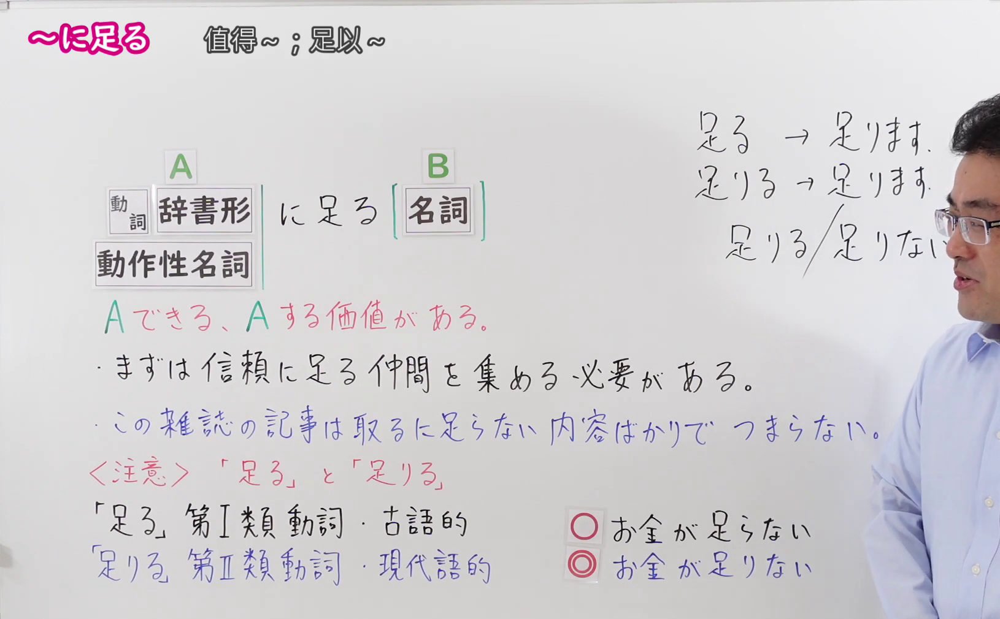
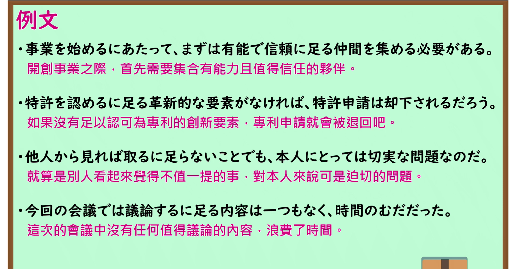

---
{
  "id": "N1-G-0071",
  "kind": "grammar",
  "level": "N1",
  "title": "～に足る：值得～；足以～",
  "card_revision": 1,
  "schema_version": 1,
  "source": {
    "lesson": "N1 第71个语法",
    "material": "出口日語原视频板书、日语自动字幕与 Hagoromo 文型检索正文",
    "video": "https://www.youtube.com/watch?v=tVT8FHHVzRw",
    "screenshot": "assets/grammar/n1/N1-G-0071-connection.png",
    "screenshot_seconds": 264.0,
    "screenshot_crop": {
      "x": 0,
      "y": 0,
      "width": 1630,
      "height": 1010
    }
  },
  "tags": [
    "主張・断定的評価",
    "N1"
  ],
  "confusions": [
    "～に足りる（「足る」为第I类古语动词，语法句型修饰名词固定用「～に足る」；「足りる」为第II类现代动词，口语肯定多用「足りる」，否定时「足らない」与「足りない」皆可）",
    "～に値する（同样表示“值得”，～に値する侧重具备相当的价值或资格，书面语色彩更浓；～に足る多用于信任、评价或固定搭配如“取るに足らない”）"
  ]
}
---

# N1 第71个语法：～に足る

# 视频学习资料整理

- 课程：[出口日語「【Ｎ１文法】～に足る」](https://www.youtube.com/watch?v=tVT8FHHVzRw)，时长 6 分 08 秒。
- 接续图：原视频 4:24.00（264.00 秒）；原图 1920×1080，固定左上角裁切区域 `(0, 0, 1630, 1010)`。0:01 画面讲师居中鞠躬遮挡了右侧板书例句与注意点，故选用讲师完成板书并让开主画面的 264.00 秒；接续框、红字「Aできる、Aする価値がある。」、板书例句及「足る」与「足りる」的区别解析均完整清晰。

- 例句图：原视频 4:35.60（275.60 秒）；原图 1920×1080，固定左上角裁切区域 `(0, 0, 1895, 1005)`。四条例句及原视频中文说明完整清晰，裁去底部多余边框。

# 核心

## 功能一：能够A、有做A的价值

**最上位意味カテゴリー：**

- **にたる：** 考え・感情（思考与感情）
- **にたりない：** 考え・感情（思考与感情）

**中位意味カテゴリー：**

- **にたる：** 主張・断定的評価（主张与断定性评价）
- **にたりない：** 主張・断定的評価（主张与断定性评价）

**意味：**

- **にたる：** 価値がある（有价值）
- **にたりない：** 評価（评价）

**くわしい意味記述：**

- **にたる：** あることを行うだけの価値があることを表す。（表示具有做某事的充分价值。）
- **にたりない：** 「〜する価値はない」「〜には十分でない」という意味を表す。「取るに足らぬ，取るに足りない，取るに足らない」という決まった言い方で「取り上げるほどの価値はない」「たいしたことではない」という意味を表す。「恐れるに足りない」「信頼するに足りない」などのように使う。（表示“没有做……的价值”“不足以……”的意思。通过“取るに足らぬ、取るに足りない、取るに足らない”等固定说法，表示“没有提及的价值”“不值一提”；也用于“恐れるに足りない”“信頼するに足りない”等表达中。）

**派生語：** にたる：にたりない；にたりない：にたる

### 例句

1. 兄は満足するに足る成績を残した。

   （哥哥取得了令人满意的成绩。）

2. コソボ危機は、信頼に足る軍事力に裏打ちされた外交の必要性を非常に明確に示した。

   （科索沃危机非常明确地表明了外交需要以值得信赖的军事力量为后盾。）

3. 社会党改革のために必要なのは、政権を託すに足るとの国民の信頼を得られるだけの現実的な政策能力と行動である。

   （社会党改革所需要的是，能够赢得国民信任、足以被托付政权的切实现实政策能力与行动。）

4. そんなことは取るに足りないことだ。

   （那种事情根本不值一提。）

5. この外れ予言も今となっては語るに足りない。

   （这个未能言中的预言事到如今也不值一提了。）

# 来源

- [出口日語原视频](https://www.youtube.com/watch?v=tVT8FHHVzRw)
- [Hagoromo 文型检索「にたる（価値がある）」「にたりない（評価）」](https://hagoromo-text.work/)（查询日期：2026-09-24；页面内检索「にたる」与「にたりない」）
