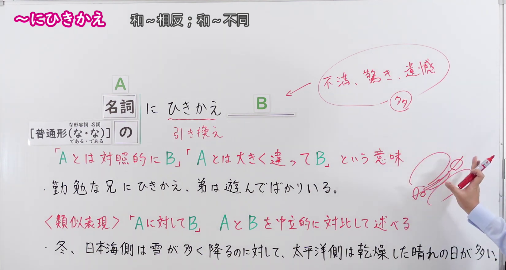
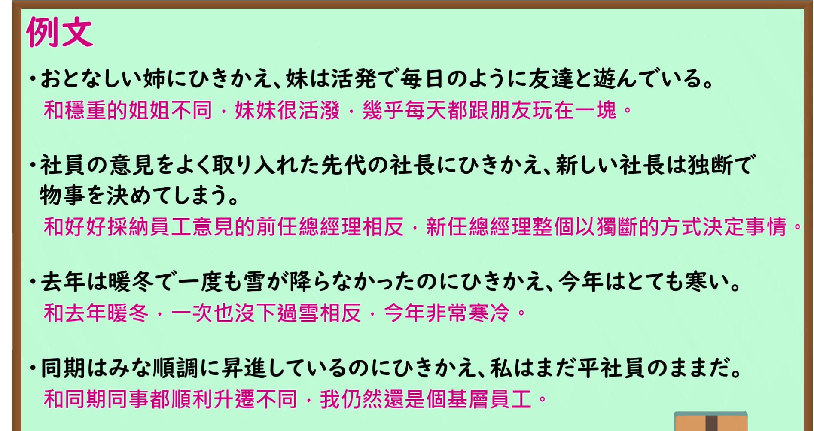

---
{
  "id": "N1-G-0072",
  "kind": "grammar",
  "level": "N1",
  "title": "～にひきかえ：与～相反；与～大不相同",
  "card_revision": 1,
  "schema_version": 1,
  "source": {
    "lesson": "N1 第72个语法",
    "material": "出口日語原视频板书、日语自动字幕与 Hagoromo 文型检索正文",
    "video": "https://www.youtube.com/watch?v=t02Z4RI-Iyo",
    "screenshot": "assets/grammar/n1/N1-G-0072-connection.png",
    "screenshot_seconds": 218.0,
    "screenshot_crop": {
      "x": 0,
      "y": 0,
      "width": 1650,
      "height": 880
    }
  },
  "tags": [
    "対比",
    "N1"
  ],
  "confusions": [
    "～に対して（中立客观地对比A与B两个事物；而～にひきかえ侧重强烈反差，后项常带有说话者的不満、惊叹或遗憾等主观感情色彩）",
    "～反面（表示同一事物或人物具有正反两面性；而～にひきかえ多用于对比两个不同的人、事或状态）"
  ]
}
---

# N1 第72个语法：～にひきかえ

# 视频学习资料整理

- 课程：[出口日語「【Ｎ１文法】～にひきかえ」](https://www.youtube.com/watch?v=t02Z4RI-Iyo)，时长 5 分 57 秒。
- 接续图：原视频 3:38.00（218.00 秒）；原图 1920×1080，固定左上角裁切区域 `(0, 0, 1650, 880)`。0:01 画面讲师居中鞠躬遮挡了下方的对比例句与补充说明，且「不満、驚き、遺憾」等板书尚未书写；故选用讲师完成全部板书并让开底行文字的 218.00 秒。接续框、红字解释、板书例句、与「～に対して」的中立对比辨析及后项情感倾向标注均清晰完整。

- 例句图：原视频 4:27.52（267.52 秒）；原图 1920×1080，固定左上角裁切区域 `(0, 0, 1895, 1005)`。四条例句及原视频中文说明完整清晰，裁去底部多余边框。

# 核心

## 功能一：与A形成对照的是B、与A大不相同的是B

**最上位意味カテゴリー：**

- **にひきかえ：** ものごとの関係（事物间的关系）

**中位意味カテゴリー：**

- **にひきかえ：** 対比（对比）

**意味：**

- **にひきかえ：** 対比（对比）

**くわしい意味記述：**

- **にひきかえ：** 「一方はXだが，他方ではそれとは対照的にYだ」という意味を表す。「それにひきかえ」という表現がよく使われる。（表示“一方面是X，另一方面与其形成对照的是Y”的意思。常使用“それにひきかえ”这一表达。）

**派生語：** 未列出

### 例句

1. 勉強家の兄にひきかえ、弟は怠け者だ。

   （与用功读书的哥哥相反，弟弟是个懒汉。）

2. とかく外国製品が高くて故障しやすいのにひきかえ、安くて品質のいい日本製品は、世界中の消費者から“熱烈歓迎”されている。

   （与外国产品往往价格昂贵且容易出故障相反，便宜且品质优良的日本产品受到了全世界消费者的“热烈欢迎”。）

3. エリート養成に巧みなはずのイギリスが、その層の薄さでつまずいたのにひきかえ、エリート養成が下手なはずの日本は、逆にその層の厚さで成功した。

   （与本应擅长培养精英的英国因人才储备单薄而受挫相反，本应不擅长培养精英的日本反而因人才储备雄厚而获得了成功。）

4. ところが、選挙の意味の重さにひきかえ、選挙戦の空疎さときたらどうだ。

   （然而，与选举本身的重大意义相反，竞选过程的空洞匮乏又该怎么说呢？）

# 来源

- [出口日語原视频](https://www.youtube.com/watch?v=t02Z4RI-Iyo)
- [Hagoromo 文型检索「にひきかえ（対比）」](https://hagoromo-text.work/)（查询日期：2026-09-24；页面内检索「にひきかえ」）
