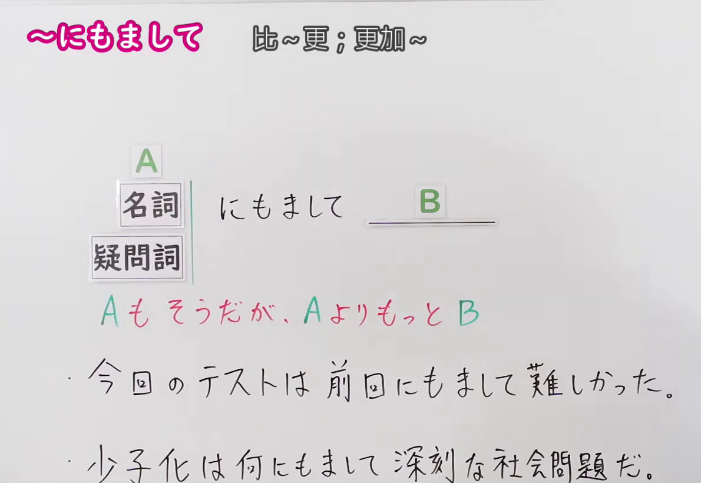
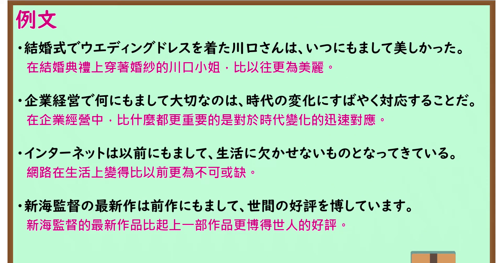

---
{
  "id": "N1-G-0073",
  "kind": "grammar",
  "level": "N1",
  "title": "～にもまして：比～更；更加～",
  "card_revision": 1,
  "schema_version": 1,
  "source": {
    "lesson": "N1 第73个语法",
    "material": "出口日語原视频板书、日语自动字幕与 Hagoromo 文型检索正文",
    "video": "https://www.youtube.com/watch?v=pElS3iF95QA",
    "screenshot": "assets/grammar/n1/N1-G-0073-connection.png",
    "screenshot_seconds": 1.0,
    "screenshot_crop": {
      "x": 0,
      "y": 0,
      "width": 1190,
      "height": 820
    }
  },
  "tags": [
    "程度の強調",
    "N1"
  ],
  "confusions": [
    "～はおろか（常用于否定或消极评价，表示“连A都……更不用说B”；而～にもまして表示“A已经如此，但B的程度甚至超过A”，后项多为程度的强调）",
    "～以上に（表示超出某个客观基准或预想；～にもまして语气更为主观、更具书面语与文学色彩，常与疑问词、时间词或固定搭配连用）"
  ]
}
---

# N1 第73个语法：～にもまして

# 视频学习资料整理

- 课程：[出口日語「【Ｎ１文法】～にもまして」](https://www.youtube.com/watch?v=pElS3iF95QA)，时长 3 分 45 秒。
- 接续图：原视频 0:01.00；原图 1920×1080，固定左上角裁切区域 `(0, 0, 1190, 820)`。画面左侧接续框「名詞／疑問詞＋にもまして」、红字解释「Aもそうだが、AよりもっとB」及两条例句板书完整清晰，裁去右侧讲师人物与多余空白。

- 例句图：原视频 2:12.30（132.30 秒）；原图 1920×1080，固定左上角裁切区域 `(0, 0, 1895, 1005)`。四条例句及原视频中文说明完整清晰，裁去底部多余边框。

# 核心

## 功能一：A固然如此，但比A更加B

**最上位意味カテゴリー：**

- **にもまして：** ものごとの関係（事物间的关系）

**中位意味カテゴリー：**

- **にもまして：** 比較（比较）

**意味：**

- **にもまして：** 程度の強調（程度的强调）

**くわしい意味記述：**

- **にもまして：** 「〜以上に」「〜と比べてもっと」という意味を表す。「何/誰/いつにもまして」などの疑問詞とともに使われる場合は，「疑問詞＋よりも」という意味になる。前述の内容と比べる「それにもまして」という表現や，時を表す「以前，従来，前，これまで，いつ」といった言葉とともによく使われる。（表示“比……更加……”“与……相比更加……”的意思。与“何/誰/いつにもまして”等疑问词一起使用时，表示“比任何事物/人/时候都更加……”。常与对比前述内容的表达“それにもまして”，以及表示时间的“以前、従来、前、これまで、いつ”等词语搭配使用。）

**派生語：** 未列出

### 例句

1. それにもまして気がかりなのは家族の健康だ。

   （比那更让人挂念的是家人的健康。）

2. 日本列島だけをみれば、よくいわれるように、関東・関西、また東北・西南日本などという設定をはじめ、その他、地域差というものがクローズ・アップされるが、この地域差にもまして、全国的な共通性は驚くほど強い。

   （单看日本列岛，正如常说的那样，以关东、关西，或东北、西南日本等划分为代表，地域差异往往受到瞩目；然而比这种地域差异更加显著的是，全国范围内的共通性强得惊人。）

3. しかも、“ヒラの人たち”が「ゆとり」を得て、以前ほどきちんと働かなくなると、その負荷はエリートにかかってくるから、彼らは以前にもまして“仕事気ちがい”たらざるをえない。

   （而且，如果“普通基层员工”获得了“从容闲暇”而不再像以前那样拼命工作，这些负担就会落到精英身上，因此他们不得不比以往更加像个“工作狂”。）

4. 米国が深く関与し、ロシアとの協議機能ももつ拡大ＮＡＴＯは、冷戦当時にもまして、欧州安保の重要な柱となろう。

   （美国深度参与且兼具与俄罗斯磋商机制的东扩后的北约，将成为比冷战时期更为关键的欧洲安全支柱。）

# 来源

- [出口日語原视频](https://www.youtube.com/watch?v=pElS3iF95QA)
- [Hagoromo 文型检索「にもまして（程度の強調）」](https://hagoromo-text.work/)（查询日期：2026-09-24；页面内检索「にもまして」）
