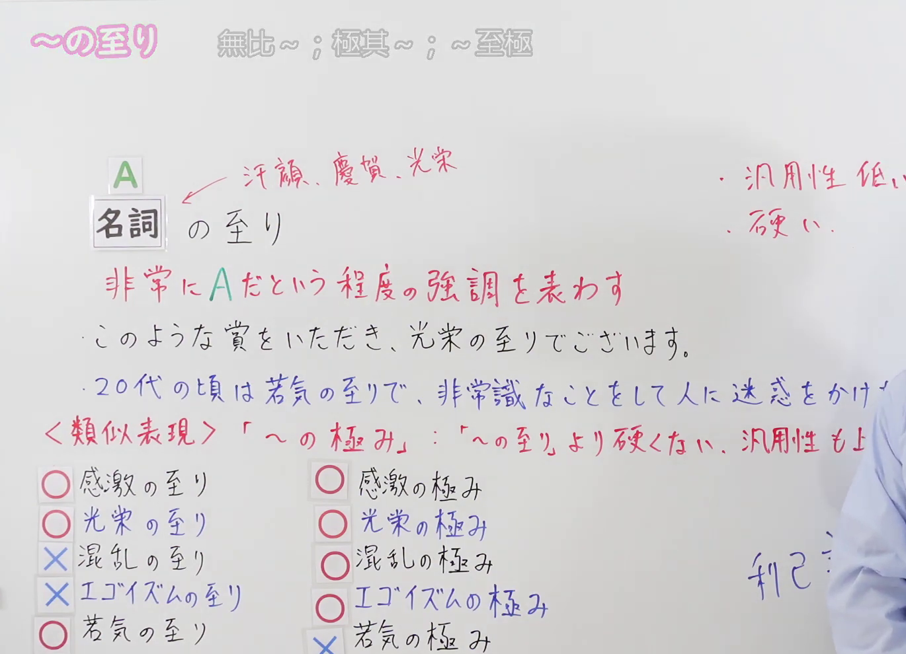
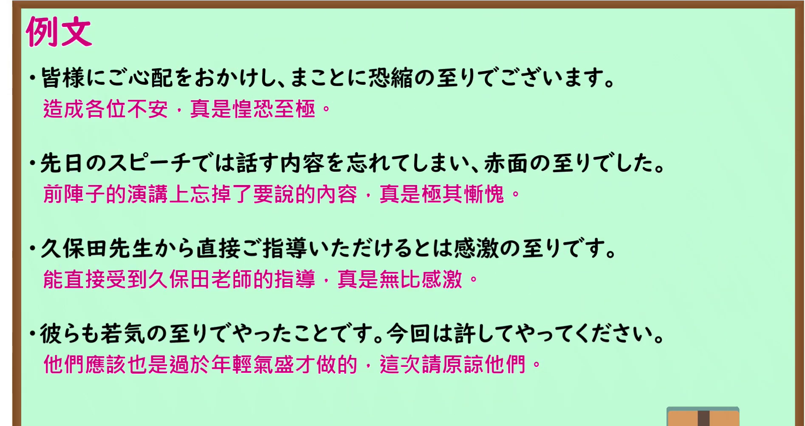

---
{
  "id": "N1-G-0074",
  "kind": "grammar",
  "level": "N1",
  "title": "～の至り：无比～；极其～；～之至",
  "card_revision": 1,
  "schema_version": 1,
  "source": {
    "lesson": "N1 第74个语法",
    "material": "出口日語原视频板书、日语自动字幕与 Hagoromo 文型检索正文",
    "video": "https://www.youtube.com/watch?v=Vj-Ln20VoMo",
    "screenshot": "assets/grammar/n1/N1-G-0074-connection.png",
    "screenshot_seconds": 282.0,
    "screenshot_crop": {
      "x": 0,
      "y": 0,
      "width": 1370,
      "height": 990
    }
  },
  "tags": [
    "重の強調",
    "N1"
  ],
  "confusions": [
    "～の極み（「～の極み」不仅可用于感情，还可修饰「混乱」「エゴイズム」等客观状态或事物，泛用性更高且稍显口语化；「～の至り」语气更为郑重生硬，常固定搭配「光栄」「感激」「恐縮」「赤面」「若気」等词）"
  ]
}
---

# N1 第74个语法：～の至り

# 视频学习资料整理

- 课程：[出口日語「【Ｎ１文法】～の至り」](https://www.youtube.com/watch?v=Vj-Ln20VoMo)，时长 6 分 22 秒。
- 接续图：原视频 4:42.00（282.00 秒）；原图 1920×1080，固定左上角裁切区域 `(0, 0, 1370, 990)`。0:01 画面讲师居中鞠躬遮挡了下方的补充例句，且「～の極み」的对比例子尚未标注 〇/× 符号；故选用讲师完成全部板书并让开主画面的 282.00 秒。接续框、红字解释、板书例句、常用词提示（汗顔、慶賀、光栄）以及与「～の極み」的 5 组详细用法对比均清晰完整。

- 例句图：原视频 4:46.43（286.43 秒）；原图 1920×1080，固定左上角裁切区域 `(0, 0, 1895, 1005)`。四条例句及原视频中文说明完整清晰，裁去底部多余边框。

# 核心

## 功能一：表示极其A这一程度的强调

**最上位意味カテゴリー：**

- **いたり：** 考え・感情（思考与感情）

**中位意味カテゴリー：**

- **いたり：** 軽重の強調（轻重的强调）

**意味：**

- **いたり：** 重の強調（程度深重的强调）

**くわしい意味記述：**

- **いたり：** 「非常に〜である」という意味。改まった話し言葉。（表示“极其……”“无上……”的意思。属于郑重的口头表达。）

**派生語：** 未列出

### 例句

1. 本日は晩餐会にお招きいただき、光栄の至りでございます。

   （今天承蒙邀请出席晚宴，深感无上光荣。）

2. しかも、この決闘のことをウワサに聞いた殿様は、とめるどころか「この時におよびその断りをかまはず、一命を捨つる志これ神妙の至り」と誉めあげたという。

   （而且，听闻这场决斗传言的城主不仅没有制止，反而赞扬道：“值此关头不顾规劝、甘愿舍弃性命的气节，实乃令人深感钦佩之至。”）

3. 兼好法師は『徒然草』の中で、明禅法印の、しやせまし、せずやあらましと思ふ事は、おほやうは、せぬはよきなり。という言葉を紹介して、まことに同感の至りだと、思いとどまるほうに軍配を挙げている。

   （兼好法师在《徒然草》中引用了明禅法印“凡遇犹豫做与不做之事，大抵以不做为妙”的话，并深表极具同感，赞成打消念头这一做法。）

4. 佐藤首相が記者会見で、『三木を外相にしたことは不明の至りだ』と言っているのは、そうした背景があった」というのだ。

   （据说佐藤首相在记者招待会上表示“任命三木为外相实属我极不明智之举”，背后正有这样的渊源。）

# 来源

- [出口日語原视频](https://www.youtube.com/watch?v=Vj-Ln20VoMo)
- [Hagoromo 文型检索「いたり（重の強調）」](https://hagoromo-text.work/)（查询日期：2026-09-24；页面内检索「いたり」）
