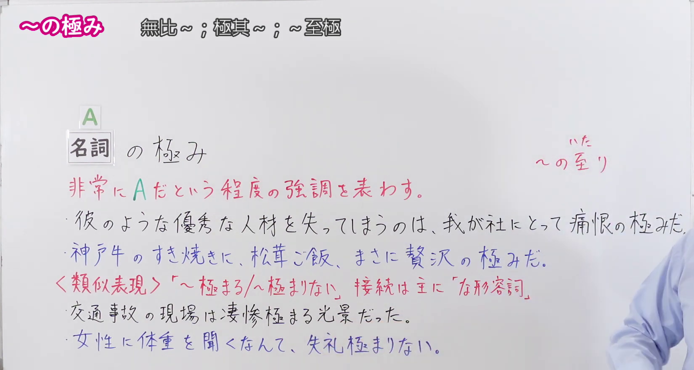
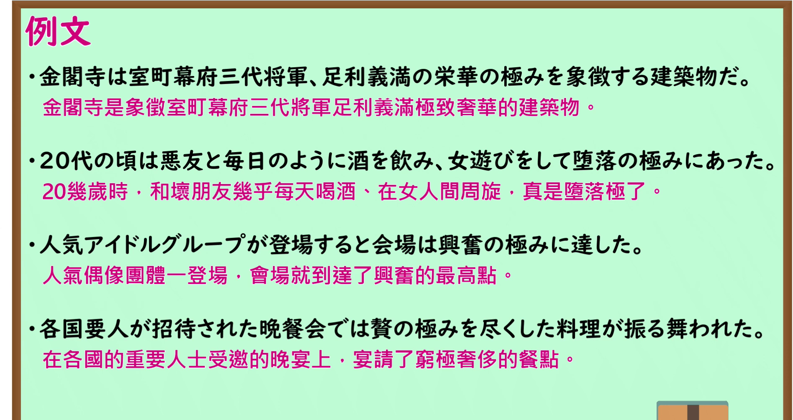

---
{
  "id": "N1-G-0075",
  "kind": "grammar",
  "level": "N1",
  "title": "～の極み：无比～；极其～；～至极",
  "card_revision": 1,
  "schema_version": 1,
  "source": {
    "lesson": "N1 第75个语法",
    "material": "出口日語原视频板书、日语自动字幕与 Hagoromo 文型检索正文",
    "video": "https://www.youtube.com/watch?v=NUlTkRhj_IE",
    "screenshot": "assets/grammar/n1/N1-G-0075-connection.png",
    "screenshot_seconds": 120.0,
    "screenshot_crop": {
      "x": 0,
      "y": 0,
      "width": 1650,
      "height": 880
    }
  },
  "tags": [
    "主張・断定的評価",
    "N1"
  ],
  "confusions": [
    "～の至り（语气更为生硬郑重，多用于表达内心的极度感情且多为固定搭配如「光栄の至り」「若気の至り」；「～の極み」不仅用于感情，还可修饰「贅沢」「栄華」「疲労」等客观事物或状态）",
    "～極まる／～極まりない（意思相近，但接续不同：「～極まる／～極まりない」主要接在“な形容词词干”后，如「失礼極まりない」「危険極まる」；而「～の極み」接在“名词”后）"
  ]
}
---

# N1 第75个语法：～の極み

# 视频学习资料整理

- 课程：[出口日語「【Ｎ１文法】～の極み」](https://www.youtube.com/watch?v=NUlTkRhj_IE)，时长 4 分 20 秒。
- 接续图：原视频 2:00.00（120.00 秒）；原图 1920×1080，固定左上角裁切区域 `(0, 0, 1650, 880)`。0:01 画面讲师居中鞠躬遮挡了右侧例句文字；选用 120.00 秒讲师位于画面右侧边缘，接续框「名詞＋の極み」、红字解释「非常にAだという程度の強調を表わす。」、板书完整例句（「優勝できたなんて、感激の極みです。」「我が社にとって痛恨の極みだ。」）以及与「～極まる／～極まりない」的类似表达辨析均完整清晰。

- 例句图：原视频 3:14.50（194.50 秒）；原图 1920×1080，固定左上角裁切区域 `(0, 0, 1895, 1005)`。四条例句及原视频中文说明完整清晰，裁去底部多余边框。

# 核心

## 功能一：表示极其A这一程度的强调

**最上位意味カテゴリー：**

- **のきわみ：** 考え・感情（思考与感情）

**中位意味カテゴリー：**

- **のきわみ：** 主張・断定的評価（主张与断定性评价）

**意味：**

- **のきわみ：** 評価（评价）

**くわしい意味記述：**

- **のきわみ：** 「〜の程度が非常に大きい」の意味。非常に改まった硬い表現（表示“……的程度极其重大”的意思。属于非常郑重生硬的表达。）

**派生語：** 未列出

### 例句

1. お目にかかれるとは、感激の極みです。

   （能见到您，真是不胜感激。）

2. 昔の修身の教科書にもなった古代中国の堯・瞬の聖王の話は退屈の極みであるが、酒池肉林の宴をはった桀・紂など悪王の話はドラマにもなるのである。

   （曾被编入过去修身教科书的古代中国尧舜圣王的故事固然极其枯燥乏味，但大摆酒池肉林盛宴的桀纣等暴君的故事却能演变成戏剧。）

3. 借金までしてギャンブルに熱中したあげく破滅を招くのは愚行の極みであり、他人にも迷惑をかける。

   （甚至不惜借债沉迷赌博最终招致身败名裂，实属荒谬至极的愚蠢行径，还会给他人带来困扰。）

4. 金融界の人間から見れば、融資は必要な分だけを行うもので、「無制限」など非常識の極みである。

   （在金融界人士看来，融资理应按需提供，“无限制”之类简直是不合常理至极。）

# 来源

- [出口日語原视频](https://www.youtube.com/watch?v=NUlTkRhj_IE)
- [Hagoromo 文型检索「のきわみ（評価）」](https://hagoromo-text.work/)（查询日期：2026-09-24；页面内检索「のきわみ」）
