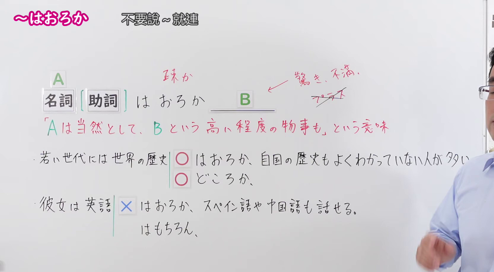
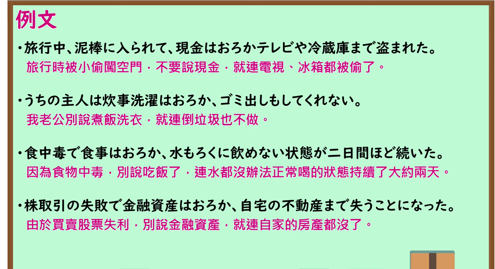

---
{
  "id": "N1-G-0076",
  "kind": "grammar",
  "level": "N1",
  "title": "～はおろか：别说～就连……；不仅……连……",
  "card_revision": 1,
  "schema_version": 1,
  "source": {
    "lesson": "N1 第76个语法",
    "material": "出口日語原视频板书、日语自动字幕与 Hagoromo 文型检索正文",
    "video": "https://www.youtube.com/watch?v=WFxgzr2k-c0",
    "screenshot": "assets/grammar/n1/N1-G-0076-connection.png",
    "screenshot_seconds": 160.0,
    "screenshot_crop": {
      "x": 0,
      "y": 0,
      "width": 1665,
      "height": 920
    }
  },
  "tags": [
    "主張・断定的評価",
    "N1"
  ],
  "confusions": [
    "～どころか（日常会话中更常使用「～どころか」；「～はおろか」语气较为生硬古雅，多见于书面语。此外，「～どころか」后项既可接消极也可接积极评价，而「～はおろか」后项基本仅限惊讶、不满等消极负面内容）",
    "～はもちろん（「～はおろか」后项只能接消极不满或极端事态，不能接积极正面的评价；如果后项是正面长处或积极事实，如「英語はもちろんスペイン語も話せる」，必须使用「～はもちろん」或「～はもとより」）"
  ]
}
---

# N1 第76个语法：～はおろか

# 视频学习资料整理

- 课程：[出口日語「【Ｎ１文法】～はおろか」](https://www.youtube.com/watch?v=WFxgzr2k-c0)，时长 4 分 58 秒。
- 接续图：原视频 2:40.00（160.00 秒）；原图 1920×1080，固定左上角裁切区域 `(0, 0, 1665, 920)`。0:01 画面讲师居中遮挡了板书后半部分；选用 160.00 秒讲师退至画面右侧边缘，接续框「名詞＋はおろか」、核心含义「Aは当然として、Bという高い程度の物事も」、感情色彩提示（惊奇、不满、消极内容；不可接积极内容）、板书例句以及与「～どころか」「～はもちろん」的用法辨析均清晰完整。

- 例句图：原视频 3:55.00（235.00 秒）；原图 1920×1080，固定左上角裁切区域 `(0, 0, 1895, 1030)`。四条例句及原视频中文说明完整清晰，裁去底部多余边框。

# 核心

## 功能一：别说A了，就连程度更高的B也……（强调程度之甚）

**最上位意味カテゴリー：**

- **はおろか：** 考え・感情（思考与感情）

**中位意味カテゴリー：**

- **はおろか：** 主張・断定的評価（主张与断定性评价）

**意味：**

- **はおろか：** 評価（评价）

**くわしい意味記述：**

- **はおろか：** Nのことは当然だが、Nよりさらに程度が上のことも加えて言いたい時に使う。話者の驚きや不満の気持ちを表す場合に使い，プラスの評価を言う時には使わない。（表示“N固然不用说，还想进一步补充程度更高的事物时使用。多用于表达说话人吃惊、不满的心情，不用于积极正面的评价。”）

**派生語：** 未列出

### 例句

1. 最近の学生は、敬語はおろか、あいさつもできない。

   （最近的学生别说敬语了，连寒暄打招呼都不会。）

2. 日本人がその国の言語はおろか、国際語となっている英語やフランス語さえよく話せないということは、今やよく知られているし、また、私たち日本人も充分に知っていることである。

   （日本人别说去掌握所在国的语言了，就连作为国际通用语言的英语和法语都说不好，这一点如今已众所周知，我们日本人自己也心知肚明。）

3. だが、現状のままでは、改革はおろか、日常生活の維持にも大きな支障をきたす。

   （然而，维持现状的话，别说进行改革了，就连维持日常生活都会出现严重障碍。）

4. 翌年には入浴はおろかトイレにも行けなくなった。

   （到了第二年，别说洗澡了，就连上厕所都无法自理了。）

# 来源

- [出口日語原视频](https://www.youtube.com/watch?v=WFxgzr2k-c0)
- [Hagoromo 文型检索「はおろか（評価）」](https://hagoromo-text.work/)（查询日期：2026-09-24；页面内检索「はおろか」）
