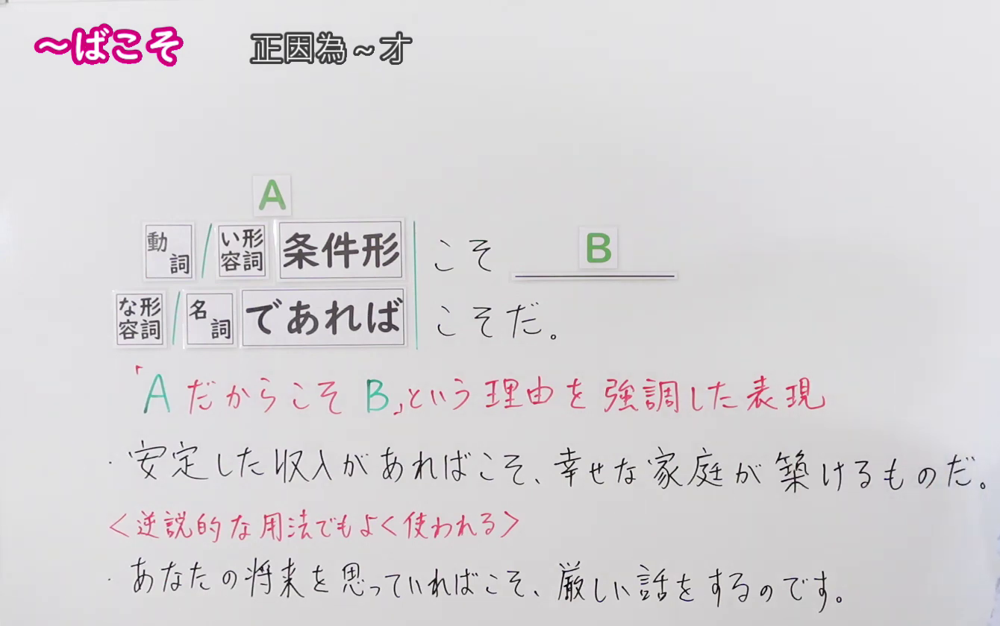
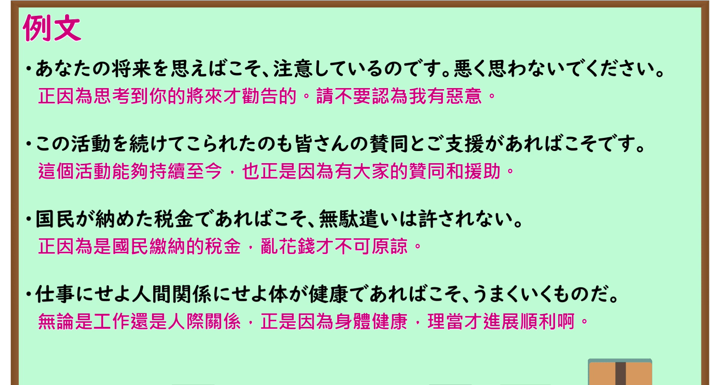

---
{
  "id": "N1-G-0077",
  "kind": "grammar",
  "level": "N1",
  "title": "～ばこそ：正因为～才……",
  "card_revision": 1,
  "schema_version": 1,
  "source": {
    "lesson": "N1 第77个语法",
    "material": "出口日語原视频板书、日语自动字幕与 Hagoromo 文型检索正文",
    "video": "https://www.youtube.com/watch?v=XK1wiWgG1Mg",
    "screenshot": "assets/grammar/n1/N1-G-0077-connection.png",
    "screenshot_seconds": 95.0,
    "screenshot_crop": {
      "x": 0,
      "y": 0,
      "width": 1340,
      "height": 840
    }
  },
  "tags": [
    "重の強調",
    "N1"
  ],
  "confusions": [
    "～からこそ（日常口语与书面皆极为常用，可广泛用于一般因果；而「～ばこそ」属于较为生硬郑重、带有文雅古风的书面语，多用于强调正当理由、深思熟虑的逆说性原因或重大评价）",
    "～ならこそ（注意在「～ばこそ」语法中，名词和な形容词通常使用「～であればこそ」，而不使用「ならこそ」）"
  ]
}
---

# N1 第77个语法：～ばこそ

# 视频学习资料整理

- 课程：[出口日語「【Ｎ１文法】～ばこそ」](https://www.youtube.com/watch?v=XK1wiWgG1Mg)，时长 4 分 42 秒。
- 接续图：原视频 1:35.00（95.00 秒）；原图 1920×1080，固定左上角裁切区域 `(0, 0, 1340, 840)`。0:01 画面讲师遮挡了部分板书；改用 95.00 秒的语法讲解画面，保留动词／い形容词条件形、な形容词／名词「であれば」的接续、红字含义 `「AだからこそB」という理由を強調した表現`、逆说性用法说明及两条板书例句，裁去右侧大部分人像与底部空白。

- 例句图：原视频 3:45.00（225.00 秒）；原图 1920×1080，固定左上角裁切区域 `(0, 0, 1895, 1030)`。四条例句及原视频中文说明完整清晰，裁去底部多余边框与进度条。

# 核心

## 功能一：强调正因为A这一理由才会有B（特别是表面看似矛盾的良苦用心）

**最上位意味カテゴリー：**

- **ばこそ：** 考え・感情（思考与感情）

**中位意味カテゴリー：**

- **ばこそ：** 軽重の強調（轻重的强调）

**意味：**

- **ばこそ：** 重の強調（程度深重的强调）

**くわしい意味記述：**

- **ばこそ：** 理由を表す「〜だから」を強調する表現。「XだからYである」の「Xだから」の意味を強める意味を持つ。Xには発話者がプラス評価している内容が使われる。（表示理由的“～だから”的强调表达。具有加强“XだからYである”中“Xだから”含义的作用。X部分多用于说话人给予正面评价或视作根本原因的内容。）

**派生語：** 未列出

### 例句

1. あなたのことを考えればこそ転職を勧めているんですよ。

   （正因为为你着想，我才建议你跳槽换工作的呀。）

2. 子供の発見であればこそ、このあたりまえのことが奇想天外のこととして大人の心をゆすぶります。

   （正因为是孩子的发现，这种理所当然的小事才会作为奇思妙想震撼大人的心灵。）

3. 人間のように、これから暑くなる、これから寒くなるという記憶にもとづいた見通しによる気分が加わればこそ、春と秋の微妙なちがいをひとしお強く感じるのでしょう。

   （正因为像人类这样，夹杂着基于“此后天气将变热、变冷”之记忆与预期的心境，才会格外强烈地感受到春秋之间微妙的差异吧。）

4. 有権者にとって、行使する一票が選挙結果に影響を与え得ると感じればこそ投票に出かけるのである。

   （对于选民而言，正因为觉得所投出的一票能够对选举结果产生影响，才会前往投票。）

# 来源

- [出口日語原视频](https://www.youtube.com/watch?v=XK1wiWgG1Mg)
- [Hagoromo 文型检索「ばこそ（重の強調）」](https://hagoromo-text.work/)（查询日期：2026-09-24；页面内检索「ばこそ」）
