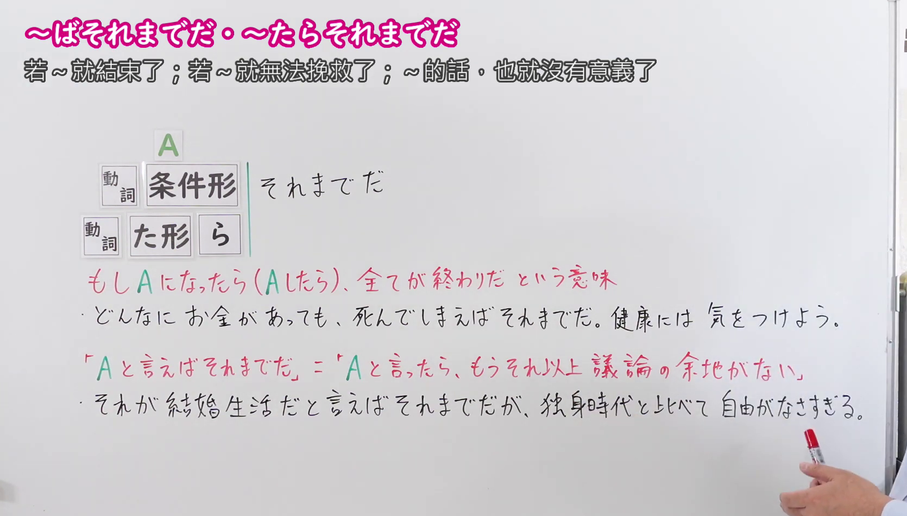
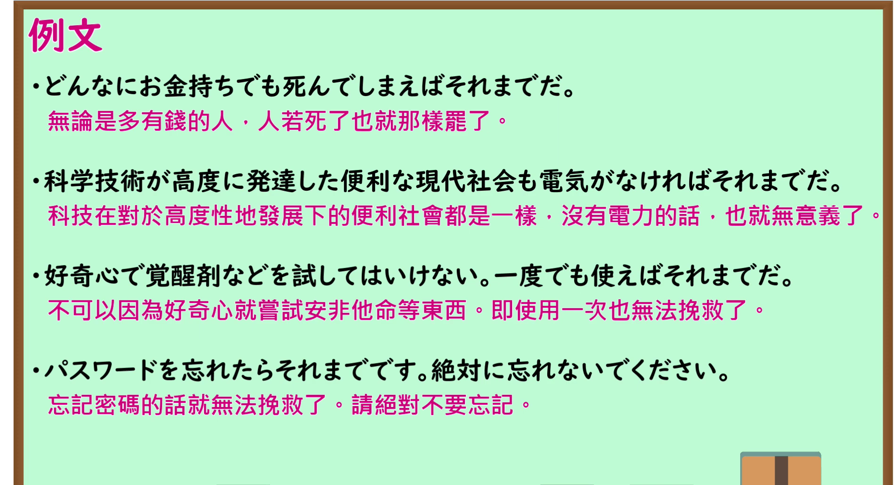

---
{
  "id": "N1-G-0078",
  "kind": "grammar",
  "level": "N1",
  "title": "～ばそれまでだ／～たらそれまでだ：一旦～就全完了；也就到此为止了",
  "card_revision": 1,
  "schema_version": 1,
  "source": {
    "lesson": "N1 第78个语法",
    "material": "出口日語原视频板书、日语自动字幕与 Hagoromo 文型检索正文",
    "video": "https://www.youtube.com/watch?v=uttTuTZnYdk",
    "screenshot": "assets/grammar/n1/N1-G-0078-connection.png",
    "screenshot_seconds": 111.0,
    "screenshot_crop": {
      "x": 0,
      "y": 0,
      "width": 1670,
      "height": 950
    }
  },
  "tags": [
    "主張・断定的評価",
    "N1"
  ],
  "confusions": [
    "～たらおしまいだ／～たら終わりだ（意思相近，均表示“一旦……就彻底完了/无可挽回”；「～たらおしまいだ」口语色彩更浓，多用于日常随意感叹；而「～ばそれまでだ」书面郑重感更强，且常构成「～と言えばそれまでだが…（要是那样定性的话也就没得谈了，但是……）」等书面议论惯用句式）",
    "～にすぎない（表示“只不过是……而已”，属于限定客观程度；而「～それまでだ」重点强调“达到终点、前功尽弃、一切都结束了或再无讨论余地”）"
  ]
}
---

# N1 第78个语法：～ばそれまでだ／～たらそれまでだ

# 视频学习资料整理

- 课程：[出口日語「【Ｎ１文法】～ばそれまでだ」](https://www.youtube.com/watch?v=uttTuTZnYdk)，时长 4 分 08 秒。
- 接续图：原视频 1:51.00（111.00 秒）；原图 1920×1080，固定左上角裁切区域 `(0, 0, 1670, 950)`。0:01 画面讲师居中遮挡了右侧大量板书文字；选用 111.00 秒讲师退至画面右侧之外，接续框（动词条件形ば形＋それまでだ、动词た形＋らそれまでだ）、红字核心含义「Aになったら（Aしたら）全てが終わりだ」、板书例句、以及高频搭配「～と言えばそれまでだ（要是那样说就没得谈了）」讲解均完整清晰呈现。

- 例句图：原视频 3:03.00（183.00 秒）；原图 1920×1080，固定左上角裁切区域 `(0, 0, 1895, 1030)`。四条例句及原视频中文说明完整清晰，裁去底部多余边框与进度条。

# 核心

## 功能一：一旦发生了A，一切就都完了（也就到此为止了）

**最上位意味カテゴリー：**

- **ばそれまでだ：** 考え・感情（思考与感情）

**中位意味カテゴリー：**

- **ばそれまでだ：** 主張・断定的評価（主张与断定性评价）

**意味：**

- **ばそれまでだ：** 評価（评价）

**くわしい意味記述：**

- **ばそれまでだ：** 「そうなったら，それで終わりだ」という意味を表す。（表示“一旦变成那样，一切就都完了/结束了”的意思。）

**派生語：** 未列出

### 例句

1. 人気のある商品も、一度消費者に嫌われればそれまでだ。

   （哪怕再有人气畅销的商品，一旦被消费者厌弃也就全完了。）

2. 要するに、あちらのやり方は、相手が弱ければそれまで、相手がスキがなければ、それならそれで、ということであるらしい。

   （简而言之，对方的做派似乎是：如果对手软弱那事情就到此为止任其宰割，如果对手毫无破绽那便另当别论。）

3. これほどまでの自由を捨てて、人はなぜ就職しなければならないのだろう。食っていかなければならないからだ、といえばそれまでだが、あまりに払う犠牲が大き過ぎるとも考えられる。

   （舍弃如此多的自由，人究竟为何非得去就业上班不可呢？要是说“因为人必须糊口度日”那倒也是（便无可反驳了），但未免让人觉得付出的代价实在太过沉重。）

4. それがデモクラシーの政治だと言えばそれまでである。

   （要是说“民主政治本就如此”，那倒确实让人无话可说了。）

# 来源

- [出口日語原视频](https://www.youtube.com/watch?v=uttTuTZnYdk)
- [Hagoromo 文型检索「ばそれまでだ（評価）」](https://hagoromo-text.work/)（查询日期：2026-09-24；页面内检索「ばそれまでだ」）
