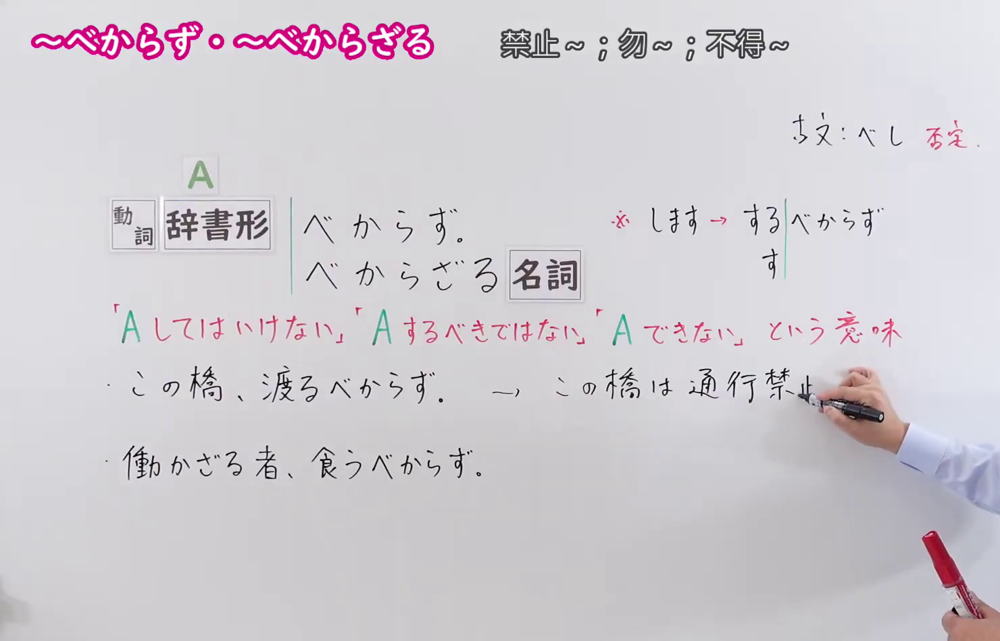
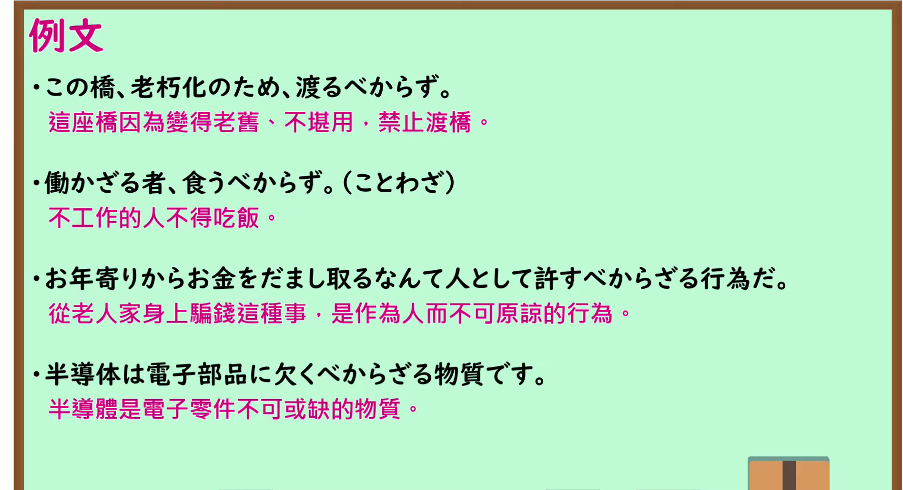

---
{
  "id": "N1-G-0079",
  "kind": "grammar",
  "level": "N1",
  "title": "～べからず／～べからざる：绝不可～；不应当……",
  "card_revision": 1,
  "schema_version": 1,
  "source": {
    "lesson": "N1 第79个语法",
    "material": "出口日語原视频板书、日语自动字幕与 Hagoromo 文型检索正文",
    "video": "https://www.youtube.com/watch?v=SW2I17AydUk",
    "screenshot": "assets/grammar/n1/N1-G-0079-connection.png",
    "screenshot_seconds": 124.0,
    "screenshot_crop": {
      "x": 0,
      "y": 0,
      "width": 1480,
      "height": 950
    }
  },
  "tags": [
    "許可・禁止・義務・不必要",
    "N1"
  ],
  "confusions": [
    "～てはならない（两者均表示禁止；「～てはならない」是现代日语中最通用的严厉禁止表达，而「～べからず」是古典文语助动词「べし」的否定形式，在现代主要限定用于公告告示、警示标语、格言谚语或「～べからざるN」这一书面连体修饰句式）",
    "～べきではない（「～べきではない」是现代日语中表示劝告或道义判断的标准表达，意为“不应该……”；「～べからず」语气远比其生硬严厉，带有不可抗拒的戒律或绝对禁止色彩）"
  ]
}
---

# N1 第79个语法：～べからず／～べからざる

# 视频学习资料整理

- 课程：[出口日語「【Ｎ１文法】～べからず／～べからざる」](https://www.youtube.com/watch?v=SW2I17AydUk)，时长 4 分 45 秒。
- 接续图：原视频 2:04.00（124.00 秒）；原图 1920×1080，固定左上角裁切区域 `(0, 0, 1480, 950)`。0:01 画面讲师居中遮挡了右侧板书内容；选用 124.00 秒讲师退至画面右侧边缘之外，接续框（动词辞书形＋べからず、连体修饰＋べからざる＋名词）、红字含义（～してはいけない/禁止、～できない/不可能）、古语「べし」否定渊源、看板告示与谚语用途讲解均 100% 完整清晰呈现。

- 例句图：原视频 3:38.00（218.00 秒）；原图 1920×1080，固定左上角裁切区域 `(0, 0, 1895, 1030)`。四条例句及原视频中文说明完整清晰，裁去底部多余边框与进度条。

# 核心

## 功能一：绝不可做某事（禁止）；不应当有的/不可……的（连体修饰）

**最上位意味カテゴリー：**

- **べからず／べからざる：** 考え・感情（思考与感情）

**中位意味カテゴリー：**

- **べからず／べからざる：** 許可・禁止・義務・不必要（许可·禁止·义务·不必要）

**意味：**

- **べからず／べからざる：** 禁止（禁止）

**くわしい意味記述：**

- **べからず：** 「してはいけない」という意味。古い書きことばで，現在では掲示板などでのみ使う。（表示“绝不可以做……”的意思。属于文语古语书面表达，现代通常仅在公告看板、标语等场合使用。）
- **べからざる：** 「べからざるN」で使う。「べきでないN」のかたい言い方。「してはいけない」「することができない」という意味を表す。（作为“べからざるN”使用。是“べきでないN”的生硬说法。表示“不应当做……”或“无法做……”的意思。）

**派生語：** べからず ⇔ べからざる

### 例句

1. 倉庫内入るべからず。

   （仓库重地，严禁入内。）

2. すると宋弘は、「いえ、私は『貧賎の知は忘るべからず、糟糠の妻は堂より下さず』と聞いております」と答えた。

   （于是宋弘回答道：“不，我听闻‘贫贱之交不可忘，糟糠之妻不下堂’。”）

3. 看護師が病人の前で言うべからざることを安易に口にした罪は重い。

   （护士在病人面前轻易说出绝不该说的话，其过失极为严重。）

4. 意味のうえからどうしても必要欠くべからざるものであるので、最小限度一字だけの許容を認めざるをえない例でありましょう。

   （从文意而言无论如何都是必不可缺的关键要素，因而这也是不得不允许最低限度保留一字的例证吧。）

# 来源

- [出口日語原视频](https://www.youtube.com/watch?v=SW2I17AydUk)
- [Hagoromo 文型检索「べからず／べからざる（禁止）」](https://hagoromo-text.work/)（查询日期：2026-09-24；页面内检索「べからず」）
