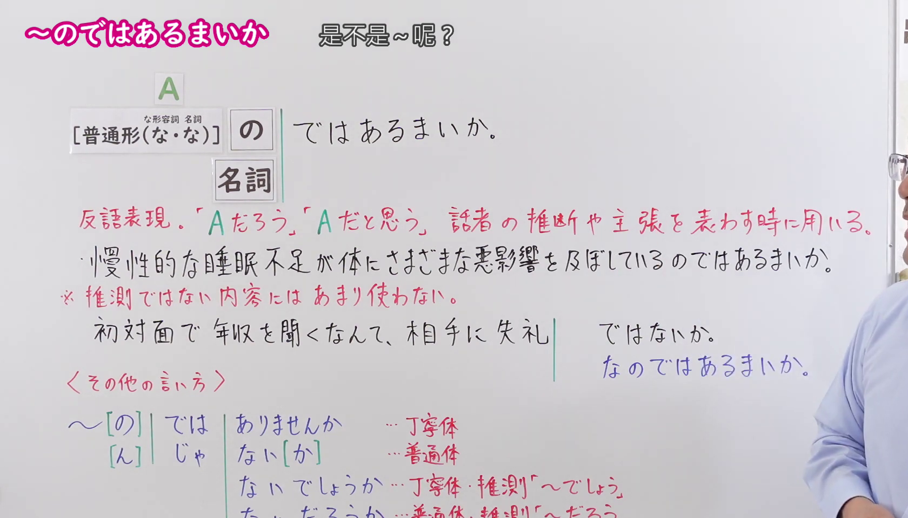
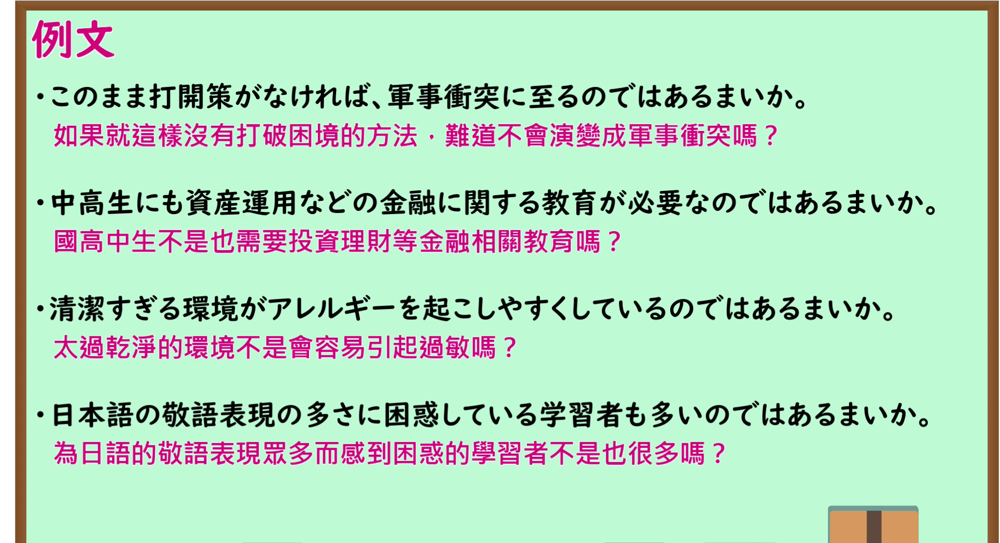

---
{
  "id": "N1-G-0080",
  "kind": "grammar",
  "level": "N1",
  "title": "～のではあるまいか：难道不是～吗；恐怕是～吧",
  "card_revision": 1,
  "schema_version": 1,
  "source": {
    "lesson": "N1 第80个语法",
    "material": "出口日語原视频板书、日语自动字幕与 Hagoromo 文型检索正文",
    "video": "https://www.youtube.com/watch?v=WcX612HIgsU",
    "screenshot": "assets/grammar/n1/N1-G-0080-connection.png",
    "screenshot_seconds": 120.0,
    "screenshot_crop": {
      "x": 0,
      "y": 0,
      "width": 1680,
      "height": 960
    }
  },
  "tags": [
    "推量",
    "主張・断定的評価",
    "N1"
  ],
  "confusions": [
    "～のではないか／～のではないだろうか（意义完全相同，都表示“难道不是……吗 / 恐怕是……吧”；但「～のではないか」「～のではないだろうか」属于现代通用书面语与郑重表达，而「～のではあるまいか」「～のではなかろうか」带有古典文语推量否定「まい」的色彩，语感极为庄重严谨，常用于论说文或学术论文）",
    "～ではないか（当提出显而易见的事实常识并加以反问或责难时，不含推测色彩，只能用「～ではないか」，如「初対面で年収を聞くなんて失礼ではないか」；若使用带有推测性质的「～のではあるまいか」则语境不自然）"
  ]
}
---

# N1 第80个语法：～のではあるまいか

# 视频学习资料整理

- 课程：[出口日語「【Ｎ１文法】～のではあるまいか」](https://www.youtube.com/watch?v=WcX612HIgsU)，时长 7 分 09 秒。
- 接续图：原视频 2:00.00（120.00 秒）；原图 1920×1080，固定左上角裁切区域 `(0, 0, 1680, 960)`。0:01 画面讲师居中遮挡了右侧大量板书说明；选用 120.00 秒讲师退至画面右侧边缘之外，接续框（动词/形容词普通形＋のではあるまいか、な形容词/名词＋な/である＋のではあるまいか）、红字核心含义（反语推断「Aだろう／Aだと思う」）、板书例句、以及推测内容与显而易见事实（失礼ではないか vs 失礼なのではあるまいか）对比均完整清晰呈现。

- 例句图：原视频 5:54.00（354.00 秒）；原图 1920×1080，固定左上角裁切区域 `(0, 0, 1895, 1030)`。四条例句及原视频中文说明完整清晰，裁去底部多余边框与进度条。

# 核心

## 功能一：难道不是……吗；恐怕是……吧（反语推断与主张）

**最上位意味カテゴリー：**

- **ではあるまいか：** 考え・感情（思考与感情）

**中位意味カテゴリー：**

- **ではあるまいか：** 推量（推测推量）／ 主張・断定的評価（主张与断定性评价）

**意味：**

- **ではあるまいか：** 推量（推测推量）／ 主張（主张）

**くわしい意味記述：**

- **推量：** 根拠に基づいて，「おそらく〜だろう」と推測する話し手の判断を表す。かたい表現で，書きことばで使う。（基于客观依据，表示说话人“恐怕……吧”的推测判断。属于严谨生硬的书面语表达。）
- **主張：** 「〜ではないか」という意味を表す。相手にある状況や出来事を認識させたり，思い出させたりするときに時に用いる。かたい表現で，書きことばで使う。（表示“难道不是……吗”的意思。用于促使对方认识到或回想起某种状况或事实。属于生硬的书面语表达。）

**派生語：** ではないだろうか

### 例句

1. 犯人は細い道を通っているから、この場所に詳しいのではあるまいか。

   （罪犯走的是偏僻小道，恐怕对此处的地形相当熟悉吧。）

2. アメリカに昔日の支配力がないことは動かせない事実なのではあるまいか。

   （美国已不复往日之支配力，这难道不是不容动摇的事实吗？）

3. 議員が年間に500万円も出張費を使うとは、使いすぎではあるまいか。

   （议员一年竟耗费高达500万日元的差旅费，这难道不是严重挥霍浪费吗？）

4. むしろ作法の規準が混乱しているというのが、今日の実情に近いのではあるまいか。

   （倒不如说礼节规范陷入混乱，恐怕才更接近当今的实际情况吧。）

# 来源

- [出口日語原视频](https://www.youtube.com/watch?v=WcX612HIgsU)
- [Hagoromo 文型检索「ではあるまいか（推量／主張）」](https://hagoromo-text.work/)（查询日期：2026-09-24；页面内检索「あるまいか」）
