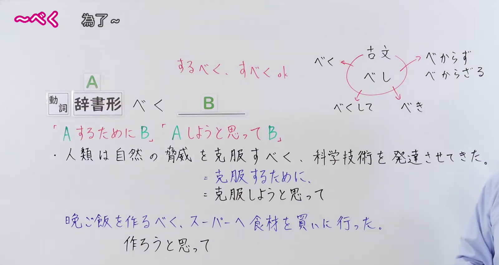
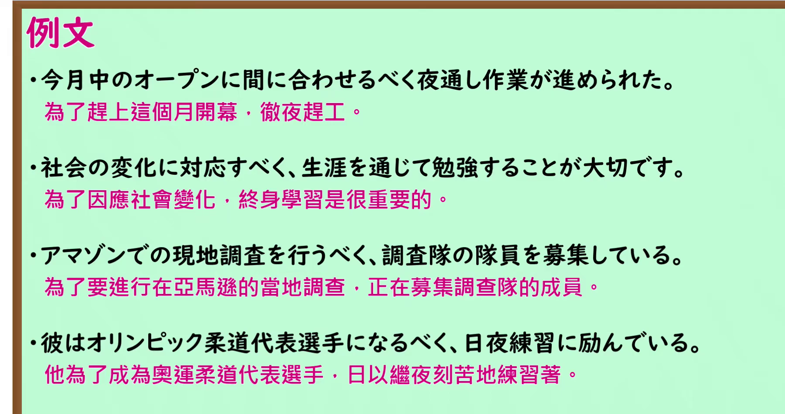

---
{
  "id": "N1-G-0081",
  "kind": "grammar",
  "level": "N1",
  "title": "べく：为了实现某个目的",
  "card_revision": 1,
  "schema_version": 1,
  "source": {
    "lesson": "N1 第81个语法",
    "material": "出口日語原视频板书、日语自动字幕与 Hagoromo「べく」正文",
    "video": "https://www.youtube.com/watch?v=gRVbiEhaGAo",
    "screenshot": "assets/grammar/n1/N1-G-0081-connection.png",
    "screenshot_seconds": 65,
    "screenshot_crop": {
      "x": 0,
      "y": 0,
      "width": 1600,
      "height": 850
    }
  },
  "tags": [
    "べく",
    "目的",
    "N1"
  ],
  "confusions": [
    "ために",
    "べき"
  ]
}
---

# べく：为了实现某个目的

# 视频学习资料整理

- [出口日語 N1 第81课原视频](https://www.youtube.com/watch?v=gRVbiEhaGAo)，时长 6 分 10 秒。课程以「A するために B」「A しようと思って B」解释「べく」的目的关系。
- 接续图：原视频 **1:05.00**，原图 **1920 × 1080**；从左上角保留 **x=0、y=0、宽=1600、高=850**。保留接续、红色含义说明、例句及「するべく／すべく」板书。

  

- 例句图：原视频 **4:28.97**，原图 **1920 × 1080**；从左上角保留 **x=0、y=0、宽=1800、高=950**。保留四句课程例句及原视频中的中文译文。

  

# 核心

## 功能一：为了做 A 而做 B；打算做 A 而做 B

**最上位意味カテゴリー：**

- **べく：** ものごとの関係（事物之间的关系）

**中位意味カテゴリー：**

- **べく：** 目的・目標（目的与目标）

**意味：**

- **べく：** 目的（目的）

**くわしい意味記述：**

- **べく：** Vをするために。「ある目的Xを達成するために，Yをする」という意味を表す。「XべくY」のXには，「になる」，「果たす/実現する」，「守る/救う」，「探る/見る/確認する」といった動詞がよく使われる。公的文書では「図る」，「対応する/応える」といったあるものに対する働きかけやその反応に関する動詞がよく使われる。前文と後文の主語は同じである。（为了做某事。表示“为了达成某个目的 X 而做 Y”。在「XべくY」中，X 常用「成为」「完成／实现」「守护／拯救」「探寻／查看／确认」等动词。公文中也常用「谋求」「应对／回应」等表示对某事物采取行动或作出反应的动词。前后两部分的主语相同。）

**派生語：** 未列出

### 例句

1. 友人を見舞うべく、病院を訪れた。

   （为了探望朋友，去了医院。）

2. そのうえで、将来的には世界平和に貢献するべく、憲法九条二項の改正が望ましいとしている。

   （在此基础上，还认为从长远来看，为了促进世界和平，修改宪法第九条第二款是可取的。）

3. 特に、2009 年11 月から開始となった「太陽光発電の新たな買取制度」の周知のため、全電気の使用者に対して、制度説明チラシ（約6,400 万部）を配布する等、本制度への国民の理解を得るべく広報活動に努めました。

   （特别是为了推广 2009 年 11 月启动的“太阳能发电新收购制度”，向所有电力用户发放约 6400 万份制度说明传单等，努力开展宣传，以争取国民对该制度的理解。）

# 来源

- [出口日語 N1 第81课原视频](https://www.youtube.com/watch?v=gRVbiEhaGAo)
- [Hagoromo 文型检索「べく（目的）」](https://hagoromo-text.work/)（查询日期：2026-09-24；站内检索「べく」）
