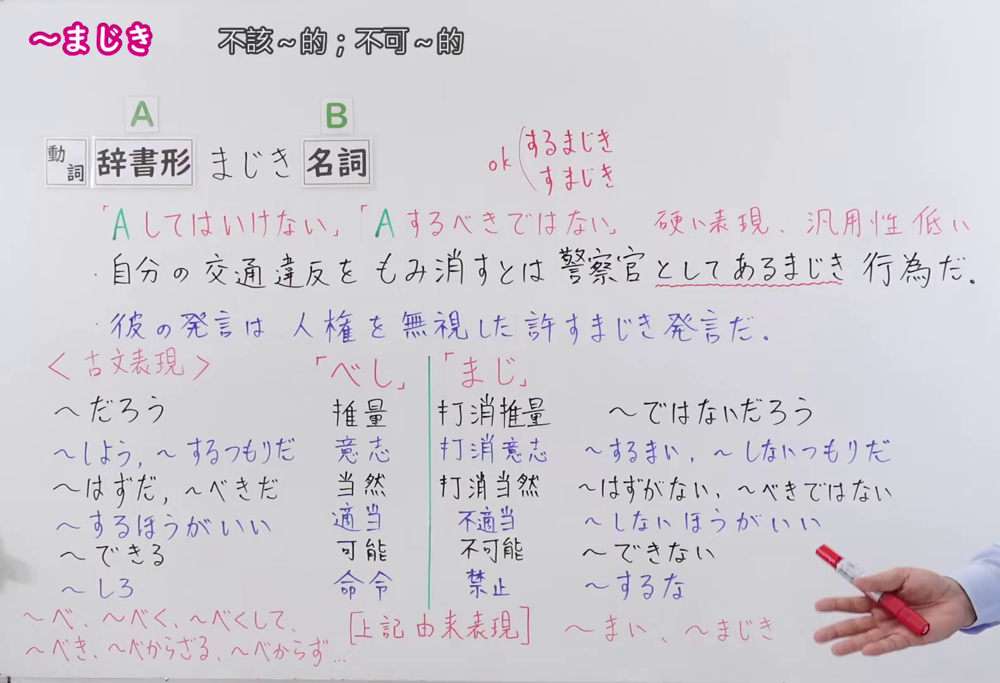
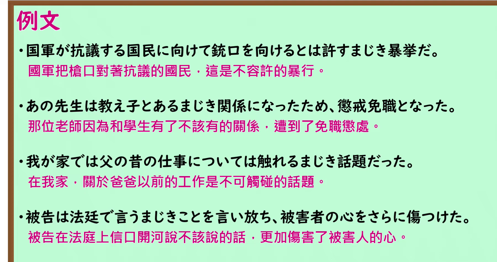

---
{
  "id": "N1-G-0082",
  "kind": "grammar",
  "level": "N1",
  "title": "まじき：不该有的行为",
  "card_revision": 1,
  "schema_version": 1,
  "source": {
    "lesson": "N1 第82个语法",
    "material": "出口日語原视频板书、日语自动字幕与 Hagoromo、日本語NET 正文",
    "video": "https://www.youtube.com/watch?v=1646BIHTzJE",
    "screenshot": "assets/grammar/n1/N1-G-0082-connection.png",
    "screenshot_seconds": 400,
    "screenshot_crop": {
      "x": 0,
      "y": 0,
      "width": 1580,
      "height": 1080
    }
  },
  "tags": [
    "まじき",
    "禁止",
    "N1"
  ],
  "confusions": [
    "べきではない",
    "べからず"
  ]
}
---

# まじき：不该有的行为

# 视频学习资料整理

- [出口日語 N1 第82课原视频](https://www.youtube.com/watch?v=1646BIHTzJE)，时长 9 分 26 秒。课程以「A してはいけない」「A するべきではない」解释「まじき」所表达的不当行为。
- 接续图：原视频 **6:40.00**，原图 **1920 × 1080**；从左上角保留 **x=0、y=0、宽=1580、高=1080**。保留接续、红色含义说明、课程例句及与「べし」对照的板书。该帧比 0:01 的板书更完整。

  

- 例句图：原视频 **8:00.33**，原图 **1920 × 1080**；从左上角保留 **x=0、y=0、宽=1800、高=950**。保留四句课程例句及原视频中的中文译文。

  

# 核心

## 功能一：A 不可以做；A 不应该做

**最上位意味カテゴリー：**

- **まじき：** 考え・感情（想法与情感）
- **あるまじき〜だ：** 考え・感情（想法与情感）

**中位意味カテゴリー：**

- **まじき：** 許可・禁止・義務・不必要（许可、禁止、义务与不必要）
- **あるまじき〜だ：** 主張・断定的評価（主张与断定性评价）

**意味：**

- **まじき：** 当為（应当如何）
- **あるまじき〜だ：** 評価（评价）

**くわしい意味記述：**

- **まじき：** 職業や地位を表す名詞について，「それにふさわしくない」や「あってはならない」といった意味を表す。ある人の地位や立場を非難する場合に用いる書き言葉的な表現。（接在表示职业或地位的名词之后，表达“与其身份不相称”或“不应存在”等意思。是批评某人作为该身份或处于该立场时的行为所用的书面表达。）
- **あるまじき〜だ：** 後に職業や地位を表す名詞が来て，「あってはならない」という意味を表す。（后接表示职业或地位的名词，表达“不应有”之意。）

**派生語：** 未列出

### 例句

1. うそをつくとは、政治家にあるまじき行為だ。

   （说谎是政治家不应有的行为。）

2. 自分の意見を、総司令部の権威で日本政府に押しつけようとしたのだろうか。 信じられないことだが、もしも事実そうだとすれば、総理大臣にはあるまじきことである。

   （他难道想借总司令部的权威，把自己的意见强加给日本政府吗？这令人难以置信；但如果属实，那便是首相绝不该做的事。）

3. SNSで学校の悪口や授業の様子を投稿するなど、許すまじき行為だ。

   （在社交平台发布诋毁学校的话或课堂情况等，是不可容许的行为。）

# 来源

- [出口日語 N1 第82课原视频](https://www.youtube.com/watch?v=1646BIHTzJE)
- [Hagoromo 文型检索「まじき（当為）」「あるまじき〜だ（評価）」](https://hagoromo-text.work/)（查询日期：2026-09-24；站内检索「まじき」）
- [日本語NET「〜まじき」](https://nihongokyoshi-net.com/2019/06/16/jlptn1-grammar-majiki/)（查询日期：2026-09-24；补充「許すまじき」例句）
