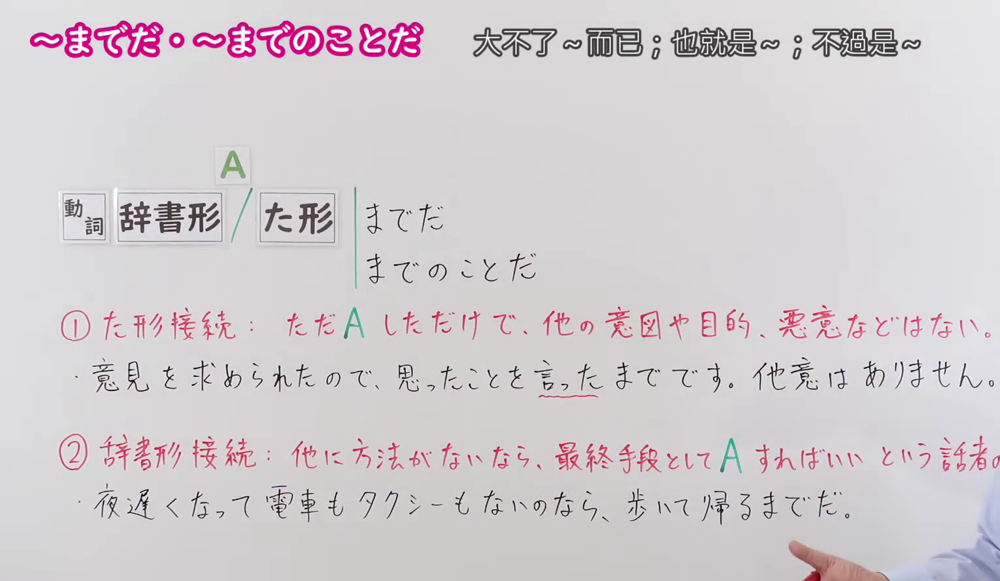
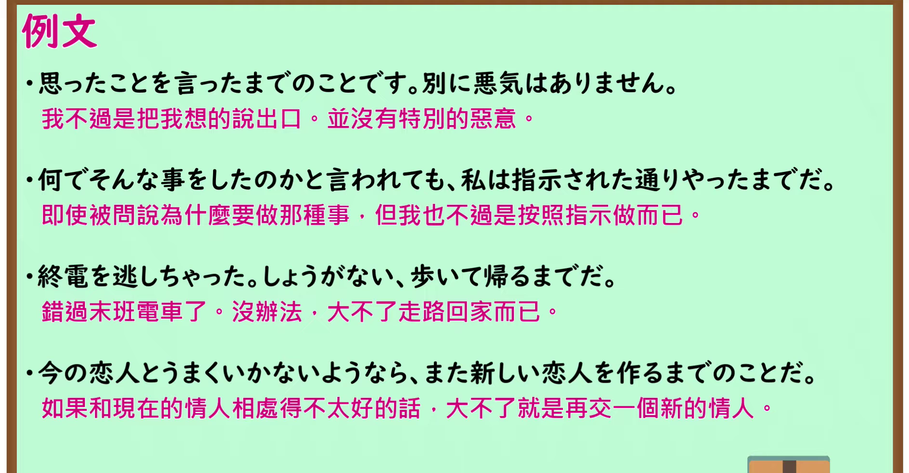

---
{
  "id": "N1-G-0083",
  "kind": "grammar",
  "level": "N1",
  "title": "～までだ／～までのことだ（大不了～而已／不过是～）",
  "card_revision": 1,
  "schema_version": 1,
  "source": {
    "lesson": "N1 第83个语法",
    "material": "出口日語原视频板书、日语自动字幕与Hagoromo文型检索正文",
    "video": "https://www.youtube.com/watch?v=hWR5frxrwNY",
    "screenshot": "assets/grammar/n1/N1-G-0083-connection.png",
    "screenshot_seconds": 85.0,
    "screenshot_crop": {
      "x": 0,
      "y": 0,
      "width": 1530,
      "height": 890
    }
  },
  "tags": [
    "限定",
    "意志",
    "N1"
  ],
  "confusions": [
    "～にすぎない",
    "～だけだ"
  ]
}
---

# N1 第83个语法：～までだ／～までのことだ

# 视频学习资料整理

- 原视频讲解链接：[出口日語 N1 第83个语法](https://www.youtube.com/watch?v=hWR5frxrwNY)
- 接续图：真实时间 85.00 秒，原图尺寸 1920×1080，裁切区域左上角 (0, 0)、宽 1530、高 890（保留完整标题、动词接续框、两种接续说明及完整例句，裁去右侧讲师与底部空白）。
  
- 例句图：真实时间 150.00 秒，原图尺寸 1920×1080，裁切区域左上角 (15, 10)、宽 1890、高 985（保留完整例句黑板，裁去外框多余黑边）。
  

# 核心

## 功能一（接た形）：只是做了某事而已，并无其他意图、目的或恶意

**最上位意味カテゴリー：**

- **までだ：** 考え・感情（想法与情感）
- **までのことだ：** 考え・感情（想法与情感）

**中位意味カテゴリー：**

- **までだ：** 主張・断定的評価（主张与断定性评价）
- **までのことだ：** 主張・断定的評価（主张与断定性评价）

**意味：**

- **までだ：** 評価（评价）
- **までのことだ：** 評価（评价）

**くわしい意味記述：**

- **までだ：** 「特別な理由や感情はなく，ただ〜するだけ」の意味。タ形に接続した場合は，深い意味はない，と説明する意味になる。（“没有特别的理由或感情，只是做……”的意思。接过去形（タ形）时，表示进行说明，表明“并无深意”。）
- **までのことだ：** 同上。

**派生語：** 未列出

### 例句

1. 思ったことを言ったまでのことです。別に悪気はありません。

   （我不过是把心中所想的说出来而已，并没有特别的恶意。）

2. 何でそんな事をしたのかと言われても、私は指示された通りやったまでだ。

   （即使被问为什么做那种事，我也只不过是按照指示做而已。）

3. 私見によれば、この蟹行事の基本にあるものこそ、じつは蛇である。時代がくだるにつれて、蛇を使用するためらいが、蟹を代用させることになったまでのことであろう。

   （依我浅见，这项螃蟹祭祀活动原本的核心，实际上是蛇。随着时代的推移，人们对使用蛇产生了顾虑，才演变为以蟹代之而已吧。）

4. ほんのちょっと寄ってみたまでのことさ。

   （我只不过是顺道稍作停留而已啦。）

## 功能二（接辞书形）：要是没有其他办法，作为最终手段做某事即可（表达说话人的决心与觉悟）

**最上位意味カテゴリー：**

- **までだ：** 考え・感情（想法与情感）
- **までのことだ：** 考え・感情（想法与情感）

**中位意味カテゴリー：**

- **までだ：** 主張・断定的評価（主张与断定性评价）
- **までのことだ：** 主張・断定的評価（主张与断定性评价）

**意味：**

- **までだ：** 評価（评价）
- **までのことだ：** 評価（评价）

**くわしい意味記述：**

- **までだ：** 「特別な理由や感情はなく，ただ〜するだけ」の意味。ル形に接続した場合は，淡々とあることを実行するという意思表明になる。（“没有特别的理由或感情，只是做……”的意思。接辞书形（ル形）时，表示淡淡地表明实行某事的意志与决心。）
- **までのことだ：** 同上。

**派生語：** 未列出

### 例句

1. 終電を逃しちゃった。しょうがない、歩いて帰るまでだ。

   （错过末班电车了。没办法，大不了走着回去而已。）

2. 今の恋人とうまくいかないようなら、また新しい恋人を作るまでのことだ。

   （如果和现在的对象处得不顺利，大不了重新找一个就是了。）

3. 問題になったら、学校を辞めるまでだ。

   （如果闹出问题，大不了退学就是了。）

4. やってみて、失敗したら止めるまでだ。

   （去尝试一下，要是失败了放弃就是了。）

5. できないのなら、やめるまでのことだ。

   （要是做不到的话，不做就是了。）

# 来源

- [出口日語原视频](https://www.youtube.com/watch?v=hWR5frxrwNY)
- [Hagoromo 文型检索「までだ」](https://hagoromo-text.work/lookup?text=%E3%81%BE%E3%81%A7%E3%81%A0&mode=partial)（查询日期：2026-09-24）
- [Hagoromo 文型检索「までのことだ」](https://hagoromo-text.work/lookup?text=%E3%81%BE%E3%81%A7%E3%81%AE%E3%81%93%E3%81%A8%E3%81%A0&mode=partial)（查询日期：2026-09-24）
