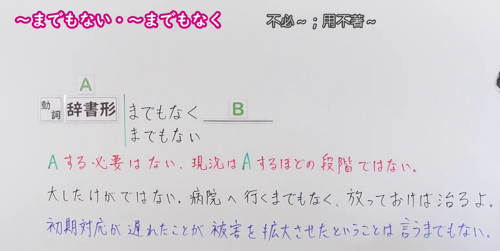
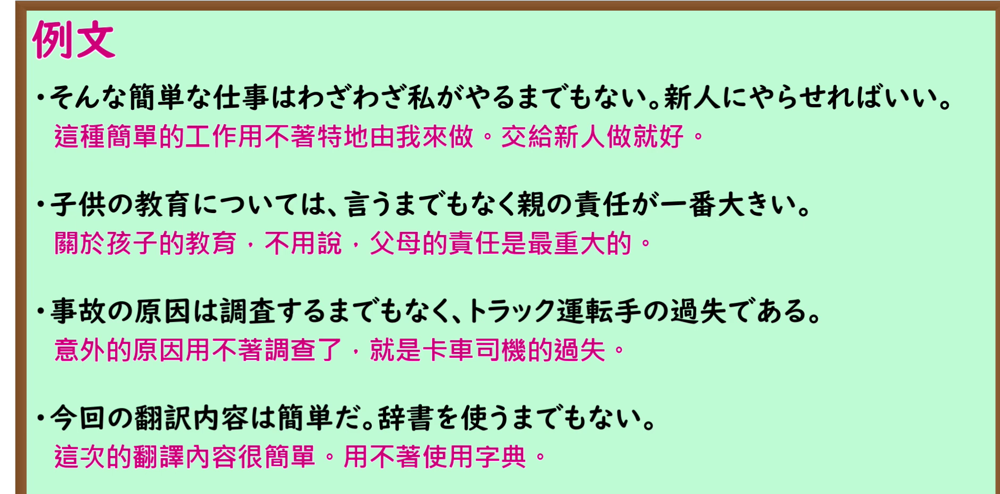

---
{
  "id": "N1-G-0084",
  "kind": "grammar",
  "level": "N1",
  "title": "〜までもない・〜までもなく：没必要做到……",
  "card_revision": 1,
  "schema_version": 1,
  "source": {
    "lesson": "N1 第84个语法",
    "material": "出口日語原视频板书、日语自动字幕与Hagoromo正文",
    "video": "https://www.youtube.com/watch?v=cC2Z_xIDBG0",
    "screenshot": "assets/grammar/n1/N1-G-0084-connection.png",
    "screenshot_seconds": 68,
    "screenshot_crop": {
      "x": 0,
      "y": 0,
      "width": 1550,
      "height": 780
    }
  },
  "tags": [
    "没必要",
    "N1"
  ],
  "confusions": [
    "〜までもない表示没必要做到某事；不要与表示无需赘述的固定搭配「言うまでもない」机械等同。"
  ]
}
---

# 〜までもない・〜までもなく

# 视频学习资料整理

课程：[出口日語 N1 第84课](https://www.youtube.com/watch?v=cC2Z_xIDBG0)。板书介绍动词辞书形后的「〜までもない／〜までもなく」，并用红字说明其含义。自动字幕把「動詞」误写成「同市」等，以下以原视频画面为准。

- 接续与含义板书：视频 01:08.00；原图 1920 × 1080；从左上角裁切，区域 `(x=0, y=0, width=1550, height=780)`。保留接续、红字含义说明及下方两条板书例句。

- 课程例句板书：视频 02:00.00；原图 1920 × 1080；从左上角裁切，区域 `(x=0, y=0, width=1880, height=930)`。保留四条日语例句及其视频中的中文译文。

# 核心

## 功能一：没有做 A 的必要，目前还不到要做 A 的程度

**最上位意味カテゴリー：**

- **までもない（含派生形式「までもなく」）：** 考え・感情（想法与感情）

**中位意味カテゴリー：**

- **までもない（含派生形式「までもなく」）：** 主張・断定的評価（主张与断定性评价）

**意味：**

- **までもない（含派生形式「までもなく」）：** 評価（评价）

**くわしい意味記述：**

- **までもない（含派生形式「までもなく」）：** 「〜する必要はない」という意味。やや改まった表現。（表示“没有必要做……”。语气稍显正式。）

**派生語：** までもなく

### 例句

1. これぐらいの頭痛なら、医者に行くまでもない。

   （只是这点头痛，没必要去看医生。）

2. 今さら言うまでもなく、野球は国民的スポーツである。

   （事到如今不用多说，棒球是一项国民运动。）

3. こうした例をまつまでもなく、将校と兵の間の親密感はいろいろな面にあらわれ、それがことのほか日本社会では高く断定的評価されている。

   （无需等待这类事例出现，军官与士兵之间的亲近感已在各个方面显现，而且在日本社会受到格外肯定的评价。）

# 来源

- [出口日語原视频](https://www.youtube.com/watch?v=cC2Z_xIDBG0)
- [Hagoromo「までもない」条目](https://www.hagoromo-text.work/lookup?vid=1548)（查询日期：2026-09-24）
- [Hagoromo「までもない」例句](https://www.hagoromo-text.work/get_reibun?vid=1548)（查询日期：2026-09-24）
