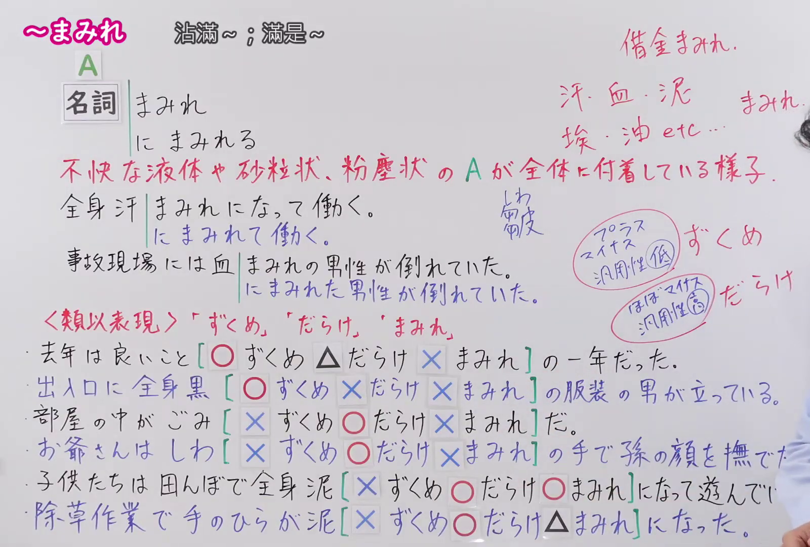
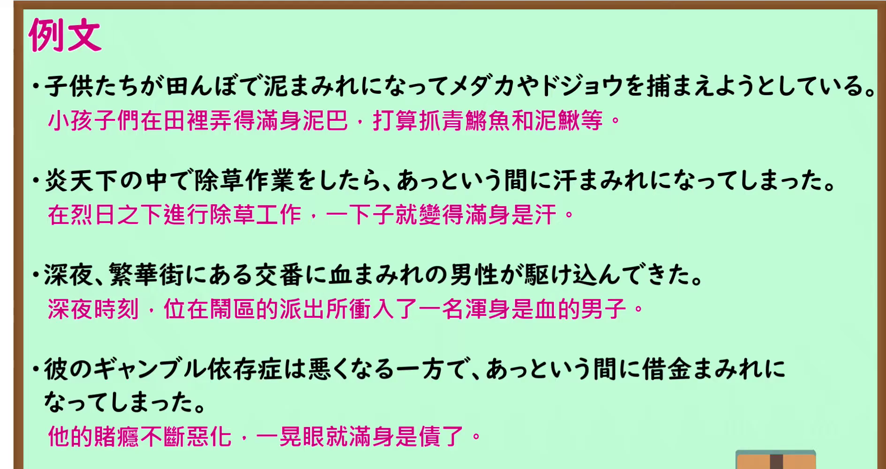

---
{
  "id": "N1-G-0085",
  "kind": "grammar",
  "level": "N1",
  "title": "〜まみれ：满身沾着令人不快的东西",
  "card_revision": 1,
  "schema_version": 1,
  "source": {
    "lesson": "N1 第85个语法",
    "material": "出口日語原视频板书、日语自动字幕与Hagoromo正文",
    "video": "https://www.youtube.com/watch?v=g6kPthK-Olw",
    "screenshot": "assets/grammar/n1/N1-G-0085-connection.png",
    "screenshot_seconds": 600,
    "screenshot_crop": {
      "x": 0,
      "y": 0,
      "width": 1600,
      "height": 1080
    }
  },
  "tags": [
    "沾满",
    "N1"
  ],
  "confusions": [
    "まみれ常指液体或细小物大量附着，带不快感；视频板书对比了ずくめ、だらけ。"
  ]
}
---

# 〜まみれ

# 视频学习资料整理

课程：[出口日語 N1 第85课](https://www.youtube.com/watch?v=g6kPthK-Olw)。板书展示名词后的「〜まみれ」和「〜にまみれる」，并对比「〜ずくめ」「〜だらけ」。日语自动字幕将「名詞」误识别为「名刺」，以下以视频板书为准。

- 接续、含义及对比板书：视频 10:00.00；原图 1920 × 1080；从左上角裁切，区域 `(x=0, y=0, width=1600, height=1080)`。保留红字含义、板书例句及下方对比行；部分对比句的右端在原画面中被教师遮挡。

- 课程例句页：视频 10:20.00；原图 1920 × 1080；从左上角裁切，区域 `(x=0, y=0, width=1890, height=1000)`。保留四条日语例句及视频中的中文译文。

# 核心

## 功能一：令人不快的液体、沙粒或粉尘等沾满 A 的全身

**最上位意味カテゴリー：**

- **Nまみれ：** ものごとの様子（事物的样子）

**中位意味カテゴリー：**

- **Nまみれ：** 様子・状態（样子与状态）

**意味：**

- **Nまみれ：** 状態（状态）

**くわしい意味記述：**

- **Nまみれ：** 不快な液体や細かいものがたくさんある。「ある人・事物Xに不快なYがたくさん付いていて汚い状態だ」という意味を表す。「血，汗，泥，ほこり，砂，油」といった液体や細かいものを表す名詞がよく使われる。これらが「まみれ」とともに使われることで，不快感を表している。「スキャンダルまみれ」「借金まみれ」「金まみれ」のようなものもあり、「ある人に汚くてネガティブなイメージが付いている」という意味もある。改まった文や論理的な文では使わない。（指令人不快的液体或细小物大量存在，表示人或事物 X 沾上许多令人不快的 Y，处于肮脏的状态。常接表示液体或细小物的名词，如血、汗、泥、灰尘、沙和油，带有不快感；也有「丑闻缠身」「债务缠身」「浑身铜臭」等比喻用法，表示某人带有肮脏、负面的形象。不用于正式或逻辑论述性文章。）

**派生語：** 未列出

### 例句

1. 子どもが公園で遊んで泥まみれになった。

   （孩子在公园玩得浑身是泥。）

2. どこ行っても汗まみれ。

   （走到哪里都是满身汗。）

3. さくら:額に汗して、油まみれになって働く人と、いいカッコしてブラブラしてる人とどっちが偉いと思うの。

   （樱：你觉得，挥汗劳作、满身油污的人，和只顾摆样子、四处闲逛的人，哪个更了不起？）

4. 快晴の朝が数分で暗やみとなり自動車も砂まみれ。

   （晴朗的早晨几分钟内变得一片昏暗，汽车也沾满了沙。）

# 来源

- [出口日語原视频](https://www.youtube.com/watch?v=g6kPthK-Olw)
- [Hagoromo「Nまみれ」条目](https://www.hagoromo-text.work/lookup?vid=128)（查询日期：2026-09-24）
- [Hagoromo「Nまみれ」例句](https://www.hagoromo-text.work/get_reibun?vid=128)（查询日期：2026-09-24）
