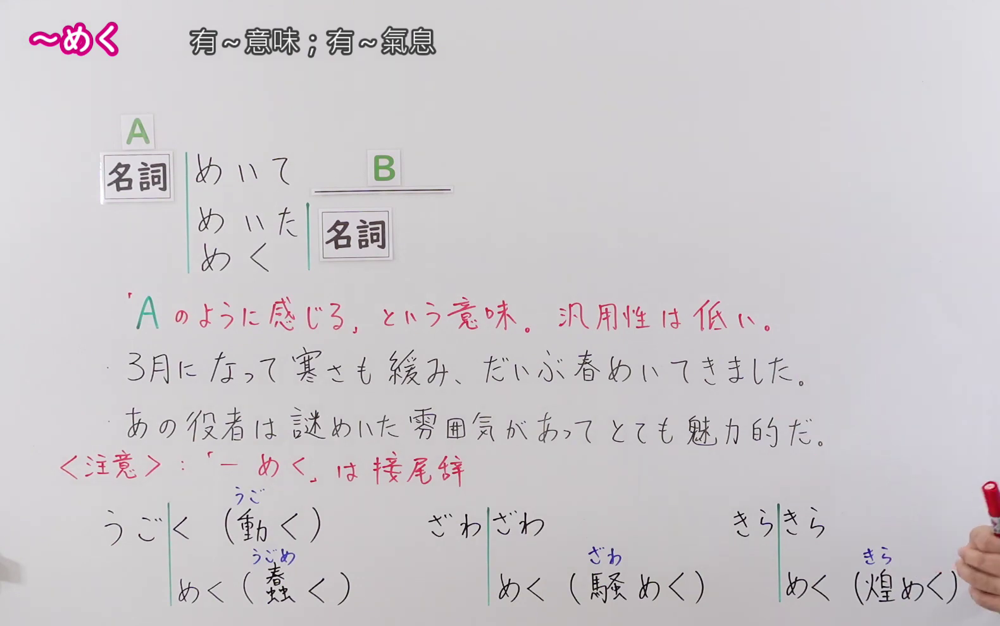
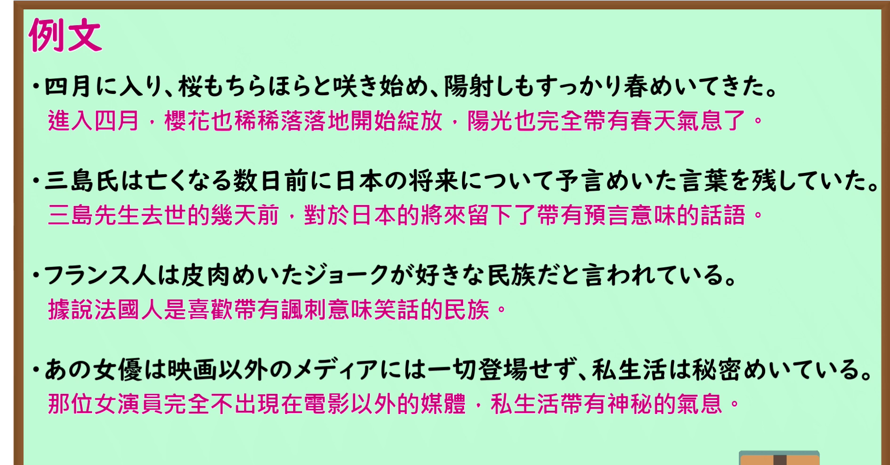

---
{
  "id": "N1-G-0086",
  "kind": "grammar",
  "level": "N1",
  "title": "〜めく：感觉带有某种样子",
  "card_revision": 1,
  "schema_version": 1,
  "source": {
    "lesson": "N1 第86个语法",
    "material": "出口日語原视频板书、日语自动字幕与Hagoromo正文",
    "video": "https://www.youtube.com/watch?v=IBL5qeByTtI",
    "screenshot": "assets/grammar/n1/N1-G-0086-connection.png",
    "screenshot_seconds": 220,
    "screenshot_crop": {
      "x": 0,
      "y": 0,
      "width": 1580,
      "height": 990
    }
  },
  "tags": [
    "近似",
    "N1"
  ],
  "confusions": [
    "视频板书列出「〜めく」「〜めいて」「〜めいた名词」；前接名词的选择有限，不宜任意套用。"
  ]
}
---

# 〜めく

# 视频学习资料整理

课程：[出口日語 N1 第86课](https://www.youtube.com/watch?v=IBL5qeByTtI)。板书展示「〜めく」「〜めいて」「〜めいた名词」，并提示这类表达的通用性较低。日语自动字幕将「名詞」误识别为「名刺」，以下以原视频板书为准。

- 接续与含义板书：视频 03:40.00；原图 1920 × 1080；从左上角裁切，区域 `(x=0, y=0, width=1580, height=990)`。保留红字含义、两条板书例句及下方词形提示。

- 课程例句页：视频 04:13.60；原图 1920 × 1080；从左上角裁切，区域 `(x=0, y=0, width=1890, height=990)`。保留四条日语例句及视频中的中文译文。

# 核心

## 功能一：感觉像 A；适用范围有限

**最上位意味カテゴリー：**

- **Nめく：** ものごとの様子（事物的样子）

**中位意味カテゴリー：**

- **Nめく：** 傾向（倾向）

**意味：**

- **Nめく：** 近似（近似）

**くわしい意味記述：**

- **Nめく：** 「〜の様子が感じられる」という意味。前に来る名詞は固定的。また，「〜めいたN」「〜めいて」という形になることが非常に多い。（表示“能感觉到带有……的样子”。前接的名词较固定，而且经常以「〜めいたN」「〜めいて」的形式出现。）

**派生語：** 未列出

### 例句

1. ようやく春めいてきた。

   （终于有了春天的气息。）

2. 事実はただの事実にすぎません。まあ、こんな理屈めいたことを言っていても、あんまり意味がないことです。

   （事实终究只是事实。唉，说这些像是在讲道理的话，也没多大意义。）

3. これまでの調べで、遺体のあった場所付近の水中から、小松容疑者のものと見られる現金数十万円と遺書めいたメモなどが入った黒色リュックを発見した。

   （截至目前的调查，在发现遗体的地点附近水域，找到了一个黑色背包，里面装有据信属于小松嫌疑人的数十万日元现金，以及一张类似遗书的便条等物品。）

# 来源

- [出口日語原视频](https://www.youtube.com/watch?v=IBL5qeByTtI)
- [Hagoromo「Nめく」条目](https://www.hagoromo-text.work/lookup?vid=129)（查询日期：2026-09-24）
- [Hagoromo「Nめく」例句](https://www.hagoromo-text.work/get_reibun?vid=129)（查询日期：2026-09-24）
