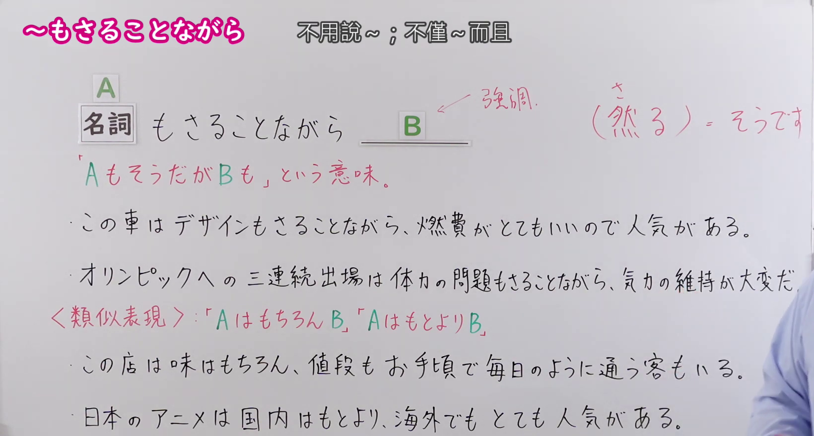
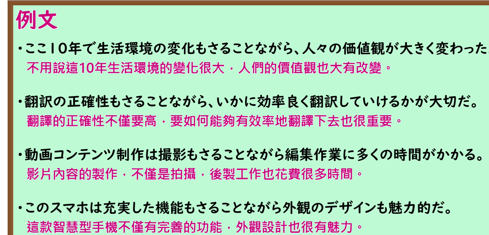

---
{
  "id": "N1-G-0087",
  "kind": "grammar",
  "level": "N1",
  "title": "～もさることながら（不用說～；不僅～而且）",
  "card_revision": 1,
  "schema_version": 1,
  "source": {
    "lesson": "N1 第87个语法",
    "material": "出口日語原视频板书、日语自动字幕与 Hagoromo 正文",
    "video": "https://www.youtube.com/watch?v=eZAMuinhaCk",
    "screenshot": "assets/grammar/n1/N1-G-0087-connection.png",
    "screenshot_seconds": 120,
    "screenshot_crop": {
      "x": 0,
      "y": 0,
      "width": 1640,
      "height": 880
    }
  },
  "tags": [
    "文法",
    "N1"
  ],
  "confusions": [
    "～はもちろんB",
    "～はもとよりB"
  ]
}
---

# ～もさることながら（不用說～；不僅～而且）

## 视频学习资料整理

- 原视频：[出口日語 N1 第87个语法](https://www.youtube.com/watch?v=eZAMuinhaCk)
- 接续图：
  - 真实时间 2:00；原图 1920×1080，裁切区域 (0,0)–(1640,880)。0:01 画面中例句尚未书写完整且右侧被老师遮挡，故改用板书全部完成、老师退至画面右缘的 2:00 时点。画面保留本课接续（名词＋もさることながら＋B）、红色意义解释、两个例句、类似表现（AはもちろんだB、AはもとよりB）及其两个例句，以及红字注释「（然る）＝そうです」。右下角少量衣袖未遮挡任何文字。
- 例句图：
  - 真实时间 3:25；原图 1920×1080，裁切区域 (0,0)–(1852,890)。裁去底部桌缘装饰图形与右侧多余边框，四条课程例句及中文翻译完整清晰。

# 核心

## 功能一：「A もそうだが B も」という意味（意思是“A 是这样，B 也同样如此”）

**最上位意味カテゴリー：**

- **もさることながら：** ものごとの関係（事物之间的关系）

**中位意味カテゴリー：**

- **もさることながら：** 付加（添加）

**意味：**

- **もさることながら：** 付加（添加）

**くわしい意味記述：**

- **もさることながら：** 「N＋もさることながら〜」で，Nも重要で無視できないが，「〜」で表すことも重要で無視できない，と付け加えたい時に使う。（用于「N＋もさることながら〜」，表示 N 也很重要、不容忽视，而「〜」所表达的内容同样重要、不容忽视，想要补充说明这一层时使用。）

**派生語：** 未列出

### 例句

1. このレストランは、味もさることながらサービスも一流だ。

   （这家餐厅不用说味道，服务也是一流的。）

2. また、正確なデータ収集もさることながら、酸性雨に対する共通の認識を深めることも重要だ。

   （而且，不用说准确的数据收集，加深对酸雨的共同认识也很重要。）

3. 有権者もさることながら、政治家の責任こそ重大である。

   （不用说选民，恰恰是政治家的责任才重大。）

4. それはさておき、医療サービスの側面に話を戻すと老人科センターが中心になって、老人ケア対策を進めているわけだが、重荷になっているのは、ねたきり老人もさることながら、より一層たいへんなのは精神障害をもつもののケアである。

   （且说回来，回到医疗服务的层面，老年科中心在牵头推进老年护理对策，而成为重担的，不用说卧床的老人，更加吃力的是对精神障碍者的护理。）

# 来源

- [出口日語原视频](https://www.youtube.com/watch?v=eZAMuinhaCk)
- [Hagoromo「もさることながら」](https://hagoromo-text.work/lookup?vid=1601)（查询日期：2026-09-24）
