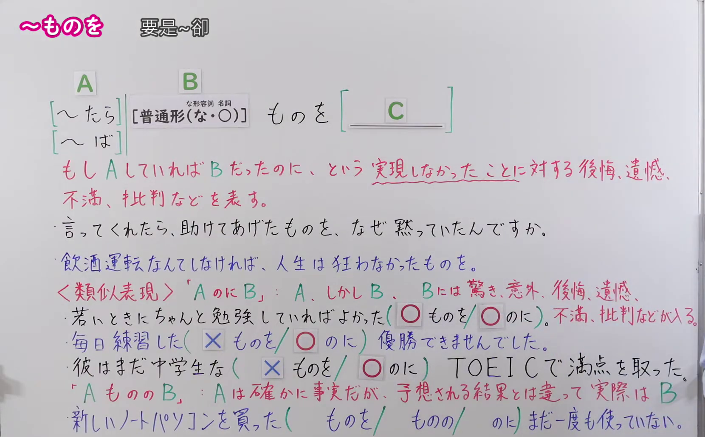
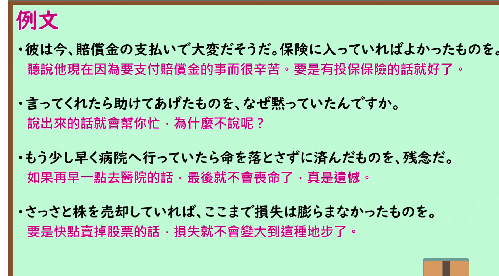

---
{
  "id": "N1-G-0088",
  "kind": "grammar",
  "level": "N1",
  "title": "～ものを（要是～卻）",
  "card_revision": 1,
  "schema_version": 1,
  "source": {
    "lesson": "N1 第88个语法",
    "material": "出口日語原视频板书、日语自动字幕与 Hagoromo 正文",
    "video": "https://www.youtube.com/watch?v=hHYfmqtNDd0",
    "screenshot": "assets/grammar/n1/N1-G-0088-connection.png",
    "screenshot_seconds": 420,
    "screenshot_crop": {
      "x": 0,
      "y": 0,
      "width": 1660,
      "height": 1030
    }
  },
  "tags": [
    "文法",
    "N1"
  ],
  "confusions": [
    "～のに",
    "～ものの"
  ]
}
---

# ～ものを（要是～卻）

## 视频学习资料整理

- 原视频：[出口日語 N1 第88个语法](https://www.youtube.com/watch?v=hHYfmqtNDd0)
- 接续图：
  - 真实时间 7:00；原图 1920×1080，裁切区域 (0,0)–(1660,1030)。0:01 与 0:14 时画面右侧红字解释与类似表现行被老师头部遮挡，7:00 时老师已退至画面右缘之外，板书（含练习○×答案）完整清晰，故改用该时点。画面保留本课接续（～たら／～ば＋普通形＋ものを＋C）、红色意义解释、两个例句、类似表现「AのにB」「AもののB」的说明与三道填空练习。
- 例句图：
  - 真实时间 8:59；原图 1920×1080，裁切区域 (0,0)–(1852,1025)。裁去底部桌缘装饰图形与右侧多余边框，四条课程例句及中文翻译完整清晰。

# 核心

## 功能一：要是 A 的话，B 了——对未能实现之事表示后悔、遗憾、不满、批评等

**最上位意味カテゴリー：**

- **ものを：** ものごとの関係（事物之间的关系）

**中位意味カテゴリー：**

- **ものを：** 逆接・譲歩（逆接与让步）

**意味：**

- **ものを：** 逆接：反事実条件（逆接：反事实条件）

**くわしい意味記述：**

- **ものを：** 「のに」の意味。実際には実現しなかったについて，後悔したり，不満に思っている気持ちを表すのに使う。実際に起こったことには使えない。（意思同「のに」。用于表达对实际上未能实现之事的后悔、不满等心情。不能用于实际已经发生的事情。）

**派生語：** 未列出

### 例句

1. 知っていれば助けてあげたものを、連絡してくれないから間に合わなかったじゃないの。

   （要是知道的话我肯定会帮你的，可你都不联系我，所以来不及了嘛。）

2. 「ある」と言えばすむものを、奥歯に物の挟まったように「無いこともない」と遠回しに言う。

   （明明说“有”就能了事，却像牙缝里卡了东西似的，拐弯抹角地说“也不是没有”。）

3. ある日本の女性がその話を聞いて、「何も食事を減らさなくても余裕ができたときにそのお金をまとめて払えばよさそうなものを」と言ったところ、ユダヤ人は、「私は神様のお金をごまかすことは死んでもできない」と答えた。

   （一位日本女性听了这件事后说：“不必非得减少伙食，等手头宽裕时一次性付清不就好了嘛”，而那位犹太人回答：“我就是死也不能糊弄神的钱”。）

4. 寅：ましてや頭でもよけりゃなにか気のきいた言葉の一つもかけてやれるものを、それもできやしねえ。

   （阿寅：更何况要是生个病发烧，还能说句什么体贴的话安慰人家，可连这也做不到。）

# 来源

- [出口日語原视频](https://www.youtube.com/watch?v=hHYfmqtNDd0)
- [Hagoromo「ものを」](https://hagoromo-text.work/lookup?vid=1635)（查询日期：2026-09-24）
