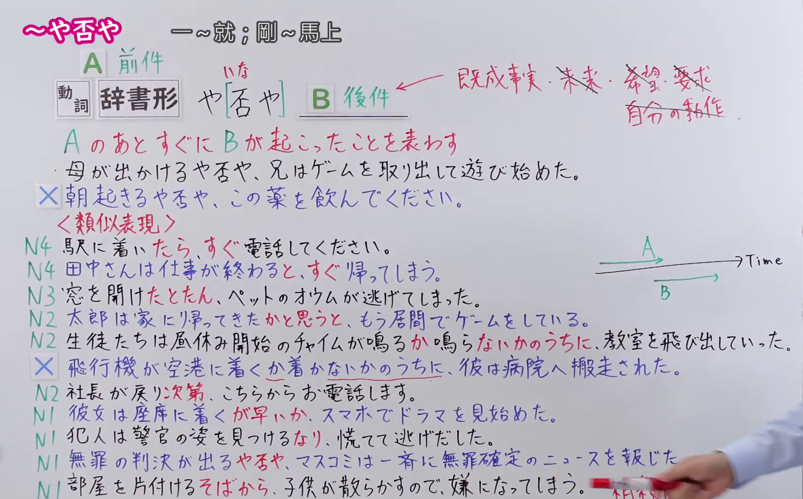
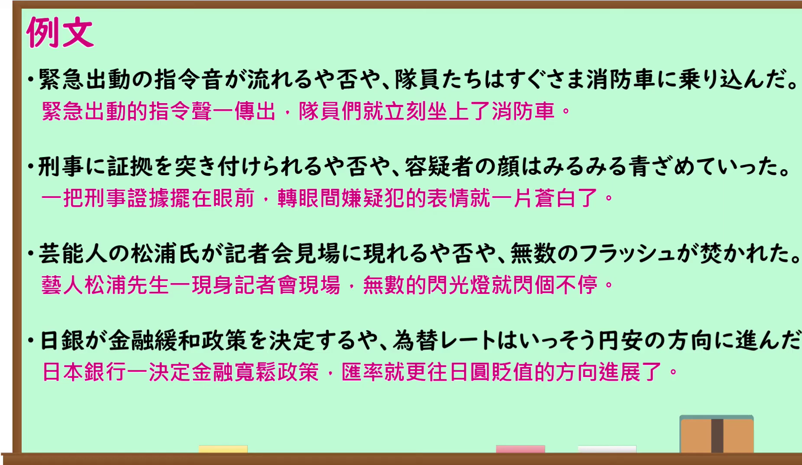

---
{
  "id": "N1-G-0089",
  "kind": "grammar",
  "level": "N1",
  "title": "～や否や（一～就；剛～馬上）",
  "card_revision": 1,
  "schema_version": 1,
  "source": {
    "lesson": "N1 第89个语法",
    "material": "出口日語原视频板书、日语自动字幕与 Hagoromo 正文",
    "video": "https://www.youtube.com/watch?v=1cplsdGCQdc",
    "screenshot": "assets/grammar/n1/N1-G-0089-connection.png",
    "screenshot_seconds": 748,
    "screenshot_crop": {
      "x": 0,
      "y": 0,
      "width": 1630,
      "height": 1015
    }
  },
  "tags": [
    "文法",
    "N1"
  ],
  "confusions": [
    "～とたん（に）",
    "～か～ないかのうちに",
    "～が早いか",
    "～そばから"
  ]
}
---

# ～や否や（一～就；剛～馬上）

## 视频学习资料整理

- 原视频：[出口日語 N1 第89个语法](https://www.youtube.com/watch?v=1cplsdGCQdc)
- 接续图：
  - 真实时间 12:28；原图 1920×1080，裁切区域 (0,0)–(1630,1015)。0:01 与 0:47 时类似表现各行右端被老师身体遮挡，12:28 时板书全部完成、老师退至画面右缘，仅剩右下角衣袖与笔尖且未遮挡任何文字，故改用该时点。画面保留本课接续（动词辞书形＋や否や＋后项）、红色意义解释、两个例句（含标×的不成立例句）、类似表现（とたら／と／たとたん／かと思うと／か～ないかのうちに／次第／が早いか／なり／そばから）共十行例句、红字后项限制注释（既成事実・未来・希望・要求・自分の動作）与 A、B 时间轴示意图。
- 例句图：
  - 真实时间 13:10；原图 1920×1080，裁切区域 (0,0)–(1852,1075)。裁去右侧多余边框，四条课程例句及中文翻译完整清晰，底部保留少量装饰图形。

# 核心

## 功能一：表示 A 发生之后，紧接着就发生了 B

**最上位意味カテゴリー：**

- **やいなや：** 場所・時間（场所与时间）

**中位意味カテゴリー：**

- **やいなや：** 時間的前後（时间的前后）

**意味：**

- **やいなや：** 継起（後）（相继（后项））

**くわしい意味記述：**

- **やいなや：** あることが起こると直後に別のことが起こることを表す。（表示一件事发生后紧接着又发生另一件事。）

**派生語：** 未列出

### 例句

1. 社長は席に着くやいなや、大声で自分の考えを話し始めた。

   （社长刚一坐下，就大声讲起了自己的想法。）

2. 『種の起原』は発表されるやいなや、生物の進化を初めて科学的に説明した画期的な理論としてまたたく間に広がっていった。

   （《物种起源》一发表，便作为首次科学解释生物进化的划时代理论迅速传开。）

3. 昨年暮れには衰弱したオオミズナギドリを一か月ほど保護し、多摩川に放ったが、水面に着水するやいなや数十羽のカラスに襲われた。

   （去年年底，他们救助了一只虚弱的白额鹱约一个月后将其放归多摩川，可它一落到水面就遭到几十只乌鸦的袭击。）

# 来源

- [出口日語原视频](https://www.youtube.com/watch?v=1cplsdGCQdc)
- [Hagoromo「やいなや」](https://hagoromo-text.work/lookup?vid=1650)（查询日期：2026-09-24）
