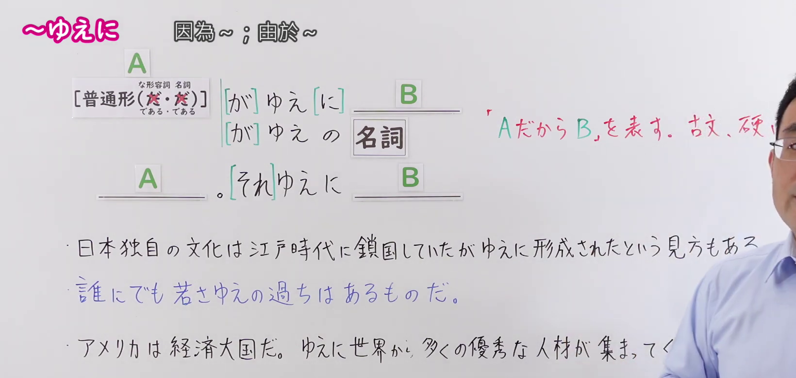
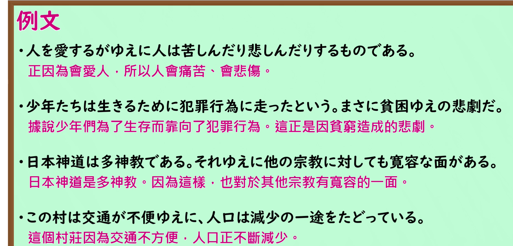

---
{
  "id": "N1-G-0090",
  "kind": "grammar",
  "level": "N1",
  "title": "～ゆえに（因為～；由於～）",
  "card_revision": 1,
  "schema_version": 1,
  "source": {
    "lesson": "N1 第90个语法",
    "material": "出口日語原视频板书、日语自动字幕与 Hagoromo 正文",
    "video": "https://www.youtube.com/watch?v=h_e5NQXLK2o",
    "screenshot": "assets/grammar/n1/N1-G-0090-connection.png",
    "screenshot_seconds": 75,
    "screenshot_crop": {
      "x": 0,
      "y": 0,
      "width": 1640,
      "height": 780
    }
  },
  "tags": [
    "文法",
    "N1"
  ],
  "confusions": [
    "～ため（に）",
    "～ので"
  ]
}
---

# ～ゆえに（因為～；由於～）

## 视频学习资料整理

- 原视频：[出口日語 N1 第90个语法](https://www.youtube.com/watch?v=h_e5NQXLK2o)
- 接续图：
  - 真实时间 1:15；原图 1920×1080，裁切区域 (0,0)–(1640,780)。0:01、0:16、0:45 时红字解释与例句右半被老师身体遮挡，1:15 时老师退至画面右缘，为全课遮挡最少时点。画面保留本课接续（普通形〔な形容词・名词为である・である〕＋がゆえに＋B、＋がゆえの＋名词；A＋それゆえに＋B）、红字「故」注音、红色意义解释与三个例句。红句末字「い」右侧被老师头部边缘轻微遮挡，其余文字全部清晰；该句完整内容为「「AだからB」を表す。古文、硬い」。
- 例句图：
  - 真实时间 4:02；原图 1920×1080，裁切区域 (0,0)–(1852,890)。裁去底部桌缘装饰图形与右侧多余边框，四条课程例句及中文翻译完整清晰。

# 核心

## 功能一：表示“因为 A，所以 B”。文言体、生硬的表达

**最上位意味カテゴリー：**

- **ゆえ（に）：** ものごとの関係（事物之间的关系）

**中位意味カテゴリー：**

- **ゆえ（に）：** 関連・対応（关联与对应）

**意味：**

- **ゆえ（に）：** 関連（关联）

**くわしい意味記述：**

- **ゆえ（に）：** したがって，だから，〜が理由で，〜というわけで，という意味を表す。古く文語的に聞こえる表現であり，硬い表現でもある。「彼は第一線で活躍する専門家であるがゆえに，周りからの期待も大きい」「組織が大きくなりすぎたがゆえに，保守的になってしまったかもしれない」ように「である」やタ形を伴う形の場合，「がゆえに」という形式を伴うことが多い。（表示“因此、所以、因为〜、由于〜”的意思。是听起来古老、文语化且生硬的表达。像“正因为他是活跃在第一线的专家，周围的期待也很高”“正因为组织变得过于庞大，可能也因此变得保守了”那样，接续「である」或他形时，多以「がゆえに」的形式出现。）

**派生語：** ゆえ，ゆえに，ゆえの

### 例句

1. これは、貧しさゆえに犯した犯罪である。

   （这是因为贫穷而犯下的罪行。）

2. 戦争中のことゆえ、薬も充分に手に入らなかった。

   （因为是战争时期，连药都没能充分买到。）

3. 同位体と同素体は、日本語なるがゆえに、似ているように思うだけである。

   （同位体和同素体，正因为是日语，才只是让人觉得相似而已。）

4. 企業間の情報伝達効率化により、別法人であるがゆえに生じる業務の重複を排除し、業務プロセスのリードタイムを抜本的に短縮化し、複数の企業があたかも一つの企業であるかのように活動することが可能となっている。

   （通过提高企业间的信息传递效率，得以排除因分属不同法人而产生的业务重复，从根本上缩短业务流程的交付周期，使多家企业能够宛如一家企业般开展活动。）

# 来源

- [出口日語原视频](https://www.youtube.com/watch?v=h_e5NQXLK2o)
- [Hagoromo「ゆえ（に）」](https://hagoromo-text.work/lookup?vid=1660)（查询日期：2026-09-24）
