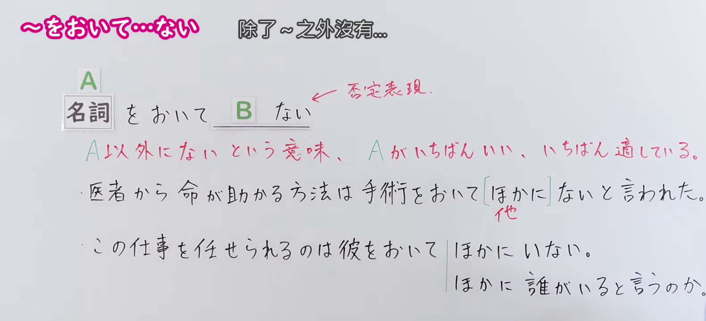
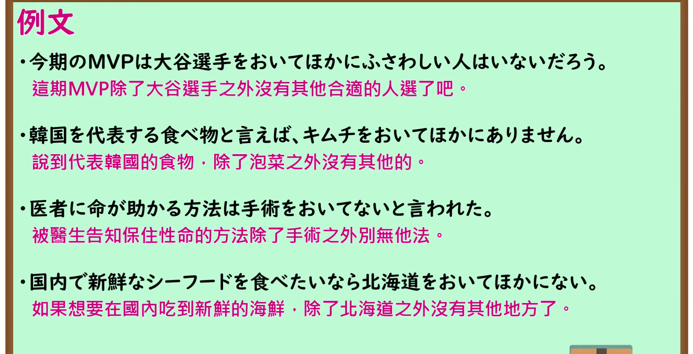

---
{
  "id": "N1-G-0091",
  "kind": "grammar",
  "level": "N1",
  "title": "～をおいて～ない（除了～之外没有）",
  "card_revision": 1,
  "schema_version": 1,
  "source": {
    "lesson": "N1 第91个语法",
    "material": "出口日語原视频板书、日语自动字幕与Hagoromo文型检索正文",
    "video": "https://www.youtube.com/watch?v=27do6duyRS0",
    "screenshot": "assets/grammar/n1/N1-G-0091-connection.png",
    "screenshot_seconds": 85.0,
    "screenshot_crop": {
      "x": 0,
      "y": 0,
      "width": 1580,
      "height": 730
    }
  },
  "tags": [
    "限定",
    "N1"
  ],
  "confusions": [
    "～ならでは",
    "～にとどまらず"
  ]
}
---

# N1 第91个语法：～をおいて～ない

# 视频学习资料整理

- 原视频讲解链接：[出口日語 N1 第91个语法](https://www.youtube.com/watch?v=27do6duyRS0)
- 接续图：真实时间 85.00 秒，原图尺寸 1920×1080，裁切区域左上角 (0, 0)、宽 1580、高 730（裁去右侧人物与底部空白，保留完整接续与板书）。
  
- 例句图：真实时间 193.30 秒，原图尺寸 1920×1080，裁切区域左上角 (14, 14)、宽 1892、高 970（裁去外框多余黑边，保留完整例句黑板）。
  

# 核心

## 功能一：除A以外没有的意思，A最好、最合适

**最上位意味カテゴリー：**

- **をおいて：** ものごとの関係（事物的关系）

**中位意味カテゴリー：**

- **をおいて：** 限定（限定）

**意味：**

- **をおいて：** 限定（限定）

**くわしい意味記述：**

- **をおいて：** 「〜以外に」の意味。後ろには必ず否定文が来て，「〜以外には〜ない」という意味になる。「〜をおいて他にいない」というコロケーションもある。（“除……以外”的意思。后项必定接否定句，表示“除……以外没有……”的意思。也有“～をおいて他にいない（除……之外没有别人）”这种惯用搭配。）

**派生語：** 未列出

### 例句

1. あなたをおいて、チームをまとめられる人は他にいません。

   （除了你之外，没有其他人能把团队凝聚起来了。）

2. 新生児の脳の重さは三七〇〜四〇〇グラムもある、といってもピンとこない人が多いだろう。この重さは、新生児の体重の約一割を占める。これほど脳の比率の大きい動物は、人間をおいて他にない。

   （即使说新生儿的大脑重达370至400克，可能很多人也没有切身体会。这个重量约占新生儿体重的百分之十。大脑占比如此之大的动物，除了人类之外别无其他。）

3. 全面解決のチャンスは、今をおいてない。

   （全面解决的机会，除了现在别无他时。）

4. その首脳たちが、定期的に一堂に会する場はＡＰＥＣをおいてほかにない。

   （那些各国首脑定期齐聚一堂的场合，除了APEC之外别无其他。）

# 来源

- [出口日語原视频](https://www.youtube.com/watch?v=27do6duyRS0)
- [Hagoromo 文型检索「をおいて」](https://hagoromo-text.work/lookup?text=%E3%82%92%E3%81%8A%E3%81%84%E3%81%A6&mode=partial)（查询日期：2026-09-24）
