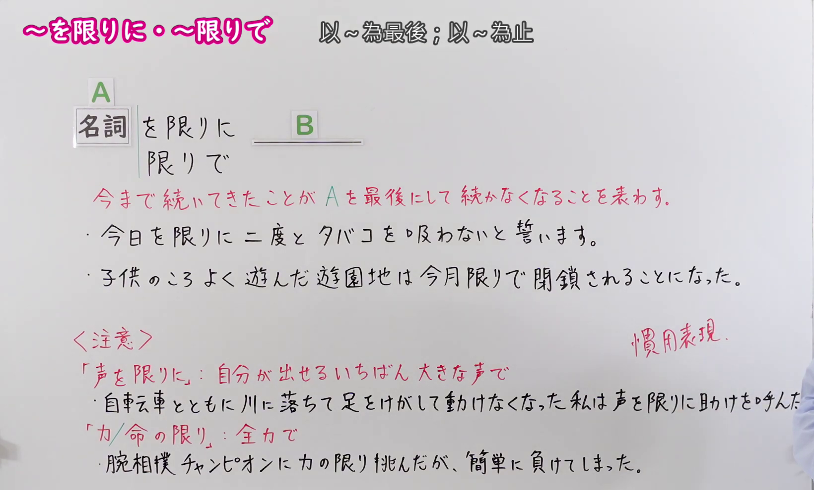
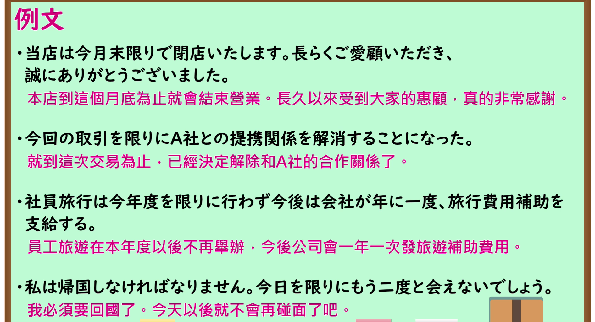

---
{
  "id": "N1-G-0092",
  "kind": "grammar",
  "level": "N1",
  "title": "～を限りに／～限りで（以～为最后；以～为止）",
  "card_revision": 1,
  "schema_version": 1,
  "source": {
    "lesson": "N1 第92个语法",
    "material": "出口日語原视频板书、日语自动字幕与Hagoromo文型检索正文",
    "video": "https://www.youtube.com/watch?v=V5gXshLThQU",
    "screenshot": "assets/grammar/n1/N1-G-0092-connection.png",
    "screenshot_seconds": 140.0,
    "screenshot_crop": {
      "x": 0,
      "y": 0,
      "width": 1640,
      "height": 990
    }
  },
  "tags": [
    "起点・終点",
    "限界",
    "N1"
  ],
  "confusions": [
    "～を皮切りに",
    "～を最後に"
  ]
}
---

# N1 第92个语法：～を限りに／～限りで

# 视频学习资料整理

- 原视频讲解链接：[出口日語 N1 第92个语法](https://www.youtube.com/watch?v=V5gXshLThQU)
- 接续图：真实时间 140.00 秒，原图尺寸 1920×1080，裁切区域左上角 (0, 0)、宽 1640、高 990（裁去右侧人物与底部空白，保留完整接续、说明与惯用注意板书）。
  
- 例句图：真实时间 204.87 秒，原图尺寸 1920×1080，裁切区域左上角 (14, 14)、宽 1892、高 1026（裁去外框多余黑边，保留完整例句黑板与全部译文）。
  

# 核心

## 功能一：表示一直持续至今的事情以A为最后而不再持续

**最上位意味カテゴリー：**

- **をかぎりに：** 場所・時間（场所与时间）

**中位意味カテゴリー：**

- **をかぎりに：** 起点・終点（起点与终点）

**意味：**

- **をかぎりに：** 限界（界限）

**くわしい意味記述：**

- **をかぎりに：** 今まで続いたことがこれで続かなくなることを表す。（表示一直持续的事情以此为界不再持续。）

**派生語：** 未列出

### 例句

1. 今日を限りに禁煙する。

   （以今天为最后期限戒烟。）

2. 声を限りに叫ぶ。

   （竭尽全力大声呼喊。）

3. 寅:もう一度聞くけどな、今日を限りに、おじちゃんと俺とは甥でも、叔父でもねえと、こう言うんだね。

   （寅次郎：我再问你一遍，你是说以今天为界，你我之间就既不是叔侄，也没有任何瓜葛了，是这样吗？）

# 来源

- [出口日語原视频](https://www.youtube.com/watch?v=V5gXshLThQU)
- [Hagoromo 文型检索「をかぎりに」](https://hagoromo-text.work/lookup?text=%E3%82%4B%E3%81%8E%E3%82%8A%E3%81%AB&mode=partial)（查询日期：2026-09-24）
