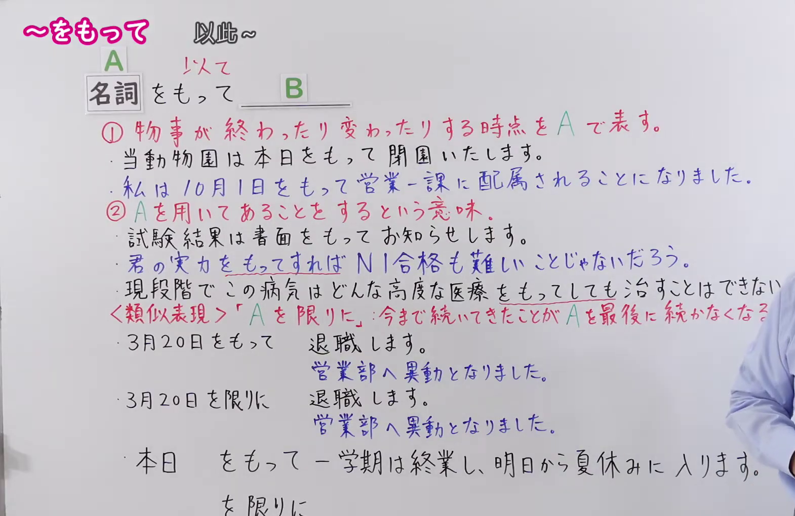
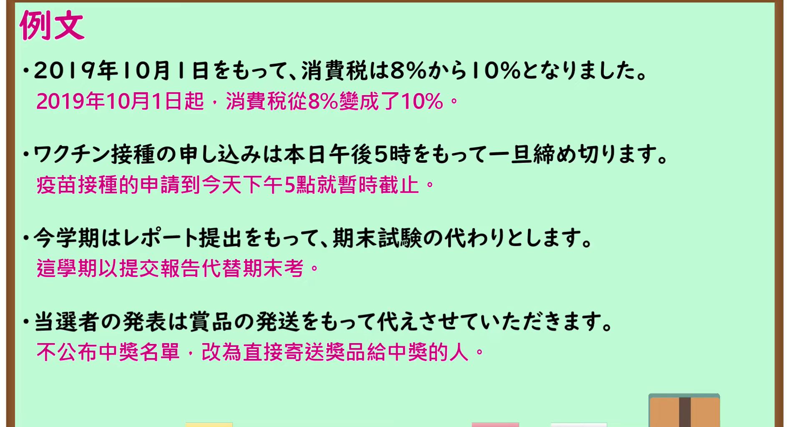

---
{
  "id": "N1-G-0093",
  "kind": "grammar",
  "level": "N1",
  "title": "～をもって（以此～；以～为界）",
  "card_revision": 1,
  "schema_version": 1,
  "source": {
    "lesson": "N1 第93个语法",
    "material": "出口日語原视频板书、日语自动字幕与Hagoromo文型检索正文",
    "video": "https://www.youtube.com/watch?v=G6WNN0N1ReY",
    "screenshot": "assets/grammar/n1/N1-G-0093-connection.png",
    "screenshot_seconds": 200.0,
    "screenshot_crop": {
      "x": 0,
      "y": 0,
      "width": 1570,
      "height": 1020
    }
  },
  "tags": [
    "起点・終点",
    "手段・媒介",
    "N1"
  ],
  "confusions": [
    "～を限りに",
    "～を通じて"
  ]
}
---

# N1 第93个语法：～をもって

# 视频学习资料整理

- 原视频讲解链接：[出口日語 N1 第93个语法](https://www.youtube.com/watch?v=G6WNN0N1ReY)
- 接续图：真实时间 200.00 秒，原图尺寸 1920×1080，裁切区域左上角 (0, 0)、宽 1570、高 1020（裁去右侧多余背景与底部空白，保留完整接续、两大功能讲解、对比辨析与板书例句；右侧“続かなくなる”末字受讲师衣袖轻微局部遮挡）。
  
- 例句图：真实时间 375.00 秒，原图尺寸 1920×1080，裁切区域左上角 (14, 14)、宽 1892、高 1026（裁去外框多余黑边，保留完整例句黑板与全部译文）。
  

# 核心

## 功能一：以A表示事物结束或发生变化的时间点

**最上位意味カテゴリー：**

- **をもって：** 場所・時間（场所与时间）

**中位意味カテゴリー：**

- **をもって：** 起点・終点（起点与终点）

**意味：**

- **をもって：** 終点（终点）

**くわしい意味記述：**

- **をもって：** 期限を表す言葉について，継続した動作が終了することを表す。「でもって」「をもちまして」という言い方もある。（接在表示期限的词后，表示持续的动作结束。也有“でもって”“をもちまして”的说法。）

**派生語：** 未列出

### 例句

1. この連絡会は、本日をもって解散する。

   （该联络会于今日正式解散。）

2. 一誌あたり、三〜四点の「ふろく」がついているという、この「ふろく・別冊」競争は、そうしたものを一切つけない『漫画少年』を、この年の一〇月号をもって終刊においこむ一因ともなった。

   （每本杂志附带三到四件“附录”的这种“附录·别册”竞争，也成为导致完全不带附录的《漫画少年》在这一年的十月号停刊的原因之一。）

3. 議員辞職願を提出した六月十五日、社会党は、「本日をもって正常な国会機能は喪失したとの立場」を強調する党声明を出している。

   （在递交议员辞呈的6月15日，社会党发表了党派声明，强调“以今日为界，正常的国会机能已告丧失的立场”。）

4. なお、制度改正により昭和６３年３月１日をもって新たな患者の認定は行わないこととされた。

   （此外，由于制度改革，决定自昭和63年3月1日起不再进行新的患者认定。）

## 功能二：表示使用A来进行某事的意思

**最上位意味カテゴリー：**

- **をもって：** ものごとの関係（事物的关系）

**中位意味カテゴリー：**

- **をもって：** 手段・媒介（手段与媒介）

**意味：**

- **をもって：** 手段・方法（手段与方法）

**くわしい意味記述：**

- **をもって：** 「それを使ってあることをする」という意味。（“使用该事物来进行某事”的意思。）

**派生語：** 未列出

### 例句

1. 非常な努力をもってその行事を成功させた。

   （付出了巨大的努力使该活动取得了成功。）

2. 本来ならいちいちお伺いして御礼を申し上げるべきところですが書面をもってかえさせていただく失礼をお赦し下さい。

   （本应亲自登门致谢，但在此以书面形式代为致谢，还望原谅我的失礼。）

3. また、本人特有の決断力をもって急進的な経済改革の実現に着手した。

   （此外，他以自身特有的决断力着手推进激进经济改革的实现。）

4. 司会者:えー、みなさま、どうぞ拍手をもって迎え下さいませ。

   （主持人：各位来宾，请大家以热烈的掌声欢迎。）

# 来源

- [出口日語原视频](https://www.youtube.com/watch?v=G6WNN0N1ReY)
- [Hagoromo 文型检索「をもって」](https://hagoromo-text.work/lookup?text=%E3%82%92%E3%82%82%E3%81%A3%E3%81%A6&mode=partial)（查询日期：2026-09-24）
