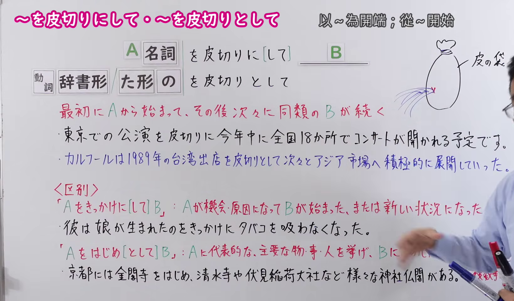
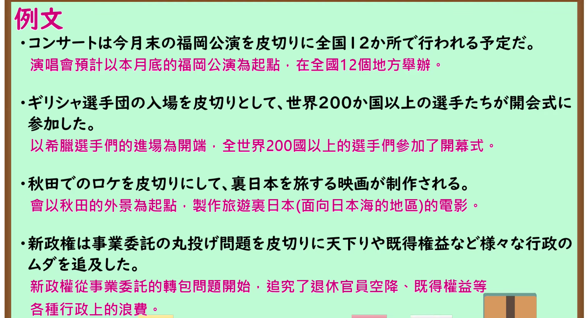

---
{
  "id": "N1-G-0094",
  "kind": "grammar",
  "level": "N1",
  "title": "～を皮切りにして／～を皮切りとして（以～为开端；从～开始）",
  "card_revision": 1,
  "schema_version": 1,
  "source": {
    "lesson": "N1 第94个语法",
    "material": "出口日語原视频板书、日语自动字幕与Hagoromo文型检索正文",
    "video": "https://www.youtube.com/watch?v=Z4fZ_K2gQec",
    "screenshot": "assets/grammar/n1/N1-G-0094-connection.png",
    "screenshot_seconds": 105.0,
    "screenshot_crop": {
      "x": 0,
      "y": 0,
      "width": 1640,
      "height": 960
    }
  },
  "tags": [
    "起点・終点",
    "起点",
    "N1"
  ],
  "confusions": [
    "～をきっかけに",
    "～をはじめとして"
  ]
}
---

# N1 第94个语法：～を皮切りにして／～を皮切りとして

# 视频学习资料整理

- 原视频讲解链接：[出口日語 N1 第94个语法](https://www.youtube.com/watch?v=Z4fZ_K2gQec)
- 接续图：真实时间 105.00 秒，原图尺寸 1920×1080，裁切区域左上角 (0, 0)、宽 1640、高 960（裁去右侧人物躯干与底部空白，保留完整接续、词源“皮の袋”板书、讲解与区辨内容）。
  
- 例句图：真实时间 365.00 秒，原图尺寸 1920×1080，裁切区域左上角 (14, 14)、宽 1892、高 1026（裁去外框多余黑边，保留完整例句黑板与全部译文）。
  

# 核心

## 功能一：最初从A开始，之后接连不断发生同类的B

**最上位意味カテゴリー：**

- **をかわきりに：** 場所・時間（场所与时间）

**中位意味カテゴリー：**

- **をかわきりに：** 起点・終点（起点与终点）

**意味：**

- **をかわきりに：** 起点（起点）

**くわしい意味記述：**

- **をかわきりに：** 「〜から始まって，その後次々に」という意味を表す。（表示“从……开始，其后接连不断地……”的意思。）

**派生語：** をかわきりとして，をかわきりにして

### 例句

1. 今度の出演を皮切りに舞台や映画からの仕事が次々と舞いこんでいる。

   （以这次演出为开端，舞台剧和电影的工作接二连三地纷至沓来。）

2. 一次試験は七月三日の北海道を皮切りに二十六日の東北地区まで続く。

   （初试以7月3日的北海道为起点，一直持续到26日的东北地区。）

3. 特に、昭和３７年に我が国初のハイウェーである首都高速１号線の東京・京橋—芝浦間が開通したのを皮切りに、全国各地で高速道路網が整備され始めた。

   （特别是以昭和37年我国第一条高速公路——首都高速1号线东京京桥至芝浦段开通为开端，全国各地开始建设高速公路网。）

4. 1992 年にCNPC がカナダに進出したのを皮切りに、中国の国営石油会社による海外での石油資源開発が始まりました。

   （以1992年中国石油天然气集团公司（CNPC）进军加拿大为开端，中国国有石油公司在海外的石油资源开发拉开了序幕。）

# 来源

- [出口日語原视频](https://www.youtube.com/watch?v=Z4fZ_K2gQec)
- [Hagoromo 文型检索「をかわきりに」](https://hagoromo-text.work/lookup?text=%E3%81%8B%E3%82%8F%E3%81%8D%E3%82%8A&mode=partial)（查询日期：2026-09-24）
