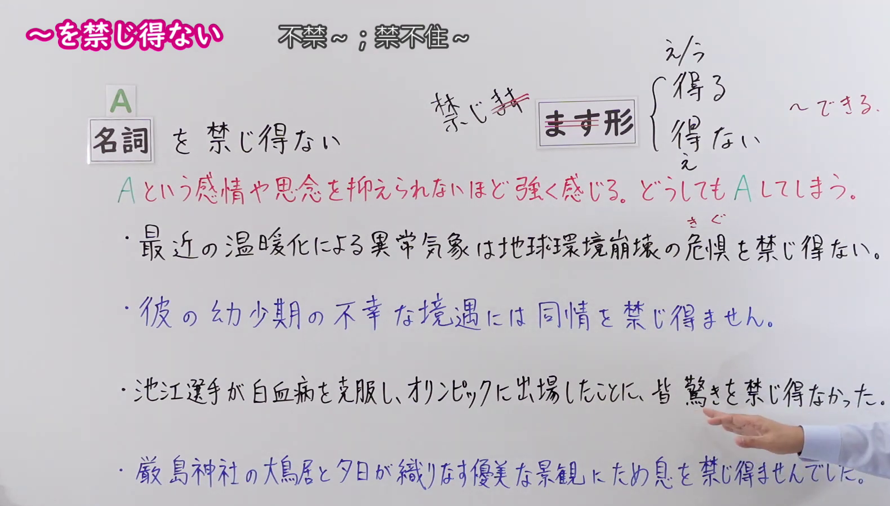
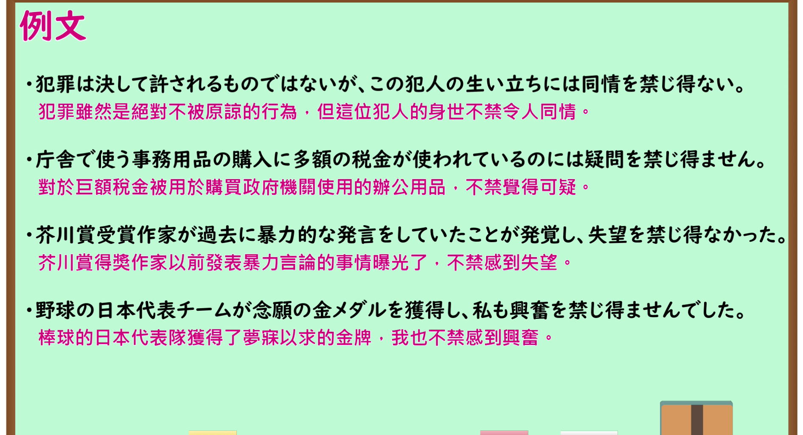

---
{
  "id": "N1-G-0095",
  "kind": "grammar",
  "level": "N1",
  "title": "～を禁じ得ない（不禁～；禁不住～）",
  "card_revision": 1,
  "schema_version": 1,
  "source": {
    "lesson": "N1 第95个语法",
    "material": "出口日語原视频板书、日语自动字幕与Hagoromo文型检索正文",
    "video": "https://www.youtube.com/watch?v=a6tUSIXAWLc",
    "screenshot": "assets/grammar/n1/N1-G-0095-connection.png",
    "screenshot_seconds": 140.0,
    "screenshot_crop": {
      "x": 0,
      "y": 0,
      "width": 1580,
      "height": 900
    }
  },
  "tags": [
    "避けられない心情・行動",
    "心情",
    "N1"
  ],
  "confusions": [
    "～を余儀なくされる",
    "～を禁じえない"
  ]
}
---

# N1 第95个语法：～を禁じ得ない

# 视频学习资料整理

- 原视频讲解链接：[出口日語 N1 第95个语法](https://www.youtube.com/watch?v=a6tUSIXAWLc)
- 接续图：真实时间 140.00 秒，原图尺寸 1920×1080，裁切区域左上角 (0, 0)、宽 1580、高 900（裁去右侧人物躯干与底部空白，保留完整接续、“禁じ得ない”构造板书、意义讲解与全部例句；讲师手部自右下轻微指示板书未遮挡文字）。
  
- 例句图：真实时间 244.13 秒，原图尺寸 1920×1080，裁切区域左上角 (14, 14)、宽 1892、高 1026（裁去外框多余黑边，保留完整例句黑板与全部译文）。
  

# 核心

## 功能一：强烈感受到无法抑制A这种感情或思绪，无论如何都会产生A这种情感

**最上位意味カテゴリー：**

- **をきんじえない：** 考え・感情（思考与感情）

**中位意味カテゴリー：**

- **をきんじえない：** 避けられない心情・行動（不可避免的心情与行动）

**意味：**

- **をきんじえない：** 心情（心情）

**くわしい意味記述：**

- **をきんじえない：** ある状況や事態から，何らかの感情が生じ，抑えることができないという意味。「怒り」「同情」「笑い」などの名詞につくことが多い。かたいことばで，書きことばでよく使う。（表示从某种状况或事态中产生某种感情，且无法抑制的意思。多接在“怒り（愤怒）”“同情（同情）”“笑い（笑意）”等名词后。属于生硬的书面语表达，多用于书面语。）

**派生語：** 未列出

### 例句

1. 彼の状況には、同情を禁じ得ない。

   （对于他的处境，不禁令人深表同情。）

2. そこには全然自分たちは悪いことをしたという反省の様子は見えなかった。私は不安の気持ちはいっぺんに解消されたが、これではたしていいのだろうかという疑念を禁じえなかった。

   （在那里完全看不到他们觉得自己做错了事的反省之意。虽然我的不安情绪一下子消除了，但禁不住产生了这样究竟好不好的疑虑。）

3. はたからみれば馬鹿らしいようなことを、当人たちは真面目そのものの顔つきでやっているのをみると、いかに人間が差をつけることを好むか、ほとほと感嘆の念を禁じえない。

   （看到旁人眼里看似愚蠢可笑的事情，当事人却一脸严肃地在做，不禁让人由衷感叹人类是多么热衷于划分等级、拉开差距。）

4. 大きな失望を禁じ得ない。

   （不禁感到巨大的失望。）

# 来源

- [出口日語原视频](https://www.youtube.com/watch?v=a6tUSIXAWLc)
- [Hagoromo 文型检索「をきんじえない」](https://hagoromo-text.work/lookup?text=%E3%81%8D%E3%82%93%E3%81%98%E3%81%88%E3%81%AA%E3%81%84&mode=partial)（查询日期：2026-09-24）
