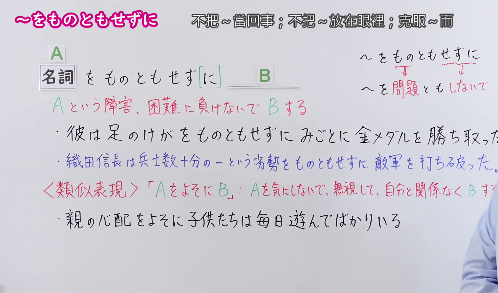
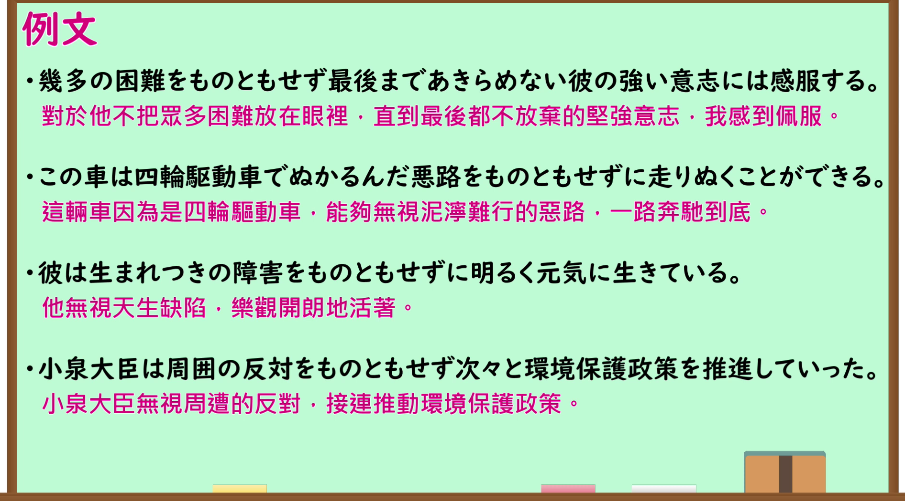

---
{
  "id": "N1-G-0096",
  "kind": "grammar",
  "level": "N1",
  "title": "～をものともせずに（不把～当回事；不畏～；克服～而～）",
  "card_revision": 1,
  "schema_version": 1,
  "source": {
    "lesson": "N1 第96个语法",
    "material": "出口日語原视频板书、日语自动字幕与Hagoromo文型检索正文",
    "video": "https://www.youtube.com/watch?v=WUGUpc-tk9A",
    "screenshot": "assets/grammar/n1/N1-G-0096-connection.png",
    "screenshot_seconds": 70.23,
    "screenshot_crop": {
      "x": 0,
      "y": 0,
      "width": 1560,
      "height": 920
    }
  },
  "tags": [
    "無関係・除外",
    "無関係",
    "N1"
  ],
  "confusions": [
    "～をよそに",
    "～にもかかわらず"
  ]
}
---

# N1 第96个语法：～をものともせずに

# 视频学习资料整理

- 原视频讲解链接：[出口日語 N1 第96个语法](https://www.youtube.com/watch?v=WUGUpc-tk9A)
- 接续图：真实时间 70.23 秒，原图尺寸 1920×1080，裁切区域左上角 (0, 0)、宽 1560、高 920（保留完整接续、构造板书、红字意义说明、全部例句与类似表现说明；裁去右侧讲师主要身躯与底部空白）。
  
- 例句图：真实时间 241.70 秒，原图尺寸 1920×1080，裁切区域左上角 (14, 14)、宽 1892、高 1050（裁去外框多余黑边，保留完整例句黑板与全部译文）。
  

# 核心

## 功能一：不输给A这种障碍或困难而去做B

**最上位意味カテゴリー：**

- **をものともせず（に）：** ものごとの関係（事物的关系）
- **Nをものともせずに：** ものごとの関係（事物的关系）

**中位意味カテゴリー：**

- **をものともせず（に）：** 無関係・除外（无关与除外）
- **Nをものともせずに：** 判断の立場（判断的立场）

**意味：**

- **をものともせず（に）：** 無関係（无关）
- **Nをものともせずに：** 観点（观点）

**くわしい意味記述：**

- **をものともせず（に）：** 「後の出来事を妨げるようなNがあったが，そのNを無視または無効化して」という意味。（表示“虽然存在阻碍后项事态发生的N，但无视或克服该N”的意思。）
- **Nをものともせずに：** Nを気にしないで行動するという意味を表す。（表示不把N放在心上而采取行动的意思。）

**派生語：** をものともせず，をものともせずに，をものともしないで

### 例句

1. 反対派の攻撃をものともせずに法案を成立させた。

   （顶住反对派的攻击，使法案获得了通过。）

2. 周囲の批判をものともせず、彼女は主張を貫いた。

   （不顾周围的批评，她坚持了自己的主张。）

3. 山田選手はプレッシャーをものともせず、金メダルを獲得した。

   （山田选手顶住巨大的压力，夺得了金牌。）

4. 先日、赤トンボを見つけた。近所の大学の芝生広場で。ギラギラ照りつける炎天をものともせず、スイーッと２匹飛んでいた。

   （前几天在附近大学的草坪广场上看到了红蜻蜓。顶着烈日炎炎，两只蜻蜓轻盈地飞翔着。）

# 来源

- [出口日語原视频](https://www.youtube.com/watch?v=WUGUpc-tk9A)
- [Hagoromo 文型检索「をものともせず」](https://hagoromo-text.work/lookup?text=%E3%82%82%E3%81%AE%E3%81%A8%E3%82%82%E3%81%9B%E3%81%9A&mode=partial)（查询日期：2026-09-24）
