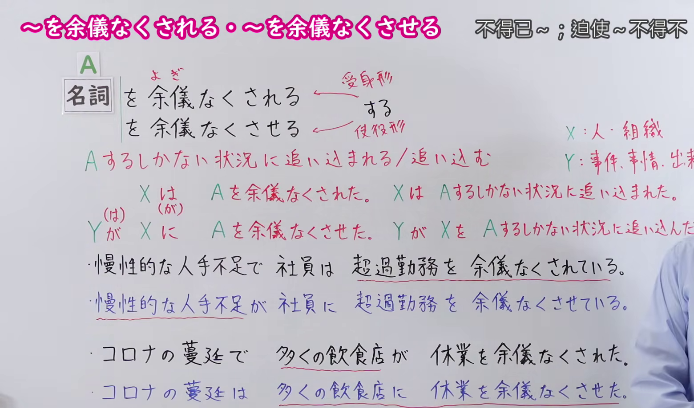
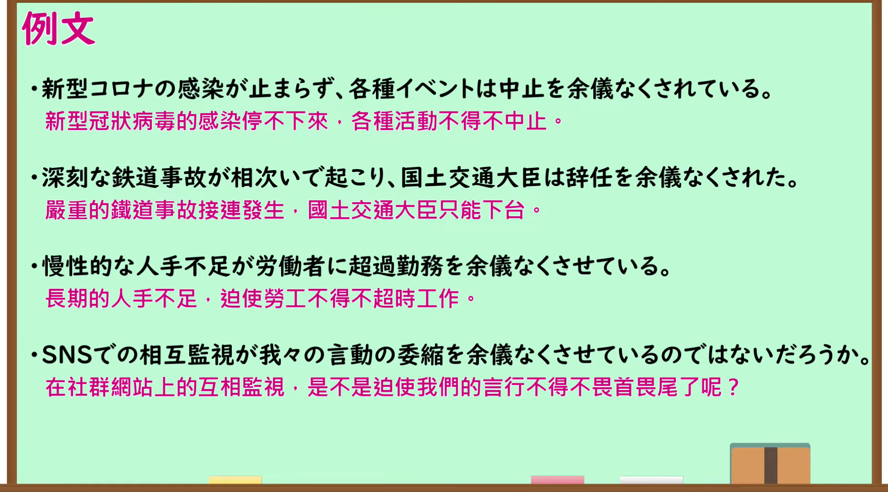

---
{
  "id": "N1-G-0097",
  "kind": "grammar",
  "level": "N1",
  "title": "～を余儀なくされる・～を余儀なくさせる（不得不～；迫使～不得不～）",
  "card_revision": 1,
  "schema_version": 1,
  "source": {
    "lesson": "N1 第97个语法",
    "material": "出口日語原视频板书、日语自动字幕与Hagoromo文型检索正文",
    "video": "https://www.youtube.com/watch?v=SFu1p8LURBw",
    "screenshot": "assets/grammar/n1/N1-G-0097-connection.png",
    "screenshot_seconds": 410.0,
    "screenshot_crop": {
      "x": 0,
      "y": 0,
      "width": 1560,
      "height": 920
    }
  },
  "tags": [
    "避けられない心情・行動",
    "行動",
    "N1"
  ],
  "confusions": [
    "～を禁じ得ない",
    "～ざるを得ない"
  ]
}
---

# N1 第97个语法：～を余儀なくされる・～を余儀なくさせる

# 视频学习资料整理

- 原视频讲解链接：[出口日語 N1 第97个语法](https://www.youtube.com/watch?v=SFu1p8LURBw)
- 接续图：真实时间 410.00 秒，原图尺寸 1920×1080，裁切区域左上角 (0, 0)、宽 1560、高 920（保留完整接续、被动与使役对应板书、红字说明、全部例句与句型对应说明；裁去右侧讲师主要身躯与底部空白）。
  
- 例句图：真实时间 444.80 秒，原图尺寸 1920×1080，裁切区域左上角 (14, 14)、宽 1892、高 1050（裁去外框多余黑边，保留完整例句黑板与全部译文）。
  

# 核心

## 功能一：陷入只能做A的境地／迫使陷入只能做A的境地

**最上位意味カテゴリー：**

- **をよぎなくされる：** 考え・感情（思考与感情）
- **をよぎなくさせる：** 考え・感情（思考与感情）

**中位意味カテゴリー：**

- **をよぎなくされる：** 避けられない心情・行動（不可避免的心情与行动）
- **をよぎなくさせる：** 避けられない心情・行動（不可避免的心情与行动）

**意味：**

- **をよぎなくされる：** 行動（行动）
- **をよぎなくさせる：** 行動（行动）

**くわしい意味記述：**

- **をよぎなくされる：** しかたなく，そうしなければならない状況になるという意味。動作を表す名詞につく。書きことばでよく使う。（表示无可奈何而陷入不得不那么做的状况的意思。接在表示动作的名词后。多用于书面语。）
- **をよぎなくさせる：** しかたなく，そうせざるをえない状態にするという意味。動作を表す名詞につく。よくない状態を引き起こす場合に使う。書きことばでよく使う。（表示使处于无可奈何、不得不那么做的状态的意思。接在表示动作的名词后。用于引发不良状况的场合。多用于书面语。）

**派生語：** をよぎなくさせる，をよぎなくされる

### 例句

1. リストラで多くの社員が退社を余儀なくされた。

   （因裁员重组，许多员工被迫离职。）

2. 日本は自主開発の方針を決めたが、米国の圧力で共同開発を余儀なくされた。

   （日本虽然定下了自主开发的方针，但在美国的压力下不得不改为共同开发。）

3. 長引く不景気は、大企業にもリストラを余儀なくさせた。

   （长期的经济不景气，迫使大企业也不得不进行裁员重组。）

4. 大統領が米欧など主要国の調停に耳を貸さず、非妥協的で攻撃的な態度を取ったことが、ＮＡＴＯに武力行使を余儀なくさせたといえる。

   （总统对美欧等主要国家的调解置若罔闻，采取不妥协且具攻击性的态度，可以说迫使北约不得不动用武力。）

# 来源

- [出口日語原视频](https://www.youtube.com/watch?v=SFu1p8LURBw)
- [Hagoromo 文型检索「をよぎなくされる」](https://hagoromo-text.work/lookup?text=%E3%82%88%E3%81%8E%E3%81%AA%E3%81%8F&mode=partial)（查询日期：2026-09-24）
