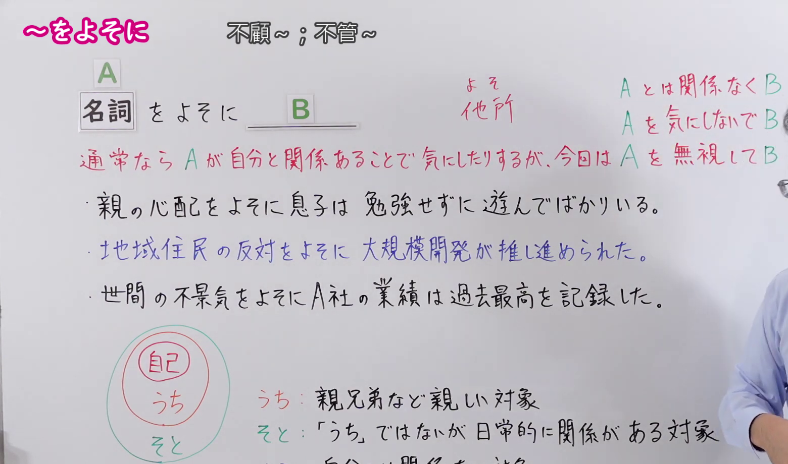
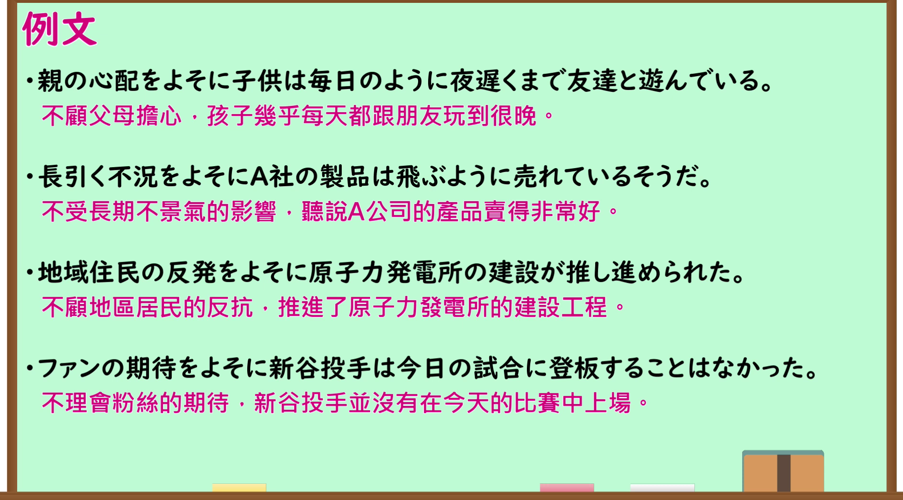

---
{
  "id": "N1-G-0098",
  "kind": "grammar",
  "level": "N1",
  "title": "～をよそに（不顾～；不管～）",
  "card_revision": 1,
  "schema_version": 1,
  "source": {
    "lesson": "N1 第98个语法",
    "material": "出口日語原视频板书、日语自动字幕与Hagoromo文型检索正文",
    "video": "https://www.youtube.com/watch?v=t086wqTJ8nw",
    "screenshot": "assets/grammar/n1/N1-G-0098-connection.png",
    "screenshot_seconds": 49.3,
    "screenshot_crop": {
      "x": 0,
      "y": 0,
      "width": 1560,
      "height": 920
    }
  },
  "tags": [
    "無関係・除外",
    "無関係",
    "N1"
  ],
  "confusions": [
    "～をものともせずに",
    "～にかかわらず"
  ]
}
---

# N1 第98个语法：～をよそに

# 视频学习资料整理

- 原视频讲解链接：[出口日語 N1 第98个语法](https://www.youtube.com/watch?v=t086wqTJ8nw)
- 接续图：真实时间 49.30 秒，原图尺寸 1920×1080，裁切区域左上角 (0, 0)、宽 1560、高 920（保留完整接续、构造板书、红字说明、全部例句与自己/うち/そと/よそ范围图解；裁去右侧讲师主要身躯与底部空白）。
  
- 例句图：真实时间 368.73 秒，原图尺寸 1920×1080，裁切区域左上角 (14, 14)、宽 1892、高 1050（裁去外框多余黑边，保留完整例句黑板与全部译文）。
  

# 核心

## 功能一：通常情况下A因与自己有关而会去在意，但这次却无视A而去做B

**最上位意味カテゴリー：**

- **をよそに：** ものごとの関係（事物的关系）

**中位意味カテゴリー：**

- **をよそに：** 無関係・除外（无关与除外）

**意味：**

- **をよそに：** 無関係（无关）

**くわしい意味記述：**

- **をよそに：** 「〜には無関心で」という意味。（表示“对～漠不关心、不予理会”的意思。）

**派生語：** 未列出

### 例句

1. 兄は、親の心配をよそに遊びまわっている。

   （哥哥不顾父母的担心，到处游玩玩乐。）

2. 誰が何と言おうと、猫は居心地の良い場所をしっかり確保している。主人の心配をよそに、「別宅持とうがアタシの勝手でしょ」とすましている。

   （不管别人怎么说，猫总能稳稳地占领舒适的地方。不管主人的担忧，一副“就算有别的地方待也是我的自由吧”的泰然自若的样子。）

3. 日本企業に対する地元の期待は、当事者の困惑をよそにますます膨らみそうだ。

   （当地对日本企业的期待，不管当事方的困惑，似乎越来越高涨。）

4. 平和的に解決しようとするあらゆる努力をよそに、それは第三次大戦とも呼ぶべき冷戦期を通じ潜在的発火点として残り、容赦ない憎しみの構図は崩れないままだった。

   （不顾谋求和平解决的一切努力，它在堪称第三次世界大战的冷战时期一直作为潜在导火索存在着，残酷仇恨的格局始终未被打破。）

# 来源

- [出口日語原视频](https://www.youtube.com/watch?v=t086wqTJ8nw)
- [Hagoromo 文型检索「をよそに」](https://hagoromo-text.work/lookup?text=%E3%82%92%E3%82%88%E3%81%9D%E3%81%AB&mode=partial)（查询日期：2026-09-24）
