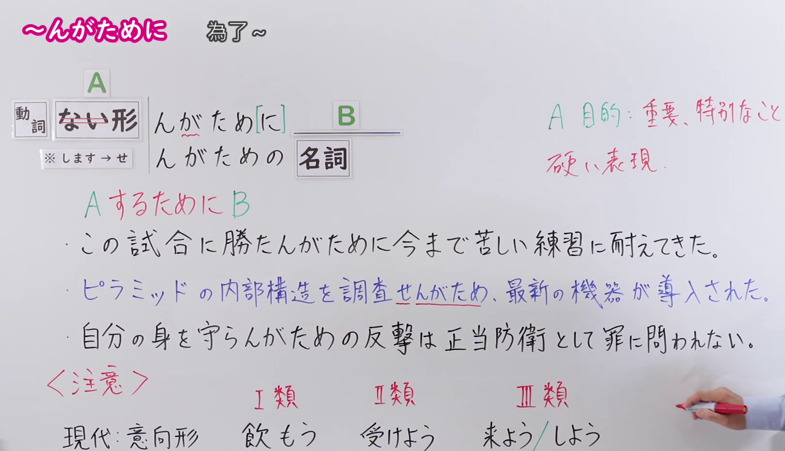

---
{
  "id": "N1-G-0099",
  "kind": "grammar",
  "level": "N1",
  "title": "～んがために（为了～）",
  "card_revision": 1,
  "schema_version": 1,
  "source": {
    "lesson": "N1 第99个语法",
    "material": "出口日語原视频板书、日语自动字幕与Hagoromo文型检索正文",
    "video": "https://www.youtube.com/watch?v=FMtkQNJDlEc",
    "screenshot": "assets/grammar/n1/N1-G-0099-connection.png",
    "screenshot_seconds": 360.0,
    "screenshot_crop": {
      "x": 0,
      "y": 0,
      "width": 1620,
      "height": 930
    }
  },
  "tags": [
    "目的・目標",
    "目的",
    "N1"
  ],
  "confusions": [
    "～ために",
    "～べく"
  ]
}
---

# N1 第99个语法：～んがために

# 视频学习资料整理

- 原视频讲解链接：[出口日語 N1 第99个语法](https://www.youtube.com/watch?v=FMtkQNJDlEc)
- 接续图：真实时间 360.00 秒，原图尺寸 1920×1080，裁切区域左上角 (0, 0)、宽 1620、高 930（保留完整接续、红字说明、语体与目的特殊性说明、全部例句与现代/古文意向形对照；裁去右侧讲师身躯与底部空白）。
  
- 例句图：真实时间 472.63 秒，原图尺寸 1920×1080，裁切区域左上角 (14, 14)、宽 1892、高 1050（裁去外框多余黑边，保留完整例句黑板与全部译文）。
  

# 核心

## 功能一：为了实现A而进行B

**最上位意味カテゴリー：**

- **んがためだ：** ものごとの関係（事物的关系）

**中位意味カテゴリー：**

- **んがためだ：** 目的・目標（目的与目标）

**意味：**

- **んがためだ：** 目的（目的）

**くわしい意味記述：**

- **んがためだ：** Vしようという目的のために。「強い意志をもってXを実現するために，Yをする」という意味を表す。前文と後文の主語は同じで，意志動詞を使う。（表示为了达到V的目的。“带着坚定的意志为了实现X而进行Y”的意思。前后句主语相同，使用意志动词。）

**派生語：** んがための,んがために

### 例句

1. 彼を裏切ったのは、勝たんがためだ。

   （之所以背叛他，是为了赢。）

2. 彼らは、目的を果たさんがためにはどんな汚い手も使うのだろうか。

   （他们为了达到目的，难道什么肮脏的手段都会使出来吗？）

3. 勝たんがための手段を考えるべきだ。

   （应该思考为了取胜所需的手段。）

4. ビジネスを成功させんがために、社長みずから必死で営業にまわる。

   （为了让事业取得成功，社长亲自拼命地奔走跑业务。）

# 来源

- [出口日語原视频](https://www.youtube.com/watch?v=FMtkQNJDlEc)
- [Hagoromo 文型检索「んがためだ」](https://hagoromo-text.work/lookup?text=%E3%82%93%E3%81%8C%E3%81%9F%E3%82%81&mode=partial)（查询日期：2026-09-24）
