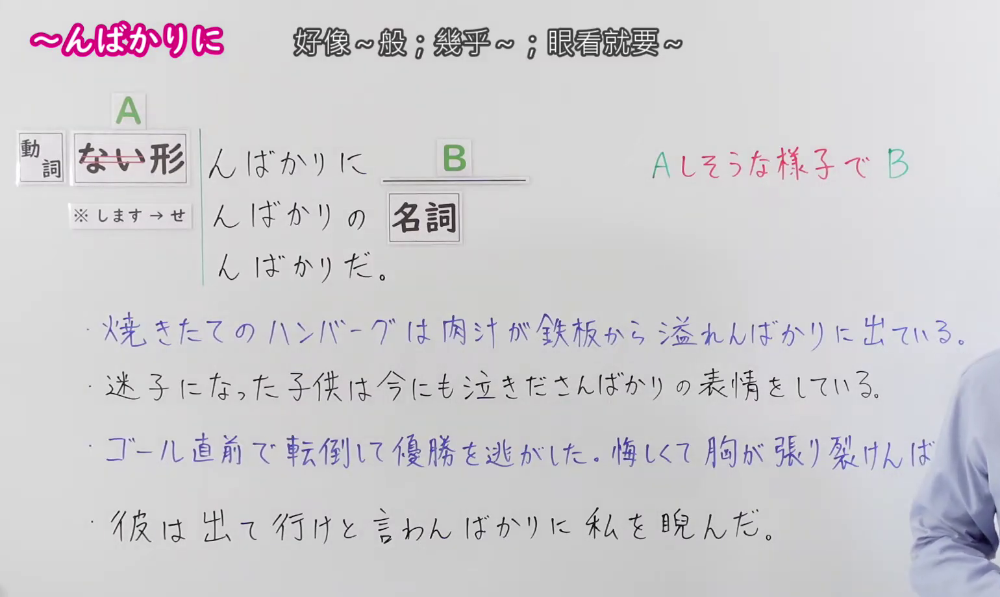
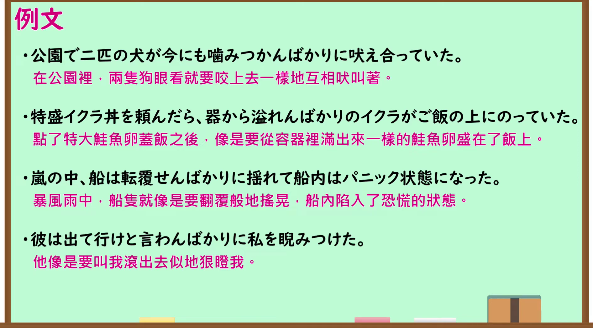

---
{
  "id": "N1-G-0100",
  "kind": "grammar",
  "level": "N1",
  "title": "～んばかりに（几乎要～；好像～般；眼看就要～）",
  "card_revision": 1,
  "schema_version": 1,
  "source": {
    "lesson": "N1 第100个语法",
    "material": "出口日語原视频板书、日语自动字幕与Hagoromo文型检索正文",
    "video": "https://www.youtube.com/watch?v=Jf_jkij1vCM",
    "screenshot": "assets/grammar/n1/N1-G-0100-connection.png",
    "screenshot_seconds": 8.0,
    "screenshot_crop": {
      "x": 0,
      "y": 0,
      "width": 1540,
      "height": 920
    }
  },
  "tags": [
    "避けられない心情・行動",
    "様子",
    "N1"
  ],
  "confusions": [
    "～ばかりに",
    "～そうに"
  ]
}
---

# N1 第100个语法：～んばかりに

# 视频学习资料整理

- 原视频讲解链接：[出口日語 N1 第100个语法](https://www.youtube.com/watch?v=Jf_jkij1vCM)
- 接续图：真实时间 8.00 秒，原图尺寸 1920×1080，裁切区域左上角 (0, 0)、宽 1540、高 920（保留完整接续形式、红字说明、接续注意与全部例句；裁去右侧讲师主要身躯与底部空白）。
  
- 例句图：真实时间 227.73 秒，原图尺寸 1920×1080，裁切区域左上角 (14, 14)、宽 1892、高 1050（裁去外框多余黑边，保留完整例句黑板与全部译文）。
  

# 核心

## 功能一：带着仿佛要做A的样子而进行B

**最上位意味カテゴリー：**

- **んばかりだ：** 考え・感情（思考与感情）

**中位意味カテゴリー：**

- **んばかりだ：** 避けられない心情・行動（不可避免的心情与行动）

**意味：**

- **んばかりだ：** 様子（样子）

**くわしい意味記述：**

- **んばかりだ：** 実際にVという行為をしたり，Vという状態になったりはしていないが，その時，まるでほとんどそれに近い状態だという意味を表す。「と（でも）いわんばかりだ」という表現が多い。（表示虽然实际上并没有进行V的行为，也没有变成V的状态，但当时几乎处于极其接近该状态的意思。多用“と（でも）いわんばかりだ”的表现。）

**派生語：** んばかりに，んばかりの，ぬばかり

### 例句

1. 合格発表を見て、彼は喜びで飛び上がらんばかりだった。

   （看到榜上有名，他高兴得几乎要跳起来了。）

2. 父は帰れと言わんばかりの顔をした。

   （父亲露出一副好像要叫我回去一样的神情。）

3. 二人は国に帰る友だちに向かって、千切れんばかりに手を振っていた。

   （两人朝着要回国的朋友，拼命挥手，手仿佛都要挥断了一般。）

4. 耳を聾せんばかりの轟音が部屋をゆるがせている。

   （震耳欲聋般的轰鸣声震颤着整个房间。）

# 来源

- [出口日語原视频](https://www.youtube.com/watch?v=Jf_jkij1vCM)
- [Hagoromo 文型检索「んばかりだ」](https://hagoromo-text.work/lookup?text=%E3%82%93%E3%81%B0%E3%81%8B%E3%82%8A&mode=partial)（查询日期：2026-09-24）
