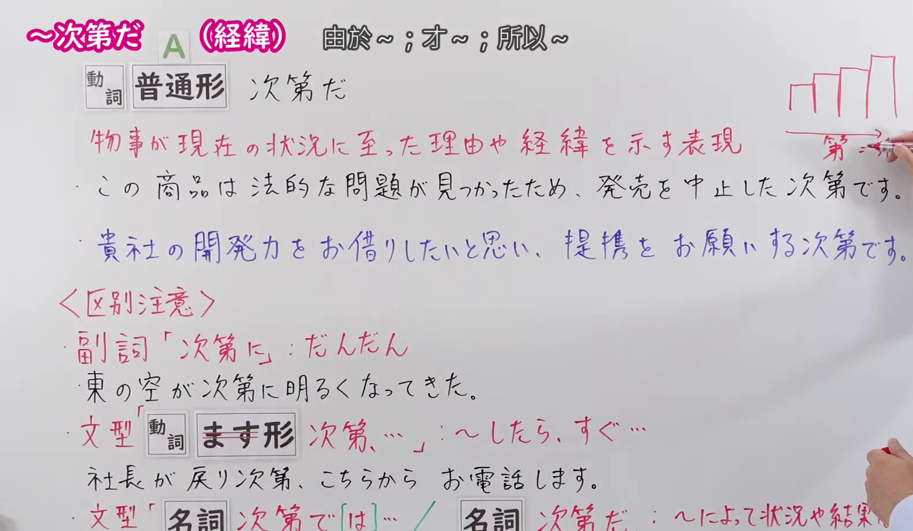
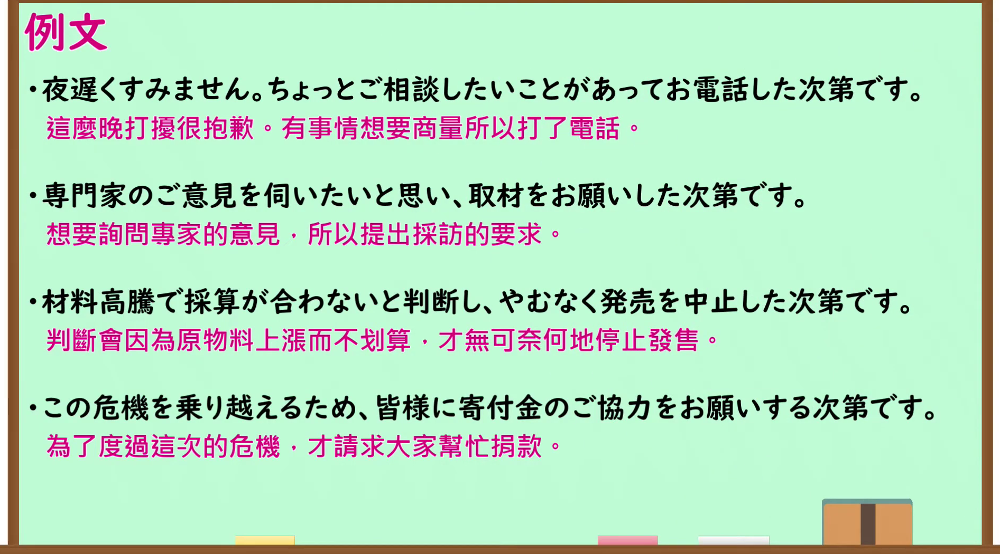

---
{
  "id": "N1-G-0101",
  "kind": "grammar",
  "level": "N1",
  "title": "～次第だ（经纬）（由于～；才～；所以～）",
  "card_revision": 1,
  "schema_version": 1,
  "source": {
    "lesson": "N1 第101个语法",
    "material": "出口日語原视频板书、日语自动字幕与Hagoromo文型检索正文",
    "video": "https://www.youtube.com/watch?v=rJmduPWOxXU",
    "screenshot": "assets/grammar/n1/N1-G-0101-connection.png",
    "screenshot_seconds": 40.0,
    "screenshot_crop": {
      "x": 0,
      "y": 0,
      "width": 1580,
      "height": 920
    }
  },
  "tags": [
    "経過・結末",
    "結果",
    "N1"
  ],
  "confusions": [
    "～次第（一……就……）",
    "～次第で（取决于……）"
  ]
}
---

# N1 第101个语法：～次第だ（経緯）

# 视频学习资料整理

- 原视频讲解链接：[出口日語 N1 第101个语法](https://www.youtube.com/watch?v=rJmduPWOxXU)
- 接续图：真实时间 40.00 秒，原图尺寸 1920×1080，裁切区域左上角 (0, 0)、宽 1580、高 920（保留完整接续形式、红字说明、例句与区别注意三类混淆点；裁去右侧讲师身躯与底部空白）。
  
- 例句图：真实时间 307.60 秒，原图尺寸 1920×1080，裁切区域左上角 (14, 14)、宽 1892、高 1050（裁去外框多余黑边，保留完整例句黑板与全部译文）。
  

# 核心

## 功能一：表示事物发展到当前状况的理由或经过的表现

**最上位意味カテゴリー：**

- **しだいだ：** ものごとの関係（事物的关系）

**中位意味カテゴリー：**

- **しだいだ：** 経過・結末（经过与结末）

**意味：**

- **しだいだ：** 結果（结果）

**くわしい意味記述：**

- **しだいだ：** 理由や事情を説明して，現在の結果になったことを表す。（说明理由或事由，表示导致了当前结果的意思。）

**派生語：** 未列出

### 例句

1. こうして今に至った次第だ。

   （事情就是这样，才发展到了今天这一地步。）

2. ご予定をお伺いしたく、メールを差し上げる次第です。

   （想向您询问一下日程安排，因此冒昧给您发邮件。）

3. 次に電話の声が変わってご主人が「そのときあなたの名前をきいたのでこうして電話した次第である。早速解決の処方を書いてもらいたい」と要請された。

   （接着电话里的声音换成了男主人，他要求道：“当时听到了您的名字，所以才打了这通电话。希望您能尽快写出解决方案。”）

4. ここに改めて厚く今までのご無沙汰のお詫びとお礼を申し上げる次第でございます。

   （在此对至今久疏问候深表歉意，并谨此向各位致以诚挚的谢意。）

# 来源

- [出口日語原视频](https://www.youtube.com/watch?v=rJmduPWOxXU)
- [Hagoromo 文型检索「しだいだ」](https://hagoromo-text.work/lookup?text=%E3%81%97%E3%81%A0%E3%81%84%E3%81%A0&mode=partial)（查询日期：2026-09-24）
